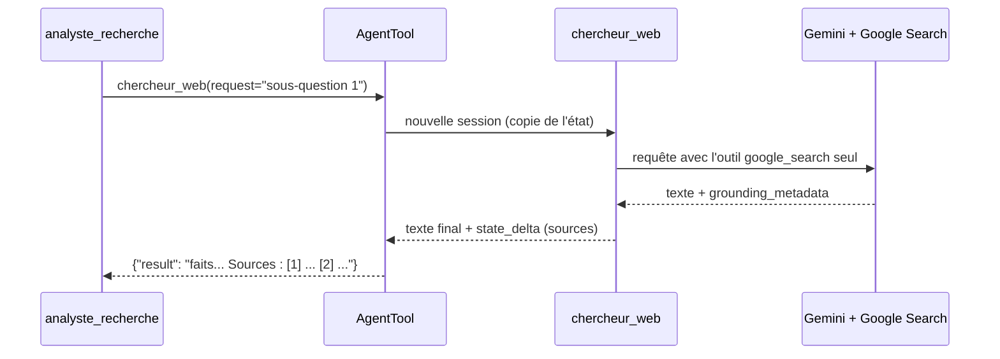

# Le sous-agent de recherche

> [!NOTE]
> Dans cette leçon, vous allez reproduire l'erreur réelle qu'on obtient en mélangeant `google_search` et une fonction dans le même agent, puis construire la bonne architecture : un sous-agent `chercheur_web` qui n'a que `google_search`, exposé à l'agent principal par `AgentTool`.

## Installer

```bash
python -m venv .venv && source .venv/bin/activate
pip install -r requirements.txt      # google-adk==2.10.0, python-dotenv, pytest
cp .env.example .env                 # collez votre clé d'API Gemini
```

## Étape 1 : la version naïve (et pourquoi elle échoue)

Premier réflexe : un seul agent avec tous les outils.

```python title="essai_naif.py (à ne pas garder)"
agent = Agent(name="mix", model="gemini-3.5-flash",
              instruction="Utilise date_du_jour puis cherche.",
              tools=[google_search, date_du_jour])
```

Lancé le 2026-10-15 avec ADK 2.10 et une clé d'API, l'appel au modèle est refusé :

```text
google.genai.errors.ClientError: 400 INVALID_ARGUMENT. {'error': {'code': 400,
'message': 'Please enable tool_config.include_server_side_tool_invocations to use
Built-in tools with Function calling.', 'status': 'INVALID_ARGUMENT'}}
```

Le message montre que l'API traite à part les outils intégrés exécutés côté serveur. Plutôt que de dépendre d'une option de bas niveau (non exposée par `Agent`), on suit le schéma documenté par ADK : séparer les agents.

```quiz
question: "Que signifie l'erreur 400 obtenue avec tools=[google_search, date_du_jour] ?"
options:
  - "La clé d'API est invalide"
  - "La requête mélange un outil intégré exécuté côté serveur et un outil fonction, ce que l'API refuse dans cette configuration"
  - "Le quota de recherches Google est épuisé"
answer: 1
explanation: "Une clé invalide donnerait une erreur 400/403 différente, un quota une erreur 429. Ici le message parle explicitement des outils intégrés combinés au function calling."
```

## Étape 2 : le chercheur, avec un seul outil

```python title="files/agent.py"
chercheur = Agent(
    name="chercheur_web",
    model=MODEL,
    description="Cherche sur le web (Google Search) et renvoie des faits datés et sourcés sur UNE question précise.",
    instruction=("Tu fais une recherche Google sur la question reçue et tu réponds en français par 3 à 6 faits "
                 "précis, chacun avec sa date ou sa période. Pas d'opinion, pas de remplissage."),
    tools=[google_search],  # seul outil de cet agent : c'est la règle
    after_model_callback=memoriser_sources,
)
```

La `description` compte : c'est elle que l'agent principal lit pour savoir **quand** appeler ce chercheur. Le callback `memoriser_sources` est détaillé dans la leçon suivante.

## Étape 3 : l'agent principal

```python title="files/agent.py"
root_agent = Agent(
    name="analyste_recherche",
    model=MODEL,
    description="Rapport de veille structuré et sourcé à partir de recherches web.",
    instruction=INSTRUCTION,
    tools=[date_du_jour, AgentTool(agent=chercheur)],
)
```

`AgentTool(agent=chercheur)` crée un outil nommé `chercheur_web` avec un paramètre `request` (le texte de la sous-question). À chaque appel, ADK lance le chercheur dans une session à part, puis renvoie son texte final comme résultat d'outil. Les modifications d'état du chercheur (`state_delta`) remontent dans la session principale.



| Approche | Avantages | Limites |
| --- | --- | --- |
| `AgentTool(chercheur)` (ce lab) | l'agent principal garde la main, peut appeler plusieurs recherches puis synthétiser | un appel de modèle de plus par recherche |
| `sub_agents=[chercheur]` (transfert) | le chercheur parle directement à l'utilisateur | l'agent principal perd la main ; ADK refuse aussi un parent avec `google_search` et des sous-agents sans option dédiée |
| `GoogleSearchTool(bypass_multi_tools_limit=True)` | une ligne : ADK 2.10 crée lui-même un sous-agent de recherche en coulisses | moins de contrôle (pas de callback de sources à vous) |

> [!TIP]
> Dans le code source d'ADK 2.10 (`llm_agent.py`), quand un agent a plusieurs outils et un `GoogleSearchTool(bypass_multi_tools_limit=True)`, ADK le remplace par un `GoogleSearchAgentTool` : c'est exactement notre architecture, automatisée. On l'écrit à la main ici pour comprendre et pour brancher notre callback.

```quiz
question: "Quel paramètre l'agent principal passe-t-il à l'outil chercheur_web créé par AgentTool ?"
options:
  - "query"
  - "request"
  - "prompt"
answer: 1
explanation: "AgentTool expose un paramètre unique « request » quand l'agent emballé n'a pas de schéma d'entrée. On le voit dans le run réel : chercheur_web({'request': '...'})."
```

## Exercice : un deuxième chercheur spécialisé

Ajoutez un sous-agent `chercheur_chiffres` qui ne cherche que des données chiffrées (montants, pourcentages, dates de version) et rendez-le disponible à l'agent principal. Quelles lignes ajoutez-vous ?

<details>
<summary>Voir la solution</summary>

```python
chercheur_chiffres = Agent(
    name="chercheur_chiffres", model=MODEL,
    description="Cherche uniquement des données chiffrées et datées sur une question.",
    instruction="Recherche Google, puis liste uniquement des chiffres avec leur date et leur contexte.",
    tools=[google_search],
    after_model_callback=memoriser_sources,   # même numérotation partagée via l'état
)

root_agent = Agent(..., tools=[date_du_jour, AgentTool(agent=chercheur),
                               AgentTool(agent=chercheur_chiffres)])
```

Chaque sous-agent a **un seul** outil intégré. Comme les deux écrivent dans `state["sources"]`, les numéros restent cohérents. Précisez dans l'instruction principale quand utiliser l'un ou l'autre.

</details>

## Résultat obtenu

Les deux comportements, observés le 2026-10-15 :

```text
# tools=[google_search, date_du_jour] dans un seul agent
ERR ClientError 400 INVALID_ARGUMENT. {'error': {'code': 400, 'message': 'Please enable
tool_config.include_server_side_tool_invocations to use Built-in tools with Function calling.'}}

# architecture agent principal + AgentTool(chercheur_web)
[outil] date_du_jour({})
[outil] chercheur_web({'request': 'Google Agent Development Kit ADK dernieres nouveautes annonces fonctionnalités'})
[outil] chercheur_web({'request': 'Google Agent Developer Kit ADK features updates Vertex AI Firebase'})
[outil] chercheur_web({'request': 'Google ADK Agent Development Kit documentation framework release notes'})
```

## Je sais faire

- [ ] Reconnaître l'erreur due au mélange outil intégré + fonction
- [ ] Isoler `google_search` dans un sous-agent
- [ ] Exposer un agent comme outil avec `AgentTool`
- [ ] Choisir entre `AgentTool`, `sub_agents` et `bypass_multi_tools_limit`
