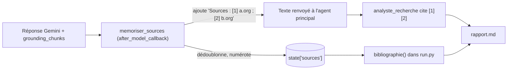

# Sources citées et rapport structuré

> [!NOTE]
> Dans cette leçon, vous allez écrire un `after_model_callback` qui relève les pages réellement utilisées par Google Search, les numérote dans l'état de session, puis faire produire à l'agent principal un rapport Markdown qui cite ces numéros, avec une bibliographie ajoutée par le code.

## Le problème des citations

Le texte renvoyé par un modèle ancré ne contient pas de liens : les sources sont dans `grounding_metadata.grounding_chunks`. Si on laisse le modèle « citer de mémoire », il peut se tromper de numéro ou inventer une URL. On fait donc circuler les numéros **dans le texte** et les URL **dans l'état**.



## Le callback `memoriser_sources`

Un `after_model_callback` reçoit la réponse du modèle **avant** qu'ADK ne la transforme en événement. Il peut la lire, la modifier et la renvoyer.

```python title="files/agent.py"
def memoriser_sources(callback_context, llm_response):
    gm = llm_response.grounding_metadata
    if not gm or not gm.grounding_chunks or not llm_response.content:
        return None
    sources = list(callback_context.state.get("sources", []))
    lignes = []
    for chunk in gm.grounding_chunks:
        if not chunk.web or not chunk.web.uri:
            continue
        source = {"titre": chunk.web.title or chunk.web.domain or "source", "url": chunk.web.uri}
        if source not in sources:
            sources.append(source)
        lignes.append(f"[{sources.index(source) + 1}] {source['titre']}")
    callback_context.state["sources"] = sources
    llm_response.content.parts.append(types.Part(text="\n\nSources : " + " ; ".join(dict.fromkeys(lignes))))
    return llm_response
```

Trois détails importants :

| Détail | Pourquoi |
| --- | --- |
| `if source not in sources` | une même page trouvée par deux recherches garde **le même numéro** |
| `dict.fromkeys(lignes)` | dédoublonne en gardant l'ordre (une page peut apparaître plusieurs fois dans les chunks) |
| `callback_context.state["sources"] = ...` | l'écriture passe par le `state_delta` du sous-agent, qu'`AgentTool` recopie dans la session principale |

```quiz
question: "Deux recherches successives trouvent b.org. Quel numéro b.org porte-t-il dans la deuxième recherche ?"
options:
  - "Un nouveau numéro, car c'est une nouvelle recherche"
  - "Le même numéro que la première fois, car la liste state['sources'] est partagée et dédoublonnée"
  - "Aucun, les doublons sont supprimés du texte"
answer: 1
explanation: "Le callback relit state['sources'], trouve b.org déjà présent et réutilise son index. Le test test_pipeline_complet_avec_faux_modeles le vérifie : « Sources : [2] b.org ; [3] c.org »."
```

> [!WARNING]
> Les `uri` renvoyées par l'API Gemini sont des liens de redirection (`https://vertexaisearch.cloud.google.com/grounding-api-redirect/...`) qui mènent à la page d'origine. Affichez-les tels quels et ne les stockez pas comme des identifiants permanents. Les conditions d'utilisation de l'ancrage demandent aussi d'afficher les suggestions de recherche (`search_entry_point`) dans une interface publique : vérifiez la page « Grounding with Google Search » de la documentation Gemini.

## Le rapport structuré

L'instruction de l'agent principal impose les étapes et le format :

```python title="files/agent.py"
INSTRUCTION = """Tu es un analyste de veille. Tu réponds en français.
1. Appelle date_du_jour.
2. Découpe la question de l'utilisateur en 2 ou 3 sous-questions précises.
3. Appelle chercheur_web une fois par sous-question.
4. Rédige un rapport Markdown avec exactement ces sections :
   ## Synthèse (3 phrases)
   ## Points clés (puces ; chaque puce finit par le ou les numéros de source, ex. [1][3])
   ## Ce qui reste incertain
N'utilise QUE les faits renvoyés par chercheur_web et ne cite QUE les numéros [n] qu'il donne.
Ne recopie pas la liste des sources : elle est ajoutée automatiquement."""
```

Puis `run.py` assemble le fichier final : titre, texte de l'agent, et la bibliographie construite **par le code** depuis l'état.

```python title="files/run.py"
s = await runner.session_service.get_session(app_name="veille", user_id="moi", session_id=s.id)
sources = s.state.get("sources", [])
texte = f"# {question}\n\n{rapport.strip()}\n\n## Sources\n{bibliographie(sources)}\n"
open("rapport.md", "w", encoding="utf-8").write(texte)
```

> [!TIP]
> On garde dans `rapport` uniquement le texte final de l'agent **principal** (`ev.author == root_agent.name`). Les réponses du chercheur sont des résultats d'outil intermédiaires, pas le livrable.

```quiz
question: "Qui écrit les URL de la section « Sources » du rapport ?"
options:
  - "Le modèle de l'agent principal"
  - "Le sous-agent chercheur_web, dans son texte"
  - "La fonction bibliographie() de run.py, à partir de state['sources'] rempli par le callback"
answer: 2
explanation: "Le modèle ne manipule que des numéros. Les URL viennent des métadonnées d'ancrage, stockées par le callback et mises en forme par du code."
```

## Exercice : signaler les citations orphelines

Écrivez une fonction `citations_invalides(rapport, sources)` qui renvoie les numéros cités dans le rapport (`[7]`) qui n'existent pas dans `sources`. Où l'appelez-vous ?

<details>
<summary>Voir la solution</summary>

```python
import re

def citations_invalides(rapport: str, sources: list) -> list[int]:
    cites = {int(n) for n in re.findall(r"\[(\d+)\]", rapport)}
    return sorted(n for n in cites if not 1 <= n <= len(sources))
```

Appelez-la dans `run.py` juste avant d'écrire `rapport.md` ; si la liste n'est pas vide, affichez un avertissement ou relancez la rédaction. Ajoutez un test : `citations_invalides("A [1] B [4]", [s1, s2]) == [4]`.

</details>

## Résultat obtenu

Rapport réel produit par `python run.py` (gemini-3.5-flash, 2026-10-15), extrait. Les faits viennent des pages trouvées ce jour-là ; relisez-les avant tout usage.

```text
## Points clés
* **Moteur d'exécution par graphes (Workflow Runtime)** : La publication d'ADK Python v2.0.0 en
  mai 2026, suivie de Go v2.0.0 en juin et TypeScript v2.0.0 en août 2026, marque la transition
  d'une exécution hiérarchique vers le *Workflow Runtime* [...] [3].
* **Écosystème multi-langage et Java v1.0.0** : ADK prend en charge Python, Java, Go, TypeScript
  et Kotlin [...] [1][2][3].

## Sources
1. [googleblog.com](https://vertexaisearch.cloud.google.com/grounding-api-redirect/AUZIYQF28L...)
2. [googleblog.com](https://vertexaisearch.cloud.google.com/grounding-api-redirect/AUZIYQGLLs...)
3. [google.com](https://vertexaisearch.cloud.google.com/grounding-api-redirect/AUZIYQE4qD...)
[...] 8 sources au total
```

## Je sais faire

- [ ] Lire `grounding_metadata` dans un `after_model_callback`
- [ ] Numéroter des sources de façon stable entre plusieurs recherches
- [ ] Faire remonter l'état d'un sous-agent appelé par `AgentTool`
- [ ] Imposer un format de rapport et séparer texte du modèle et bibliographie du code
