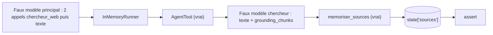

# Tester et exploiter l'agent de recherche

> [!NOTE]
> Dans cette leçon, vous allez tester toute la chaîne agent principal → `AgentTool` → chercheur → callback **sans clé d'API**, avec deux faux modèles, puis lancer une vraie recherche, relire le rapport et préparer l'exploitation (coûts, fraîcheur, règles d'affichage).

## Tester sans clé : deux faux modèles

Le chercheur reçoit un faux modèle qui renvoie du texte **et** des métadonnées d'ancrage, comme Gemini avec Google Search. L'agent principal reçoit un faux modèle qui appelle deux fois `chercheur_web` puis répond.

```python title="files/test_agent.py"
def ancre(texte, *sites):
    """Réponse comme celles de Gemini + Google Search : texte + métadonnées d'ancrage."""
    return LlmResponse(
        content=types.Content(role="model", parts=[types.Part(text=texte)]),
        grounding_metadata=types.GroundingMetadata(grounding_chunks=[
            types.GroundingChunk(web=types.GroundingChunkWeb(title=t, uri=f"https://{t}/page")) for t in sites]))
```

Le test vérifie quatre choses à la fois :

```python title="files/test_agent.py"
    # Les sources sont dédoublonnées et numérotées d'une recherche à l'autre...
    assert [s["titre"] for s in etat["sources"]] == ["a.org", "b.org", "c.org"]
    # ... et le texte renvoyé à l'agent principal porte les bons numéros.
    assert retours[0].endswith("Sources : [1] a.org ; [2] b.org")
    assert retours[1].endswith("Sources : [2] b.org ; [3] c.org")
    # L'outil intégré a bien été transmis au modèle du chercheur sous sa forme native.
    assert any(t.google_search for t in faux_chercheur.vus[0].config.tools)
```

> [!TIP]
> Le faux modèle s'appelle `gemini-faux` et non `faux` : `GoogleSearchTool` vérifie que le nom du modèle ressemble à un modèle Gemini avant d'ajouter l'outil, sinon il lève `ValueError`. Le nom suffit, aucun appel réseau n'est fait.



```quiz
question: "Pourquoi le test inspecte-t-il faux_chercheur.vus[0].config.tools ?"
options:
  - "Pour vérifier qu'ADK a bien converti google_search en outil natif types.Tool(google_search=...) dans la requête envoyée au modèle"
  - "Pour compter les tokens"
  - "Pour vérifier la clé d'API"
answer: 0
explanation: "Le faux modèle garde chaque requête reçue. On peut ainsi contrôler ce qu'ADK aurait envoyé à Gemini, sans appel réseau."
```

## Lancer pour de vrai

```bash
cd files
pytest -q                                          # 3 tests, sans clé
python run.py                                      # question par défaut
python run.py "Quelles annonces récentes sur les modèles Gemini ?"
```

Le rapport est écrit dans `rapport.md`. Relisez-le **toujours** : l'ancrage réduit les inventions mais ne garantit pas que les pages trouvées soient exactes ou à jour.

## Grille de relecture

| Critère | Comment vérifier | Automatisable ? |
| --- | --- | --- |
| Les 3 sections sont présentes | chercher `## Synthèse`, `## Points clés`, `## Ce qui reste incertain` | oui, une regex |
| Chaque point clé cite au moins une source | chaque puce contient `[n]` | oui |
| Aucune citation orpheline | numéros entre 1 et `len(sources)` | oui (exercice de la leçon précédente) |
| Les faits sont fidèles aux pages | ouvrir 2 ou 3 sources au hasard | non, relecture humaine |
| Les dates sont cohérentes avec `date_du_jour` | lecture | partiellement |

## Exploiter

| Sujet | Recommandation |
| --- | --- |
| Coût | chaque recherche = un appel du chercheur (avec ancrage, facturé selon les tarifs Gemini en vigueur) + les appels de l'agent principal. Limitez le nombre de sous-questions (ici 2 ou 3). |
| Fraîcheur | relancez la veille à date fixe et stockez les rapports datés ; ne réutilisez pas un ancien rapport comme « vérité ». |
| Quotas partagés | `run.py` réessaie sur 429 et 503 avec une attente croissante (15 s, 30 s, 45 s). |
| Affichage public | affichez les sources et les suggestions de recherche (`search_entry_point`) selon les règles de Google. |
| Sur Google Cloud | même code avec Vertex AI ; pour chercher dans **vos** documents, `VertexAiSearchTool` (soumis à la même contrainte d'outil intégré). |

> [!WARNING]
> Une question d'actualité donne un résultat différent d'un jour à l'autre : ne faites pas de test automatique qui compare le texte du rapport à une valeur fixe. Testez la **structure** (sections, citations), pas le contenu.

```quiz
question: "Quels contrôles pouvez-vous automatiser sans appeler le modèle ? (plusieurs réponses)"
options:
  - "La présence des trois sections"
  - "L'exactitude de chaque fait par rapport aux pages"
  - "L'absence de citations orphelines"
  - "La numérotation stable des sources entre recherches"
answer: [0, 2, 3]
explanation: "Structure, citations et numérotation sont du texte et des listes : du code suffit. La fidélité aux pages demande une relecture humaine (ou un LLM juge, lui-même à valider)."
```

## Exercice : un test de structure

Écrivez `test_structure_rapport(texte)` qui échoue si une des trois sections manque ou si une puce de « Points clés » ne cite aucune source.

<details>
<summary>Voir la solution</summary>

```python
import re

def verifier_structure(texte: str) -> list[str]:
    erreurs = [s for s in ("## Synthèse", "## Points clés", "## Ce qui reste incertain") if s not in texte]
    bloc = texte.split("## Points clés")[-1].split("## Ce qui reste incertain")[0]
    for puce in re.findall(r"^\s*[*-] (.+)$", bloc, re.M):
        if not re.search(r"\[\d+\]", puce):
            erreurs.append(f"puce sans source : {puce[:40]}")
    return erreurs

def test_structure_rapport():
    ok = "## Synthèse\nx\n## Points clés\n* A [1]\n## Ce qui reste incertain\ny"
    assert verifier_structure(ok) == []
    assert verifier_structure(ok.replace(" [1]", "")) != []
```

Appliquée au rapport réel du 2026-10-15, elle ne signale rien : les cinq puces citent au moins une source.

</details>

## Résultat obtenu

Tests sans clé, 2026-10-15 :

```text
test_agent.py::test_structure_respecte_la_contrainte_google_search PASSED
test_agent.py::test_bibliographie PASSED
test_agent.py::test_pipeline_complet_avec_faux_modeles PASSED
============================== 3 passed in 1.32s ===============================
```

Run réel (gemini-3.5-flash, 2026-10-15) : 1 appel `date_du_jour`, 3 recherches `chercheur_web`, un rapport de 3 sections, 5 points clés, **8 sources** dédoublonnées (googleblog.com, google.com, dev.to, firebase.blog, github.com, etc.).

## Je sais faire

- [ ] Simuler une réponse ancrée avec `GroundingMetadata` dans un test
- [ ] Tester une chaîne `AgentTool` complète sans clé
- [ ] Relire un rapport de veille avec une grille
- [ ] Expliquer coûts, fraîcheur et règles d'affichage de l'ancrage
