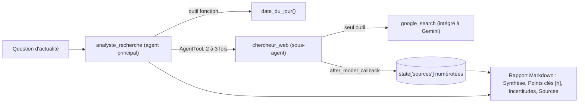

Un modèle de langage ne connaît que ce qu'il a lu pendant son entraînement. Pour répondre à « quelles sont les dernières nouveautés de X ? », il doit **chercher**. Dans ce lab, vous donnez à un agent Google ADK l'outil intégré `google_search` : Gemini lance lui-même des recherches Google et renvoie, avec sa réponse, la liste des pages utilisées (les **métadonnées d'ancrage**, ou *grounding metadata*).

Vous allez surtout apprendre à respecter une contrainte réelle d'ADK et de l'API Gemini : **un outil intégré comme `google_search` ne se mélange pas librement avec vos propres fonctions dans le même agent**. On la contourne proprement avec un sous-agent exposé comme outil (`AgentTool`).

## Pour qui ?

- Développeurs Python qui ont déjà écrit un agent ADK simple (ou suivi le lab [Assistant e-commerce](../01-assistant-ecommerce-commandes/index.md)).
- Toute personne qui doit produire des notes de veille sourcées.

## Ce que vous construisez

## Prérequis

- Python 3.10+, une clé d'API Gemini (Google AI Studio).
- `pip install -r files/requirements.txt`.

## Programme

| Module | Leçon | Ce que vous faites | Durée |
| --- | --- | --- | --- |
| 1. Cas d'usage | [Le cas d'usage et l'architecture](./01-cas-d-usage/01-cas-d-usage-et-architecture.md) | Comprendre l'ancrage et la contrainte des outils intégrés | 30 min |
| 2. Construire | [Le sous-agent de recherche](./02-construire/01-sous-agent-google-search.md) | `google_search` isolé, `AgentTool`, l'erreur 400 réelle | 40 min |
| 2. Construire | [Sources citées et rapport](./02-construire/02-sources-et-rapport.md) | Callback qui numérote les sources, rapport structuré | 40 min |
| 3. Tester et exploiter | [Tester et exploiter](./03-tester-et-exploiter/01-tester-et-exploiter.md) | Faux modèles, run réel, coûts, règles d'affichage | 40 min |

## Le code

Dans `files/` : [agent.py](./files/agent.py), [run.py](./files/run.py) (recherche réelle, écrit `rapport.md`), [test_agent.py](./files/test_agent.py) (3 tests sans clé), [requirements.txt](./files/requirements.txt) et `.env.example`.

## En local ou sur Google Cloud ?

| | En local (ce lab) | Sur Google Cloud (piste) |
| --- | --- | --- |
| Modèle et recherche | API Gemini + `google_search`, avec une clé | Vertex AI + `google_search` (même code, variables `GOOGLE_GENAI_USE_VERTEXAI=TRUE`, projet, région) |
| Sources internes | non | `VertexAiSearchTool` sur vos documents (autre outil intégré, mêmes contraintes) |
| Hébergement | `python run.py` | `adk deploy cloud_run` |

Testé de bout en bout en local le 2026-10-15 ; la variante Google Cloud n'a pas été déployée ici.
