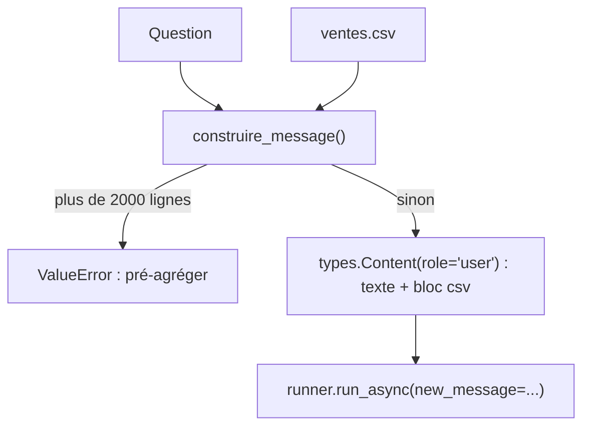

# L'agent analyste

> [!NOTE]
> Dans cette leçon, vous allez écrire l'agent `analyste_donnees` avec `BuiltInCodeExecutor`, rédiger une instruction qui force le calcul par code et un format de rapport, puis construire le message qui transporte le CSV.

## Installer

```bash
python -m venv .venv && source .venv/bin/activate
pip install -r requirements.txt      # google-adk==2.10.0, python-dotenv, pandas, pytest
cp .env.example .env                 # collez votre clé d'API Gemini
```

## L'agent : une ligne pour l'exécution de code

```python title="files/agent.py"
root_agent = Agent(
    name="analyste_donnees",
    model=MODEL,
    description="Analyse un CSV de ventes en exécutant du code Python et produit un rapport avec graphique.",
    instruction=INSTRUCTION,
    code_executor=BuiltInCodeExecutor(),  # pas d'autres outils dans cet agent
)
```

Ce n'est pas un élément de `tools` : c'est un paramètre à part, `code_executor`. Dans le code source d'ADK 2.10, `BuiltInCodeExecutor.process_llm_request` ajoute simplement `types.Tool(code_execution=types.ToolCodeExecution())` à la requête, si le modèle est un modèle Gemini.

> [!WARNING]
> Comme `google_search`, l'exécution de code intégrée fait partie des outils que la documentation ADK (« Tool limitations ») interdit de combiner avec d'autres outils dans le même agent. Besoin d'une fonction en plus ? Mettez l'analyste dans un sous-agent et exposez-le avec `AgentTool` (voir le lab « Recherche web »).

## L'instruction

```python title="files/agent.py"
INSTRUCTION = """Tu es analyste de données. Tu réponds en français.
Règles :
- Tout chiffre que tu donnes doit venir d'un code Python que tu as exécuté. Jamais de calcul de tête.
- Commence par charger les données reçues dans un DataFrame pandas (io.StringIO), en recopiant le CSV EN ENTIER,
  puis vérifie le nombre de lignes avec len(df).
- Trace UN graphique matplotlib lisible (titre, axes, légende) : chiffre d'affaires mensuel par catégorie.
Rapport final en Markdown avec ces sections :
## Chiffres clés (CA total, CA par région, CA par catégorie)
## Tendances (évolution mensuelle, saisonnalité, catégorie qui progresse le plus)
## Recommandations (3 actions concrètes, chacune justifiée par un chiffre)
## Limites de l'analyse"""
```

| Consigne | Problème évité |
| --- | --- |
| « Tout chiffre vient d'un code exécuté » | les totaux approximatifs |
| « Recopie le CSV EN ENTIER puis `len(df)` » | un DataFrame tronqué silencieusement (le modèle s'arrête à 50 lignes « pour l'exemple ») |
| « UN graphique, titre, axes, légende » | dix graphiques illisibles |
| Sections imposées | un rapport impossible à comparer d'une semaine à l'autre |
| « Limites de l'analyse » | des recommandations présentées comme des certitudes |

```quiz
question: "Pourquoi demander explicitement len(df) au début ?"
options:
  - "Pour occuper le modèle"
  - "Pour détecter, dans la sortie du code, un chargement incomplet des données (par exemple 50 lignes au lieu de 144)"
  - "Parce que pandas l'exige"
answer: 1
explanation: "Le modèle recopie le CSV dans son code ; s'il en saute une partie, tous les totaux sont faux. Afficher len(df) rend l'erreur visible dans le résultat d'exécution, et le contrôle automatique de run.py la détecterait aussi."
```

## Le message : question + CSV

```python title="files/agent.py"
def construire_message(question: str, chemin_csv: str) -> types.Content:
    """Fonction pure : la question + le contenu du CSV, dans un seul message utilisateur."""
    csv = Path(chemin_csv).read_text(encoding="utf-8").strip()
    n = csv.count("\n")
    if n > MAX_LIGNES:
        raise ValueError(f"{n} lignes : trop pour le prompt (max {MAX_LIGNES}). Pré-agrégez d'abord.")
    return types.Content(role="user", parts=[types.Part(
        text=f"{question}\n\nDonnées ({n} lignes, fichier {Path(chemin_csv).name}) :\n```csv\n{csv}\n```")])
```

Le nombre de lignes est annoncé dans le message : le modèle peut le comparer à son `len(df)`.



## Lire les événements

Les réponses d'un agent avec exécution de code contiennent plusieurs types de **parties** (`Part`) :

| Partie | Contenu |
| --- | --- |
| `executable_code` | le code Python écrit par le modèle |
| `code_execution_result` | `outcome` (`OUTCOME_OK`, `OUTCOME_FAILED`…) et `output` (la sortie standard) |
| `inline_data` | une image produite (ADK la range en artefact, leçon suivante) |
| `text` | le texte du modèle, dont le rapport final |

```python title="files/run.py"
for p in ev.content.parts if ev.content else []:
    if p.executable_code:
        nb_codes += 1
        print(f"--- code exécuté n°{nb_codes} ---\n{p.executable_code.code[-400:]}")
    if p.code_execution_result:
        print(f"--- résultat ({p.code_execution_result.outcome.name}) ---\n"
              f"{(p.code_execution_result.output or '')[:600]}")
```

```quiz
question: "Dans quelle partie d'un événement trouvez-vous le total calculé par pandas dans le bac à sable ?"
options:
  - "executable_code.code"
  - "code_execution_result.output"
  - "inline_data"
answer: 1
explanation: "executable_code contient le code écrit par le modèle ; code_execution_result.output contient ce que ce code a imprimé, par exemple « CA Total: 414,644 € ». inline_data porte les images."
```

> [!TIP]
> Si un code échoue (`OUTCOME_FAILED`), le modèle voit l'erreur et peut corriger son code ; la documentation Gemini indique jusqu'à 5 nouvelles tentatives, et chaque exécution est limitée à 30 secondes.

## Exercice : une question ciblée

Modifiez `QUESTION` dans `run.py` pour demander uniquement : « Quel mois a le plus fort CA pour la catégorie Enceintes, et de combien dépasse-t-il la moyenne mensuelle de cette catégorie ? ». Comment vérifiez-vous la réponse sans le modèle ?

<details>
<summary>Voir la solution</summary>

```python
import pandas as pd
d = pd.read_csv("ventes.csv")
e = d[d.categorie == "Enceintes"].groupby("mois").chiffre_affaires.sum()
print(e.idxmax(), e.max(), round(e.max() - e.mean(), 2))
```

On obtient `2025-12`, 22 995 € ; la moyenne mensuelle est de 12 687,50 €, donc un écart de 10 307,50 €. Comparez ces valeurs au rapport, ou mieux : ajoutez-les à `reference()` et `verifier()` dans `run.py`.

</details>

## Résultat obtenu

Run réel (gemini-3.5-flash, 2026-10-15) : l'agent a exécuté **3 blocs de code**, tous `OUTCOME_OK`. Fin du dernier bloc et sa sortie :

```text
summer_ca = df[df['mois'].isin(['2025-07', '2025-08'])]['chiffre_affaires'].sum()
summer_pct = summer_ca / ca_total * 100
print(f"CA Jul + Août: {summer_ca:,} € ({summer_pct:.2f}%)")

--- résultat (OUTCOME_OK) ---
CA Nov + Déc: 106,092 € (25.59%)
CA Jul + Août: 52,548 € (12.67%)
```

## Je sais faire

- [ ] Activer l'exécution de code avec `code_executor=BuiltInCodeExecutor()`
- [ ] Écrire une instruction qui force le calcul par code et un format stable
- [ ] Transporter un CSV dans le message avec un plafond de taille
- [ ] Lire `executable_code`, `code_execution_result` et `text` dans les événements
