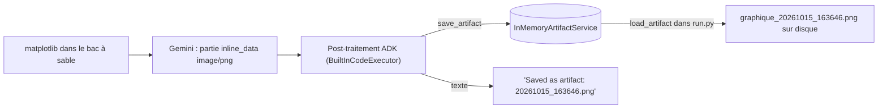
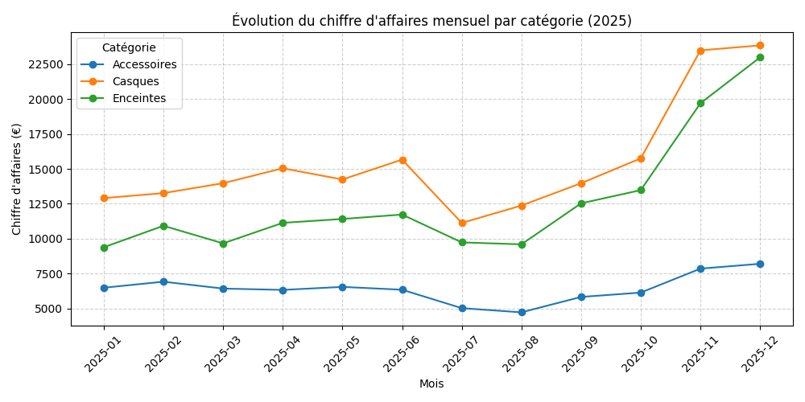

# Graphique et contrôle des chiffres

> [!NOTE]
> Dans cette leçon, vous allez récupérer le graphique produit dans le bac à sable grâce au **service d'artefacts** d'ADK, puis écrire un contrôle automatique qui compare les chiffres du rapport à un calcul pandas fait par vous.

## Où passe l'image ?

Quand le code matplotlib du modèle produit une figure, Gemini la renvoie comme une partie `inline_data` (image PNG). Avec `BuiltInCodeExecutor`, ADK 2.10 la **range dans le service d'artefacts** (un stockage de fichiers lié à la session) et remplace la partie par le texte `Saved as artifact: <nom>.png`.



Une **artefact** ADK est un fichier binaire versionné, rattaché à une application, un utilisateur et une session. `InMemoryRunner` fournit un `InMemoryArtifactService` ; en production on utilise par exemple `GcsArtifactService` (Cloud Storage).

```python title="files/run.py"
# Les images produites par le bac à sable sont rangées par ADK dans le service d'artefacts.
for nom in await runner.artifact_service.list_artifact_keys(app_name="analyse", user_id="moi", session_id=s.id):
    image = await runner.artifact_service.load_artifact(app_name="analyse", user_id="moi",
                                                        session_id=s.id, filename=nom)
    open(f"graphique_{nom}", "wb").write(image.inline_data.data)
    print("Graphique enregistré :", f"graphique_{nom}")
```

Et on ignore ce texte technique quand on assemble le rapport :

```python title="files/run.py"
if p.text and ev.is_final_response() and not p.text.startswith("Saved as artifact"):
    rapport += p.text
```

```quiz
question: "Avec BuiltInCodeExecutor et InMemoryRunner, où trouvez-vous le PNG du graphique après l'exécution ?"
options:
  - "Dans le dossier courant, écrit par le bac à sable"
  - "Dans le service d'artefacts du runner, à récupérer avec list_artifact_keys puis load_artifact"
  - "Dans state['graphique']"
answer: 1
explanation: "Le bac à sable est chez Google : il ne peut rien écrire sur votre disque. ADK reçoit l'image en inline_data et la sauvegarde comme artefact de la session."
```

Voici le graphique réellement produit le 2026-10-15 :



> [!TIP]
> Le rapport du modèle contenait ``, le nom utilisé dans **son** `savefig`. Ce fichier n'existe pas chez vous : le nom de l'artefact est un horodatage choisi par ADK. Remplacez le lien dans `rapport.md` par le fichier enregistré si vous publiez le rapport.

## Contrôler les chiffres

Même avec l'exécution de code, le texte final est écrit par le modèle : il peut recopier un chiffre de travers. On calcule donc nous-mêmes la **vérité terrain** avec pandas et on vérifie que le rapport la cite.

```python title="files/run.py"
def reference(chemin_csv: str) -> dict:
    """Les chiffres attendus, calculés par nous avec pandas : la « vérité terrain »."""
    d = pd.read_csv(chemin_csv)
    par_region = d.groupby("region").chiffre_affaires.sum()
    return {"ca_total": int(d.chiffre_affaires.sum()),
            "meilleure_region": par_region.idxmax(), "ca_meilleure_region": int(par_region.max())}


def verifier(rapport: str, ref: dict) -> dict:
    """Le rapport cite-t-il les bons chiffres ? (on ignore les séparateurs : 414 644 = 414,644 = 414644)"""
    nombres = {int(re.sub(r"[\s .,]", "", n)) for n in re.findall(r"\d[\d\s .,]*\d|\d", rapport)
               if re.sub(r"[\s .,]", "", n).isdigit()}
    return {"ca_total": ref["ca_total"] in nombres,
            "meilleure_region": ref["meilleure_region"] in rapport and ref["ca_meilleure_region"] in nombres}
```

| Format dans le rapport | Normalisé en | Reconnu ? |
| --- | --- | --- |
| `414 644 €` (espace, ou espace fine ` `) | 414644 | oui |
| `414,644 €` (style anglais) | 414644 | oui |
| `environ 415 000 €` | 415000 | non : c'est voulu, un arrondi n'est pas le chiffre exact |
| `414,6 k€` | 4146 | non |

> [!WARNING]
> La normalisation supprime aussi les virgules décimales : `29,73 %` devient `2973`. Sans conséquence ici (on cherche des entiers précis), mais ne réutilisez pas cette fonction pour vérifier des pourcentages : comparez-les avec une tolérance.

```quiz
question: "Le rapport écrit « CA total : environ 415 000 € ». Que renvoie verifier() pour ca_total ?"
options:
  - "True, car c'est proche"
  - "False, car 415000 n'est pas 414644"
  - "Une exception"
answer: 1
explanation: "Le contrôle cherche le chiffre exact. Un arrondi est un signe que le modèle n'a pas recopié le résultat du code, ce qu'on veut justement détecter. Le test test_reference_et_controle vérifie ce cas."
```

## Exercice : contrôler le CA par catégorie

Étendez `reference()` et `verifier()` pour vérifier que le CA de **chaque** catégorie apparaît dans le rapport.

<details>
<summary>Voir la solution</summary>

```python
def reference(chemin_csv):
    d = pd.read_csv(chemin_csv)
    par_region = d.groupby("region").chiffre_affaires.sum()
    return {"ca_total": int(d.chiffre_affaires.sum()),
            "meilleure_region": par_region.idxmax(), "ca_meilleure_region": int(par_region.max()),
            "ca_categories": {c: int(v) for c, v in d.groupby("categorie").chiffre_affaires.sum().items()}}

# dans verifier(), ajoutez :
#   "categories": all(v in nombres for v in ref["ca_categories"].values()),
```

Valeurs attendues : Casques 185 654, Enceintes 152 250, Accessoires 76 740. Le rapport réel du 2026-10-15 les contient toutes les trois. Pensez à mettre à jour `test_reference_et_controle`, qui compare `reference()` à un dictionnaire exact.

</details>

## Résultat obtenu

Fin du run réel (gemini-3.5-flash, 2026-10-15) :

```text
Graphique enregistré : graphique_20261015_163646.png

=== RAPPORT ===
## Chiffres clés
- **Chiffre d'affaires total 2025** : **414 644 €** (pour 14 746 unités vendues)
- **Chiffre d'affaires par région** :
  - **Sud** : **123 269 €** (29,73 % du CA total)
  [...]
CONTRÔLE : {'ca_total': True, 'meilleure_region': True}
```

## Je sais faire

- [ ] Expliquer le chemin d'une image depuis le bac à sable jusqu'au disque
- [ ] Lister et charger des artefacts d'une session ADK
- [ ] Calculer une vérité terrain et contrôler les chiffres d'un rapport
- [ ] Repérer les limites d'une normalisation de nombres
