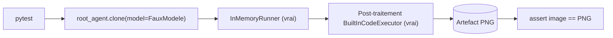

# Tester et exploiter l'agent analyste

> [!NOTE]
> Dans cette leçon, vous allez tester l'agent **sans clé d'API** avec un faux modèle qui imite l'exécution de code de Gemini, lancer l'analyse réelle, lire ses résultats avec un œil critique et choisir comment passer à des données plus grosses.

## Un faux modèle qui « exécute du code »

Le faux modèle renvoie, dans une seule réponse, les quatre types de parties que produirait Gemini : code, résultat, image et texte. On réutilise l'agent réel avec `clone()`, en ne changeant que le modèle.

```python title="files/test_agent.py"
class FauxModele(BaseLlm):
    vus: list = []

    async def generate_content_async(self, llm_request, stream=False):
        self.vus.append(llm_request)
        yield LlmResponse(content=types.Content(role="model", parts=[
            types.Part(executable_code=types.ExecutableCode(language="PYTHON", code="print(df.chiffre_affaires.sum())")),
            types.Part(code_execution_result=types.CodeExecutionResult(outcome="OUTCOME_OK", output="414644")),
            types.Part(inline_data=types.Blob(mime_type="image/png", data=PNG)),
            types.Part(text="## Chiffres clés\nCA total : 414 644 €")]))
```

```python title="files/test_agent.py"
    assert isinstance(analyste.root_agent.code_executor, BuiltInCodeExecutor)
    assert any(t.code_execution for t in faux.vus[0].config.tools)  # l'outil natif est bien demandé au modèle
    assert len(cles) == 1 and image.inline_data.data == PNG
```

Ce test prouve trois choses sans réseau : ADK ajoute bien l'outil `code_execution` à la requête, le post-traitement range l'image en artefact, et on la relit à l'identique.



```quiz
question: "Pourquoi le faux modèle s'appelle-t-il gemini-faux ?"
options:
  - "Par convention, sans effet"
  - "Parce que BuiltInCodeExecutor vérifie que le nom ressemble à un modèle Gemini avant d'ajouter l'outil, sinon il lève ValueError"
  - "Parce que l'API Gemini est appelée en arrière-plan"
answer: 1
explanation: "process_llm_request appelle is_gemini_model(llm_request.model). Le nom suffit ; aucun appel réseau n'est fait par le faux modèle."
```

## Lancer pour de vrai

```bash
cd files
pytest -q                   # 4 tests, sans clé
python run.py               # analyse de ventes.csv : rapport.md + graphique_*.png + CONTRÔLE
python run.py autre.csv     # vos propres données (moins de 2000 lignes)
```

## Relire le rapport avec un œil critique

Le contrôle automatique vérifie les chiffres, pas le **raisonnement**. Dans le run du 2026-10-15 :

| Affirmation du rapport | Vérification | Verdict |
| --- | --- | --- |
| CA total 414 644 €, Sud en tête à 123 269 € | `verifier()` | exact |
| Creux en juillet-août, pic en novembre-décembre (25,59 % du CA sur 2 mois) | pandas | exact |
| « Enceintes : +145,15 % entre janvier et décembre » | 9 380 € → 22 995 € | calcul exact, mais comparer deux mois isolés exagère la tendance : décembre est un pic saisonnier pour toutes les catégories |
| « Lancer un plan d'action sur la région Est » | Est = 20,46 % du CA | plausible, mais les données ne disent rien de la taille du marché Est |

> [!WARNING]
> Un chiffre exact peut porter une conclusion fragile. Ajoutez à l'instruction : « pour une tendance, compare des périodes de même saison (par exemple T1 contre T1) ou une moyenne glissante ». Et gardez la section « Limites » : le rapport réel y reconnaissait l'absence d'historique pluriannuel.

## Passer à l'échelle

| Situation | Option |
| --- | --- |
| Moins de quelques centaines de lignes | ce lab tel quel |
| Quelques milliers à millions de lignes | pré-agréger (pandas, SQL, BigQuery) puis envoyer le tableau réduit |
| Besoin d'une fonction en plus (lire une base, envoyer un mail) | analyste en sous-agent derrière `AgentTool` (contrainte des outils intégrés) |
| Exécution sur vos serveurs, données sensibles | `ContainerCodeExecutor` (Docker) ou exécuteurs gérés Google Cloud |
| Sur Google Cloud | même code avec Vertex AI ; `VertexAiCodeExecutor` ou `AgentEngineSandboxCodeExecutor` pour une exécution gérée ; `GcsArtifactService` pour stocker les graphiques |

> [!TIP]
> Coût : le code généré et les résultats d'exécution sont facturés comme des tokens de sortie (documentation Gemini). Recopier le CSV dans le code double donc son coût en tokens : une raison de plus de pré-agréger.

```quiz
question: "Vos données contiennent des informations clients sensibles. Quelles options limitent leur exposition ? (plusieurs réponses)"
options:
  - "Agréger et anonymiser avant d'envoyer au modèle"
  - "Coller l'export brut dans le prompt"
  - "Exécuter le code dans un conteneur que vous contrôlez (ContainerCodeExecutor)"
  - "Utiliser UnsafeLocalCodeExecutor sur le poste d'un analyste"
answer: [0, 2]
explanation: "Agréger réduit ce qui sort de votre système ; un conteneur maîtrisé isole l'exécution. L'export brut expose tout, et UnsafeLocalCodeExecutor donne au code généré l'accès à la machine."
```

## Exercice : un test pour l'échec d'exécution

Écrivez un faux modèle qui renvoie un `code_execution_result` avec `outcome="OUTCOME_FAILED"` puis un texte d'excuse, et un test qui vérifie que `run.py` afficherait ce statut (indice : lisez `p.code_execution_result.outcome.name` dans les événements).

<details>
<summary>Voir la solution</summary>

```python
class FauxEchec(BaseLlm):
    async def generate_content_async(self, llm_request, stream=False):
        yield LlmResponse(content=types.Content(role="model", parts=[
            types.Part(executable_code=types.ExecutableCode(language="PYTHON", code="1/0")),
            types.Part(code_execution_result=types.CodeExecutionResult(
                outcome="OUTCOME_FAILED", output="ZeroDivisionError")),
            types.Part(text="Le calcul a échoué.")]))

def test_echec_visible():
    agent = analyste.root_agent.clone(update={"model": FauxEchec(model="gemini-faux")})
    async def run():
        runner = InMemoryRunner(agent=agent, app_name="t")
        s = await runner.session_service.create_session(app_name="t", user_id="u")
        statuts = []
        async for ev in runner.run_async(user_id="u", session_id=s.id,
                                         new_message=analyste.construire_message("x", "ventes.csv")):
            statuts += [p.code_execution_result.outcome.name for p in (ev.content.parts if ev.content else [])
                        if p.code_execution_result]
        return statuts
    assert asyncio.run(run()) == ["OUTCOME_FAILED"]
```

Dans la vraie API, le modèle aurait corrigé et relancé son code ; ici le faux modèle s'arrête, ce qui permet de vérifier que l'échec est bien visible.

</details>

## Résultat obtenu

Tests sans clé, 2026-10-15 :

```text
test_agent.py::test_reference_et_controle PASSED
test_agent.py::test_message_contient_tout_le_csv PASSED
test_agent.py::test_csv_trop_gros_refuse PASSED
test_agent.py::test_runner_range_le_graphique_en_artefact PASSED
============================== 4 passed in 1.52s ===============================
```

Run réel (gemini-3.5-flash, 2026-10-15) : 3 blocs de code exécutés (`OUTCOME_OK`), 1 graphique enregistré, rapport en 4 sections, `CONTRÔLE : {'ca_total': True, 'meilleure_region': True}`.

## Je sais faire

- [ ] Simuler l'exécution de code de Gemini dans un test
- [ ] Vérifier qu'une image finit bien en artefact
- [ ] Distinguer un chiffre exact d'une conclusion solide
- [ ] Choisir entre pré-agrégation, sous-agent et exécuteur en conteneur
