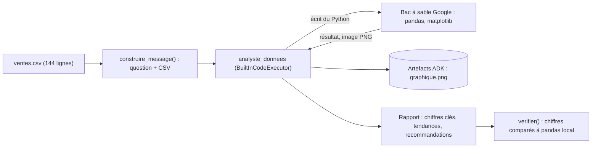

Demander à un modèle de langage « quel est le chiffre d'affaires total ? » sur 144 lignes de données, c'est lui demander de faire une addition de tête : il peut se tromper. Lui permettre d'**écrire et d'exécuter du Python**, c'est lui donner une calculatrice exacte. Dans ce lab, vous branchez l'exécution de code intégrée de Gemini sur un agent Google ADK avec une ligne, `code_executor=BuiltInCodeExecutor()`, et vous vérifiez que les chiffres du rapport sont **justes**.

Les données (`ventes.csv`) sont fictives : 12 mois de 2025, 4 régions, 3 catégories de produits d'une boutique imaginaire.

## Pour qui ?

- Développeurs ou analystes Python qui connaissent les bases de pandas.
- Vous avez déjà vu un agent ADK simple (sinon, commencez par le lab [Assistant e-commerce](../01-assistant-ecommerce-commandes/index.md)).

## Ce que vous construisez

## Prérequis

- Python 3.10+, une clé d'API Gemini.
- `pip install -r files/requirements.txt` (google-adk, python-dotenv, pandas pour le contrôle, pytest).

## Programme

| Module | Leçon | Ce que vous faites | Durée |
| --- | --- | --- | --- |
| 1. Cas d'usage | [Le cas d'usage et l'architecture](./01-cas-d-usage/01-cas-d-usage-et-architecture.md) | Où s'exécute le code, comment les données y arrivent | 30 min |
| 2. Construire | [L'agent analyste](./02-construire/01-agent-analyste.md) | `BuiltInCodeExecutor`, instruction, message avec le CSV | 40 min |
| 2. Construire | [Graphique et contrôle des chiffres](./02-construire/02-graphique-et-controle.md) | Récupérer l'image en artefact, vérifier les chiffres | 40 min |
| 3. Tester et exploiter | [Tester et exploiter](./03-tester-et-exploiter/01-tester-et-exploiter.md) | Faux modèle, run réel, limites, alternatives | 40 min |

## Le code

Dans `files/` : [agent.py](./files/agent.py), [run.py](./files/run.py) (analyse réelle + contrôle), [test_agent.py](./files/test_agent.py) (4 tests sans clé), [ventes.csv](./files/ventes.csv), [requirements.txt](./files/requirements.txt) et `.env.example`.

## En local ou sur Google Cloud ?

| | En local (ce lab) | Sur Google Cloud (piste) |
| --- | --- | --- |
| Exécution du code | bac à sable de l'API Gemini (`BuiltInCodeExecutor`) | même outil via Vertex AI, ou `VertexAiCodeExecutor` / `AgentEngineSandboxCodeExecutor` (exécution gérée) |
| Données | CSV dans le prompt (petits fichiers) | BigQuery + pré-agrégation, puis résultat au modèle |
| Hébergement | `python run.py` | `adk deploy cloud_run` |

Testé de bout en bout en local le 2026-10-15 ; les variantes Google Cloud ne sont pas déployées dans ce lab.
