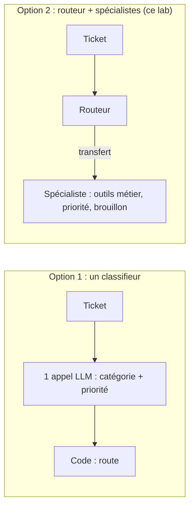
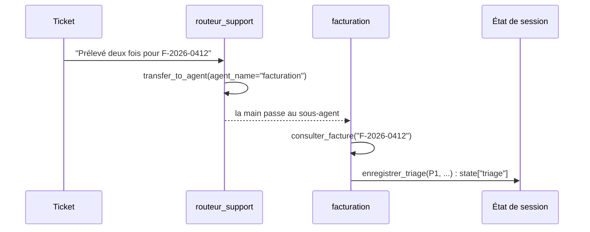

# Le cas d'usage et l'architecture

> [!NOTE]
> Dans cette leçon, vous allez définir les catégories et les niveaux de priorité du triage, comparer un simple classifieur à une architecture **routeur + spécialistes**, et préparer un jeu de tickets étiquetés pour mesurer le résultat.

## Le besoin

Le support d'un éditeur de logiciel fictif reçoit chaque jour des tickets en texte libre. Trois équipes les traitent :

| Équipe | Exemples de tickets |
| --- | --- |
| **facturation** | double prélèvement, facture erronée, TVA, changement d'offre, remboursement |
| **technique** | panne, lenteur, erreur 500, API, application mobile, export |
| **compte** | connexion, mot de passe, double authentification, droits des membres, suppression de compte |

Et trois niveaux de priorité, définis **par écrit** pour que le modèle et les humains appliquent la même règle :

| Priorité | Définition | Exemple |
| --- | --- | --- |
| P1 | bloquant : service inaccessible, paiement en double, faille ou piratage | « personne ne peut ouvrir l'application » |
| P2 | gênant mais contournable | « l'export PDF plante, j'utilise le CSV en attendant » |
| P3 | question ou demande simple | « comment ajouter un collègue ? » |

> [!TIP]
> Les définitions de priorité sont dans une constante Python (`PRIORITES`) réutilisée dans l'instruction **et** dans la validation de l'outil. Une seule source de vérité : impossible que le prompt et le code divergent.

## Classifieur ou routeur + spécialistes ?



| | Classifieur (un appel) | Routeur + spécialistes |
| --- | --- | --- |
| Appels de modèle par ticket | 1 | 2 à 3 |
| Peut consulter un outil métier (facture, état des services) | non, ou à coder à part | oui, chaque spécialiste a ses outils |
| Brouillon de réponse adapté au domaine | générique | instruction propre à chaque équipe |
| Ajout d'une 4e équipe | modifier le prompt | ajouter un sous-agent |

Si vous n'avez besoin que d'une étiquette, le classifieur suffit et coûte moins cher. Ici, chaque équipe a ses outils et sa façon de répondre : le routeur se justifie.

```quiz
question: "Dans quel cas préférer un simple classifieur à un routeur multi-agents ?"
options:
  - "Quand on veut seulement une étiquette (équipe, priorité) pour alimenter une file d'attente"
  - "Quand chaque équipe doit consulter ses propres systèmes avant de répondre"
  - "Quand on veut ajouter souvent de nouvelles équipes avec des outils différents"
answer: 0
explanation: "Une étiquette seule = un appel structuré, moins cher et plus prévisible. Le routeur devient intéressant quand le traitement aval diffère vraiment selon l'équipe."
```

## Le transfert dans ADK

Dans ADK, un agent qui a des `sub_agents` reçoit automatiquement un outil `transfer_to_agent(agent_name=...)`. Quand le modèle du routeur l'appelle, ADK passe la main au sous-agent désigné, qui poursuit **dans la même session** : il voit le ticket et écrit dans le même état.



```quiz
question: "Comment le routeur passe-t-il un ticket au spécialiste dans ADK ?"
options:
  - "En appelant l'outil transfer_to_agent, ajouté automatiquement parce qu'il a des sub_agents"
  - "En copiant le ticket dans un fichier lu par le spécialiste"
  - "En appelant le spécialiste comme une fonction Python dans son instruction"
answer: 0
explanation: "ADK expose transfer_to_agent dès qu'un agent a des sous-agents. Le modèle choisit la cible d'après les descriptions des sous-agents."
```

## Un jeu de tickets étiquetés

Sans données de référence, impossible de savoir si une modification du prompt améliore ou dégrade le tri. `tickets.json` contient 20 tickets fictifs avec l'équipe et la priorité attendues (7 facturation, 7 technique, 6 compte) :

```json title="files/tickets.json"
{"id": "T01", "texte": "Bonjour, j'ai été prélevé deux fois pour la facture F-2026-0412. Merci de corriger.", "equipe": "facturation", "priorite": "P1"},
{"id": "T20", "texte": "Mon abonnement a expiré faute de paiement et maintenant je n'ai plus accès à mes données. Comment régulariser ?", "equipe": "facturation", "priorite": "P2"}
```

T20 est volontairement **ambigu** : il parle d'accès (compte ?) mais la cause est un paiement (facturation). Un bon jeu de test contient de tels cas limites.

> [!WARNING]
> N'utilisez jamais de vrais tickets clients non anonymisés dans un jeu de test versionné. Réécrivez-les (noms, e-mails, numéros) ou générez des tickets fictifs, comme ici.

## Exercice : étiqueter trois tickets

Donnez équipe et priorité pour : (a) « Le paiement par carte échoue sur la page d'abonnement, erreur 502. » ; (b) « Je veux retirer les droits d'administrateur à un ancien salarié, il a encore accès. » ; (c) « Pouvez-vous m'envoyer un devis pour 50 licences ? »

<details>
<summary>Voir la solution</summary>

- (a) **technique, P1** : l'erreur 502 est une panne de la page, qui bloque les paiements. On pourrait défendre « facturation », mais la cause est technique : c'est la règle « l'équipe qui résout la cause ».
- (b) **compte, P1** : un ancien salarié qui garde un accès administrateur est un risque de sécurité.
- (c) **facturation, P3** (demande commerciale simple) ; dans une vraie organisation, peut-être une 4e catégorie « commercial ». Notez ce genre de cas : il dit quand ajouter un spécialiste.

Si deux personnes de l'équipe ne sont pas d'accord sur une étiquette, la règle de priorité est trop floue : précisez-la avant d'évaluer le modèle.

</details>

## Résultat obtenu

Le test sans clé qui garde le jeu de données cohérent (2026-10-15) :

```text
test_agent.py::test_jeu_de_tickets_equilibre PASSED
```

Il vérifie : 20 tickets, identifiants uniques, les trois équipes présentes, priorités dans `{P1, P2, P3}`.

## Je sais faire

- [ ] Définir des catégories et des priorités écrites, partagées par le code et le prompt
- [ ] Choisir entre un classifieur et un routeur multi-agents
- [ ] Expliquer le transfert `transfer_to_agent` d'ADK
- [ ] Construire un jeu de tickets étiquetés avec des cas limites
