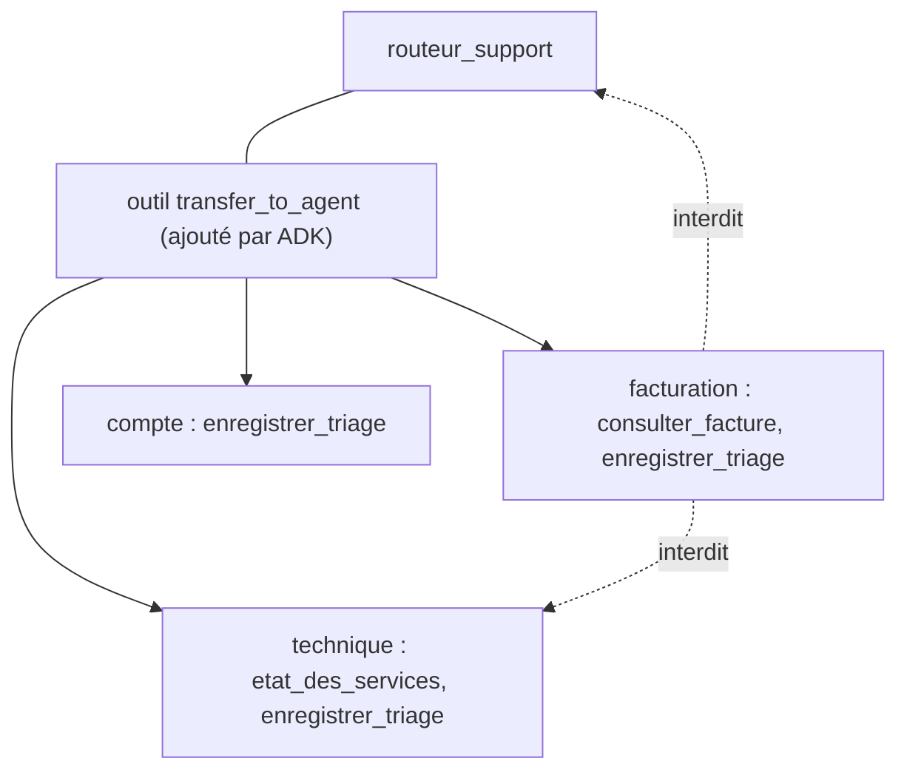

# Le routeur et les spécialistes

> [!NOTE]
> Dans cette leçon, vous allez écrire trois sous-agents spécialisés à partir d'une même fabrique, un routeur qui les reçoit en `sub_agents`, et empêcher les transferts en boucle entre agents.

## Installer

```bash
python -m venv .venv && source .venv/bin/activate
pip install -r requirements.txt      # google-adk==2.10.0, python-dotenv, pytest
cp .env.example .env                 # collez votre clé d'API Gemini
```

## Une fabrique de spécialistes

Les trois spécialistes ne diffèrent que par leur nom, leur domaine et leurs outils métier. Une petite fonction évite de répéter trois fois la même instruction :

```python title="files/agent.py"
def specialiste(nom, domaine, outils):
    return Agent(
        name=nom, model=MODEL,
        description=f"Spécialiste {domaine}.",
        instruction=(f"Tu es le spécialiste {domaine} du support. Tu traites le ticket transmis.\n"
                     "Si un outil métier aide (numéro de facture, service cité), appelle-le d'abord.\n"
                     f"Puis appelle enregistrer_triage. Priorités :\n{REGLE_PRIORITE}\n"
                     "La réponse proposée est en français, vouvoie le client et ne promet rien que les outils ne confirment pas."),
        tools=[*outils, enregistrer_triage],
        disallow_transfer_to_parent=True, disallow_transfer_to_peers=True,  # pas de ping-pong entre agents
    )


facturation = specialiste("facturation", "facturation (factures, paiements, remboursements, abonnements, TVA)",
                          [consulter_facture])
technique = specialiste("technique", "technique (bugs, pannes, lenteurs, API, application mobile, exports)",
                        [etat_des_services])
compte = specialiste("compte", "compte utilisateur (connexion, mot de passe, double authentification, "
                     "e-mail, droits des membres, suppression de compte, données personnelles)", [])
```

La `description` est **lue par le routeur** : c'est elle qui lui dit quel spécialiste choisir. Une liste d'exemples concrets (« TVA », « double authentification ») vaut mieux qu'un mot vague (« questions d'argent »).

| Paramètre | Valeur | Effet |
| --- | --- | --- |
| `name` | `facturation` | identifiant utilisé par `transfer_to_agent` et dans `state["triage"]["equipe"]` |
| `description` | domaine + exemples | critère de choix du routeur |
| `disallow_transfer_to_parent` | `True` | le spécialiste ne peut pas renvoyer le ticket au routeur |
| `disallow_transfer_to_peers` | `True` | ni à un autre spécialiste |

> [!WARNING]
> Sans ces deux options, un spécialiste hésitant peut renvoyer le ticket au routeur, qui le renvoie au même spécialiste, et ainsi de suite : chaque aller-retour coûte un appel de modèle. Ici, une fois transféré, le ticket est traité.

```quiz
question: "Qu'est-ce que le routeur lit pour choisir entre facturation, technique et compte ?"
options:
  - "Le code Python des outils de chaque spécialiste"
  - "Le nom et la description de chaque sous-agent, présentés avec l'outil transfer_to_agent"
  - "L'instruction complète de chaque spécialiste"
answer: 1
explanation: "ADK présente au routeur la liste des agents cibles avec leur nom et leur description. L'instruction des spécialistes n'est pas envoyée au routeur."
```

## Le routeur

```python title="files/agent.py"
root_agent = Agent(
    name="routeur_support",
    model=MODEL,
    description="Reçoit les tickets et les transfère à l'équipe compétente.",
    instruction=("Tu tries les tickets du support. Tu ne réponds JAMAIS toi-même au client : "
                 "transfère immédiatement le ticket au sous-agent compétent (facturation, technique ou compte). "
                 "En cas de doute, choisis l'équipe qui peut résoudre la CAUSE du problème "
                 "(ex. « je ne peux plus me connecter depuis ma carte expirée » -> facturation)."),
    sub_agents=[facturation, technique, compte],
)
```

Deux règles dans l'instruction :

1. **« Tu ne réponds JAMAIS toi-même »** : sinon le routeur, plus général, répond parfois directement et le ticket n'est pas trié.
2. **« L'équipe qui peut résoudre la CAUSE »** : une règle de départage pour les cas ambigus, avec un exemple. L'exemple ne figure pas tel quel dans `tickets.json`, pour ne pas fausser l'évaluation.



> [!TIP]
> Lors du run, ADK 2.10 affiche : *App "triage" can transfer between agents but has no context_cache_config.* C'est une suggestion d'optimisation : chaque transfert change l'instruction système, donc le préfixe du prompt n'est pas réutilisé en cache. Sans effet sur le résultat ; à regarder si le volume de tickets est élevé.

```quiz
question: "Pourquoi l'exemple de départage de l'instruction ne doit-il pas être un ticket du jeu d'évaluation ?"
options:
  - "Parce qu'ADK l'interdit"
  - "Parce que le modèle aurait la réponse sous les yeux : l'exactitude mesurée serait gonflée sur ce ticket"
  - "Parce que les exemples ralentissent le modèle"
answer: 1
explanation: "C'est une fuite de données de test. Le score ne mesurerait plus la capacité à généraliser à des tickets nouveaux."
```

## Exercice : ajouter une équipe « commercial »

Ajoutez un spécialiste `commercial` (devis, licences supplémentaires, démonstrations) sans outil métier. Que modifiez-vous, et qu'ajoutez-vous à `tickets.json` ?

<details>
<summary>Voir la solution</summary>

```python
commercial = specialiste("commercial", "commercial (devis, achat de licences supplémentaires, "
                         "demandes de démonstration, partenariats)", [])

root_agent = Agent(..., instruction="... (facturation, technique, compte ou commercial) ...",
                   sub_agents=[facturation, technique, compte, commercial])
```

Ajoutez 4 à 6 tickets étiquetés `commercial`, dont au moins un ambigu avec `facturation` (« je veux passer de 10 à 50 licences, combien ça coûte ? »), et mettez à jour `test_jeu_de_tickets_equilibre` qui vérifie l'ensemble des équipes. Relancez l'évaluation : une nouvelle catégorie peut faire baisser le score des anciennes.

</details>

## Résultat obtenu

Test sans clé avec deux faux modèles (routeur et spécialiste technique), 2026-10-15 :

```text
test_agent.py::test_specialistes_ne_renvoient_pas_le_ticket PASSED
test_agent.py::test_transfert_puis_triage_en_etat PASSED
```

Le second rejoue un vrai transfert : le faux routeur appelle `transfer_to_agent(agent_name="technique")`, ADK passe la main au sous-agent, et l'état final contient `{"equipe": "technique", "priorite": "P2", ...}`.

## Je sais faire

- [ ] Créer des sous-agents avec une fabrique et des descriptions précises
- [ ] Brancher des spécialistes sur un routeur avec `sub_agents`
- [ ] Interdire les transferts vers le parent et entre pairs
- [ ] Écrire une règle de départage sans fuite de données de test
