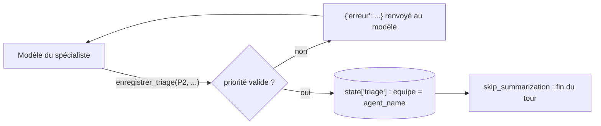

# Priorité, réponse proposée et état

> [!NOTE]
> Dans cette leçon, vous allez écrire l'outil `enregistrer_triage` qui valide la priorité, range le résultat dans l'état de session et termine le tour sans appel de modèle supplémentaire, puis les outils métier qui permettent au spécialiste de vérifier avant de répondre.

## Un résultat structuré, pas une phrase

Le triage doit être exploitable par du code : quelle équipe, quelle priorité, quel brouillon. Plutôt que d'analyser le texte final du modèle, on lui fait **appeler un outil** dont les paramètres sont exactement les champs voulus.

```python title="files/agent.py"
def enregistrer_triage(priorite: str, resume: str, reponse_proposee: str, tool_context: ToolContext) -> dict:
    """Enregistre le triage du ticket. À appeler UNE fois, en dernier.

    Args:
        priorite: "P1", "P2" ou "P3".
        resume: le problème en une phrase.
        reponse_proposee: brouillon de réponse au client (3 phrases max), relu par un humain avant envoi.
    """
    if priorite not in PRIORITES:
        return {"erreur": f"Priorité invalide : {priorite}. Valeurs : P1, P2, P3."}
    tool_context.state["triage"] = {"equipe": tool_context.agent_name, "priorite": priorite,
                                    "resume": resume, "reponse_proposee": reponse_proposee}
    tool_context.actions.skip_summarization = True  # fin du tour : pas d'appel modèle de plus
    return tool_context.state["triage"]
```

| Ligne | Rôle |
| --- | --- |
| `if priorite not in PRIORITES` | refuse « urgent » ou « haute » ; le modèle lit l'erreur et réessaie avec P1/P2/P3 |
| `"equipe": tool_context.agent_name` | l'équipe est le **nom de l'agent qui appelle l'outil** : le modèle ne peut pas se tromper ni mentir sur ce champ |
| `tool_context.actions.skip_summarization = True` | ADK considère le résultat de l'outil comme réponse finale : pas de nouvel appel au modèle pour « résumer » |



```quiz
question: "Pourquoi l'équipe est-elle tirée de tool_context.agent_name plutôt que d'un paramètre de l'outil ?"
options:
  - "Pour économiser un paramètre"
  - "Parce que c'est un fait connu du code (quel agent s'exécute) : le demander au modèle introduirait une source d'erreur inutile"
  - "Parce qu'ADK interdit les paramètres de type chaîne"
answer: 1
explanation: "Tout ce que le code sait déjà ne doit pas être demandé au modèle. L'équipe mesurée par l'évaluation est ainsi celle qui a réellement traité le ticket."
```

> [!TIP]
> `skip_summarization` économise un appel de modèle par ticket. Le test `test_transfert_puis_triage_en_etat` le vérifie : le faux modèle du spécialiste n'est appelé que **2 fois** (outil métier, puis `enregistrer_triage`), pas 3.

## Les outils métier

Un spécialiste qui vérifie avant d'écrire fait de meilleurs brouillons. Deux outils simples, sur des données fictives :

```python title="files/agent.py"
FACTURES = {"F-2026-0412": {"montant": 49.0, "statut": "payée", "prelevements": 2},
            "F-2026-0398": {"montant": 19.0, "statut": "impayée", "prelevements": 0}}
SERVICES = {"application web": "opérationnel", "api": "dégradé (latence élevée depuis 9 h)",
            "synchronisation mobile": "opérationnel", "export pdf": "en panne"}


def consulter_facture(numero: str) -> dict:
    """Retrouve une facture (montant, statut, nombre de prélèvements).

    Args:
        numero: par exemple "F-2026-0412".
    """
    return FACTURES.get(numero.upper(), {"erreur": "Facture introuvable."})
```

| Spécialiste | Outil métier | Ce qu'il permet de confirmer |
| --- | --- | --- |
| facturation | `consulter_facture` | le double prélèvement est réel (`prelevements: 2`) |
| technique | `etat_des_services` | l'export PDF est bien en panne : on peut l'écrire au client |
| compte | aucun | dans la réalité : statut de la double authentification, dernières connexions |

> [!WARNING]
> La réponse proposée reste un **brouillon relu par un humain**. Un agent de triage qui envoie seul des réponses à des clients touchant à l'argent ou à la sécurité de leur compte, c'est une décision à prendre consciemment, avec des garde-fous comme ceux du lab « Assistant e-commerce ».

```quiz
question: "Le modèle appelle enregistrer_triage(priorite=\"urgent\", ...). Que se passe-t-il ?"
options:
  - "Le triage est enregistré avec la priorité « urgent »"
  - "L'outil renvoie une erreur listant P1, P2, P3 ; skip_summarization n'est pas activé, donc le modèle peut réessayer"
  - "ADK lève une exception et le ticket est perdu"
answer: 1
explanation: "La validation précède l'écriture et le skip_summarization. Le modèle lit l'erreur et rappelle l'outil avec une valeur valide. Le test test_priorite_invalide_refusee couvre ce cas."
```

## Lire le résultat

Après le run, le code lit simplement l'état de la session :

```python title="files/evaluer.py"
s = await runner.session_service.get_session(app_name="triage", user_id="support", session_id=s.id)
triage = s.state.get("triage") or {"equipe": "aucune", "priorite": "-", "reponse_proposee": ""}
```

Si le routeur avait répondu lui-même sans transférer, `triage` serait absent : l'évaluation le compterait comme une erreur (`obtenu = aucune`).

## Exercice : un champ « délai de réponse »

Ajoutez au triage un champ `delai_cible` calculé par le code à partir de la priorité (P1 : 1 h, P2 : 8 h, P3 : 48 h). Le modèle doit-il le fournir ?

<details>
<summary>Voir la solution</summary>

Non : c'est une règle déterministe, le code la connaît. On ne l'ajoute pas aux paramètres de l'outil.

```python
DELAIS = {"P1": "1 h", "P2": "8 h", "P3": "48 h"}

def enregistrer_triage(priorite, resume, reponse_proposee, tool_context):
    if priorite not in PRIORITES:
        return {"erreur": ...}
    tool_context.state["triage"] = {"equipe": tool_context.agent_name, "priorite": priorite,
                                    "delai_cible": DELAIS[priorite],
                                    "resume": resume, "reponse_proposee": reponse_proposee}
    ...
```

Même principe que pour `equipe` : ne demandez au modèle que ce qu'il est seul à pouvoir juger (la priorité, le résumé, le brouillon).

</details>

## Résultat obtenu

Trois triages réels issus de l'évaluation (gemini-3.5-flash, 2026-10-15) :

```text
T01 facturation P1  Bonjour, nous avons bien constaté qu'un double prélèvement a eu lieu pour la
                    facture F-2026-0412. Notre équipe financière prend en charge votre dossier afin
                    de procéder à la régularisation. [...]
T06 facturation P3  Bonjour. Les virements bancaires peuvent nécessiter quelques jours ouvrés avant
                    d'être traités [...]. La facture F-2026-0398 figure actuellement comme impayée [...]
T15 compte      P1  Nous avons bien pris en compte votre signalement concernant l'accès non autorisé
                    à votre compte [...] transmis en priorité absolue à notre équipe de sécurité [...]
```

Dans T01, « nous avons bien constaté » s'appuie sur `consulter_facture` (`prelevements: 2`). T06 a été classé P3 alors que l'étiquette attendue est P2 : on y revient dans l'analyse d'erreurs.

## Je sais faire

- [ ] Obtenir un résultat structuré en faisant appeler un outil au modèle
- [ ] Valider les valeurs d'un outil et laisser le modèle se corriger
- [ ] Remplir un champ depuis `tool_context` plutôt que depuis le modèle
- [ ] Terminer un tour avec `skip_summarization`
