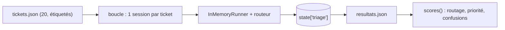

# Évaluer sur 20 tickets et exploiter

> [!NOTE]
> Dans cette leçon, vous allez lancer les tests sans clé, puis l'**évaluation réelle** sur les 20 tickets étiquetés : exactitude du routage, exactitude de la priorité, confusions. Vous analyserez les erreurs, puis verrez comment mettre ce triage en production.

## Deux niveaux de vérification

| | `pytest` (sans clé) | `python evaluer.py` (vrai modèle) |
| --- | --- | --- |
| Question posée | « le câblage ADK fonctionne-t-il ? » | « le modèle trie-t-il correctement ? » |
| Contenu | transfert simulé, état, validation, jeu de données, calcul des scores | 20 tickets, une session chacun |
| Résultat | vert ou rouge | des pourcentages et une liste d'erreurs |
| Quand | à chaque modification | à chaque changement de prompt, de modèle ou de description |

## Le script d'évaluation

Chaque ticket est joué dans une **nouvelle session** : aucun ticket ne voit le précédent.

```python title="files/evaluer.py"
def scores(resultats):
    """Fonction pure : exactitude du routage, de la priorité, et confusions."""
    n = len(resultats)
    return {
        "routage": sum(r["attendu"] == r["obtenu"] for r in resultats) / n,
        "priorite": sum(r["priorite_attendue"] == r["priorite"] for r in resultats) / n,
        "confusions": dict(Counter(f"{r['attendu']}->{r['obtenu']}" for r in resultats if r["attendu"] != r["obtenu"])),
    }
```

La fonction `scores` est pure : elle est testée sans modèle (`test_scores`). Les **confusions** (par exemple `technique->facturation: 2`) disent quelle frontière entre équipes pose problème, ce qu'un pourcentage seul ne dit pas.



```bash
cd files
pytest -q            # 5 tests, sans clé
python evaluer.py    # 20 tickets, quelques dizaines d'appels de modèle
```

`evaluer.py` réessaie sur 429 et 503 et ferme proprement le runner à la fin (`await runner.close()`).

```quiz
question: "Pourquoi créer une nouvelle session pour chaque ticket ?"
options:
  - "Pour aller plus vite"
  - "Pour que chaque ticket soit trié indépendamment : sinon l'historique et state['triage'] du ticket précédent influenceraient le suivant"
  - "Parce qu'une session ne peut contenir qu'un message"
answer: 1
explanation: "Dans la même session, le spécialiste du ticket précédent aurait encore la main et l'état contiendrait l'ancien triage. L'évaluation doit mesurer chaque ticket isolément."
```

## Résultat obtenu

Tests sans clé, 2026-10-15 :

```text
test_agent.py::test_jeu_de_tickets_equilibre PASSED
test_agent.py::test_scores PASSED
test_agent.py::test_specialistes_ne_renvoient_pas_le_ticket PASSED
test_agent.py::test_transfert_puis_triage_en_etat PASSED
test_agent.py::test_priorite_invalide_refusee PASSED
============================== 5 passed in 1.31s ===============================
```

Évaluation réelle `python evaluer.py` (gemini-3.5-flash, 2026-10-15), sortie complète :

```text
OK  T01 attendu=facturation obtenu=facturation prio P1/P1
OK  T02 attendu=facturation obtenu=facturation prio P3/P3
OK  T03 attendu=facturation obtenu=facturation prio P3/P3
OK  T04 attendu=facturation obtenu=facturation prio P2/P2
OK  T05 attendu=facturation obtenu=facturation prio P2/P2
OK  T06 attendu=facturation obtenu=facturation prio P2/P3
OK  T07 attendu=technique   obtenu=technique   prio P1/P1
OK  T08 attendu=technique   obtenu=technique   prio P2/P2
OK  T09 attendu=technique   obtenu=technique   prio P2/P2
OK  T10 attendu=technique   obtenu=technique   prio P3/P3
OK  T11 attendu=technique   obtenu=technique   prio P3/P3
OK  T12 attendu=technique   obtenu=technique   prio P2/P2
OK  T13 attendu=technique   obtenu=technique   prio P1/P1
OK  T14 attendu=compte      obtenu=compte      prio P2/P2
OK  T15 attendu=compte      obtenu=compte      prio P1/P1
OK  T16 attendu=compte      obtenu=compte      prio P3/P3
OK  T17 attendu=compte      obtenu=compte      prio P2/P2
OK  T18 attendu=compte      obtenu=compte      prio P3/P3
OK  T19 attendu=compte      obtenu=compte      prio P3/P3
OK  T20 attendu=facturation obtenu=facturation prio P2/P1

Routage : 100%   Priorité : 90%   Confusions : aucune
```

## Analyser les erreurs

Le routage est parfait sur ce jeu, y compris le cas ambigu T20. Les deux écarts portent sur la priorité :

| Ticket | Attendu | Obtenu | Lecture |
| --- | --- | --- | --- |
| T06 « facture impayée alors que j'ai fait le virement lundi » | P2 | P3 | le modèle y a vu une simple attente de rapprochement bancaire ; défendable |
| T20 « abonnement expiré, plus d'accès à mes données » | P2 | P1 | « plus d'accès » ressemble à « service inaccessible » de la définition de P1 |

Dans les deux cas, la **définition** de la priorité laisse de la place à l'interprétation. Avant de toucher au prompt, demandez-vous si l'étiquette est la bonne : parfois c'est le jeu de test qu'il faut corriger.

> [!WARNING]
> 20 tickets, c'est un **test de fumée**, pas une mesure fiable : un seul ticket vaut 5 points de pourcentage, et un autre jour ou un autre modèle peut donner un résultat différent. Pour décider d'une mise en production, visez plusieurs centaines de tickets réels anonymisés, et relancez plusieurs fois.

```quiz
question: "Le score de priorité passe de 90 % à 85 % après une modification du prompt. Que concluez-vous sur 20 tickets ?"
options:
  - "La modification est clairement mauvaise"
  - "C'est un seul ticket de différence : il faut regarder lequel, et confirmer sur un jeu plus grand ou plusieurs exécutions"
  - "Le modèle est cassé"
answer: 1
explanation: "Sur 20 exemples, 5 points = 1 ticket, ce qui peut relever de la variabilité du modèle. On inspecte l'erreur et on mesure sur plus de données avant de conclure."
```

## Exploiter en production

| Sujet | Recommandation |
| --- | --- |
| Entrée | webhook de l'outil de support ou file Pub/Sub, vers un service (par exemple Cloud Run avec `adk deploy cloud_run`) |
| Sortie | écrire équipe, priorité et brouillon dans le ticket ; l'humain valide avant envoi |
| Tickets hors catégories | ajouter un spécialiste « autre » ou une sortie « à trier manuellement » plutôt que forcer un choix |
| Suivi | journaliser `equipe`, `priorite` et les corrections faites par les agents humains : ce sont vos futures étiquettes |
| Régression | relancer `evaluer.py` en CI à chaque changement de prompt ou de modèle, seuil minimal de routage |
| Outils ADK | `adk eval` et les jeux d'évaluation ADK pour versionner des cas de test d'agent |

> [!TIP]
> Les corrections des agents humains (« ce ticket était en fait technique ») forment gratuitement un jeu d'évaluation qui grandit chaque jour, avec la vraie distribution de vos tickets.

## Exercice : un seuil en CI

Écrivez un test `test_seuil_routage` qui lit `resultats.json` (produit par `evaluer.py`) et échoue si le routage est inférieur à 90 % ou si une confusion apparaît plus de deux fois. Pourquoi ne pas le mettre dans `pytest -q` par défaut ?

<details>
<summary>Voir la solution</summary>

```python
import json, os, pytest
from evaluer import scores

@pytest.mark.skipif(not os.path.exists("resultats.json"), reason="lancer evaluer.py d'abord")
def test_seuil_routage():
    s = scores(json.load(open("resultats.json", encoding="utf-8")))
    assert s["routage"] >= 0.9
    assert all(n <= 2 for n in s["confusions"].values())
```

Il dépend d'un fichier produit par un run **avec clé**, qui coûte des appels et varie d'une exécution à l'autre. On le lance dans un job CI dédié (manuel ou nocturne), pas à chaque commit. Le `skipif` garde `pytest -q` vert sans clé.

</details>

## Je sais faire

- [ ] Évaluer un routeur sur un jeu étiqueté, une session par ticket
- [ ] Lire exactitude et confusions, et analyser chaque erreur
- [ ] Remettre en cause une étiquette avant de modifier le prompt
- [ ] Dire pourquoi 20 tickets ne suffisent pas pour décider
- [ ] Brancher le triage dans un flux de production avec validation humaine
