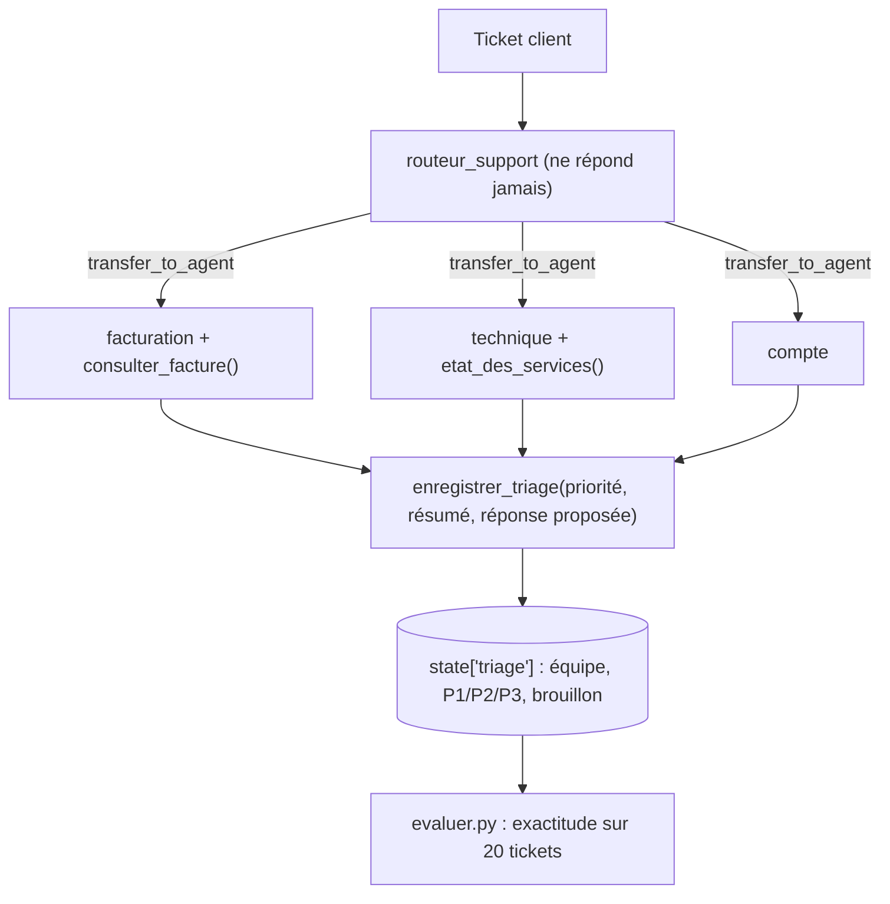

Une équipe support reçoit des tickets en vrac : un double prélèvement, une API en panne, un compte piraté. Avant de répondre, il faut **trier** : quelle équipe, quelle urgence ? Dans ce lab, vous construisez avec Google ADK un **agent routeur** qui ne répond jamais lui-même mais transfère chaque ticket à l'un de trois **sous-agents spécialisés**. Le spécialiste fixe la priorité, rédige une réponse proposée (relue par un humain) et écrit le tout dans l'état de session.

Puis vous faites ce que la plupart des démos oublient : **mesurer**. Un script rejoue 20 tickets fictifs étiquetés et calcule l'exactitude du routage et de la priorité.

## Pour qui ?

- Développeurs Python qui ont écrit un premier agent ADK.
- Responsables support ou ops qui veulent automatiser le tri sans perdre le contrôle.

## Ce que vous construisez

## Prérequis

- Python 3.10+, une clé d'API Gemini.
- `pip install -r files/requirements.txt`.
- L'évaluation complète fait de l'ordre de 2 à 3 appels de modèle par ticket, soit quelques dizaines d'appels.

## Programme

| Module | Leçon | Ce que vous faites | Durée |
| --- | --- | --- | --- |
| 1. Cas d'usage | [Le cas d'usage et l'architecture](./01-cas-d-usage/01-cas-d-usage-et-architecture.md) | Catégories, priorités, routeur ou classifieur | 30 min |
| 2. Construire | [Le routeur et les spécialistes](./02-construire/01-routeur-et-specialistes.md) | `sub_agents`, transfert, descriptions, interdire le ping-pong | 45 min |
| 2. Construire | [Priorité, réponse proposée et état](./02-construire/02-priorite-reponse-et-etat.md) | `enregistrer_triage`, `skip_summarization`, outils métier | 40 min |
| 3. Tester, évaluer, exploiter | [Évaluer sur 20 tickets](./03-tester-et-exploiter/01-evaluer-et-exploiter.md) | Faux modèles, évaluation réelle, analyse d'erreurs, production | 50 min |

## Le code

Dans `files/` : [agent.py](./files/agent.py), [evaluer.py](./files/evaluer.py) (évaluation réelle), [tickets.json](./files/tickets.json) (20 tickets étiquetés), [test_agent.py](./files/test_agent.py) (5 tests sans clé), [requirements.txt](./files/requirements.txt) et `.env.example`.

## En local ou sur Google Cloud ?

| | En local (ce lab) | Sur Google Cloud (piste) |
| --- | --- | --- |
| Modèle | API Gemini avec une clé | Vertex AI (mêmes agents, variables d'environnement différentes) |
| Entrée des tickets | `tickets.json` | Pub/Sub ou webhook de l'outil de support vers un service Cloud Run |
| Résultat | `state['triage']` + `resultats.json` | écriture dans l'outil de support, journal dans BigQuery |
| Évaluation | `python evaluer.py` | même script en CI, ou `adk eval` avec des jeux d'évaluation |

Testé de bout en bout en local le 2026-10-15 (évaluation réelle sur les 20 tickets) ; la variante Google Cloud n'est pas déployée dans ce lab.
