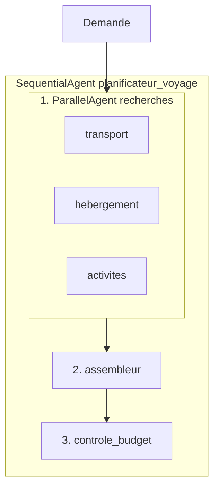
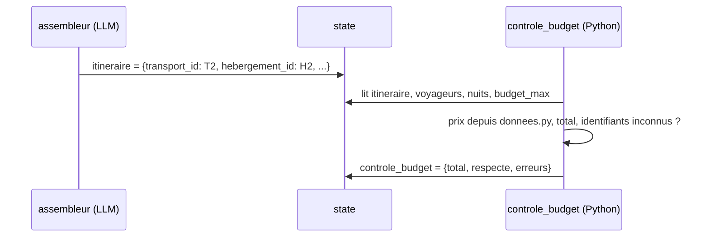
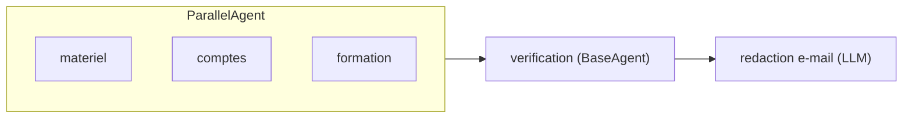

# Pourquoi un pipeline parallèle puis séquentiel

> [!NOTE]
> Dans cette leçon, vous allez découper un problème de planification en étapes, repérer celles qui peuvent tourner en parallèle, et choisir pour chacune le bon type d'agent ADK : agent LLM, agent de workflow ou agent écrit en Python.

## Le besoin

Un service interne (par exemple l'équipe qui organise les déplacements d'une entreprise) reçoit des demandes du type : « Nous partons à 2 de Lyon à Lisbonne pour 3 nuits, nous aimons la culture et la gastronomie, budget 900 euros tout compris. » Il doit répondre avec un itinéraire **réaliste** (des options qui existent vraiment dans le catalogue) et **dans le budget**.

Un seul agent avec trois outils pourrait le faire. Mais il appellerait les outils l'un après l'autre, mélangerait tout dans un seul prompt, et c'est lui qui additionnerait les prix : trois sources d'erreur.

## Découper : dépendances et parallélisme

| Étape | Dépend de… | Qui la fait ? |
| --- | --- | --- |
| Chercher les transports | la demande seule | agent LLM `transport` + outil |
| Chercher les hébergements | la demande seule | agent LLM `hebergement` + outil |
| Chercher les activités | la demande seule | agent LLM `activites` + outil |
| Assembler l'itinéraire | les 3 recherches | agent LLM `assembleur`, sortie structurée |
| Vérifier le budget | l'itinéraire | **code Python** (`BaseAgent`), aucun LLM |

Les trois recherches ne dépendent que de la demande : elles peuvent tourner **en même temps**. L'assemblage attend les trois. Le contrôle attend l'assemblage. D'où la forme :



## Les briques ADK utilisées

- **`Agent`** (alias de `LlmAgent`) : un agent piloté par un modèle, avec une instruction et des outils.
- **`ParallelAgent`** : un *agent de workflow* (il n'appelle pas de modèle lui-même) qui exécute ses sous-agents **en concurrence**. Chaque sous-agent tourne dans sa propre branche : ils ne voient pas les messages des autres pendant l'exécution.
- **`SequentialAgent`** : agent de workflow qui exécute ses sous-agents **dans l'ordre**, avec la même session.
- **L'état de session** (`session.state`) : un dictionnaire partagé par tous les agents d'une exécution. Avec `output_key="transport"`, la réponse finale d'un agent est copiée dans `state["transport"]`.
- **`BaseAgent`** : la classe de base de tous les agents. En héritant d'elle, on écrit un agent **déterministe** (même entrée, même sortie) en pur Python.

```quiz
question: "Pourquoi les trois agents de recherche peuvent-ils être placés dans un ParallelAgent ?"
options:
  - "Parce qu'ils utilisent tous le même modèle"
  - "Parce qu'aucun n'a besoin du résultat d'un autre : ils ne dépendent que de la demande"
  - "Parce qu'un ParallelAgent est toujours plus rapide qu'un SequentialAgent, quelles que soient les dépendances"
answer: 1
explanation: "Le parallélisme n'est correct que si les tâches sont indépendantes. L'assembleur, lui, dépend des trois résultats : il doit venir après, dans le SequentialAgent."
```

> [!WARNING]
> Dans ADK 2.10, `SequentialAgent`, `ParallelAgent` et `LoopAgent` émettent un avertissement `DeprecationWarning` : ils sont dépréciés au profit de **Workflow**, un nouveau moteur de graphes (`google.adk.workflow`). Ils fonctionnent toujours et restent la façon la plus simple d'apprendre ces schémas ; le message précise d'ailleurs qu'un Workflow ne peut pas encore servir de sous-agent d'un `LlmAgent`. Surveillez les notes de version avant une mise en production durable.

## Qui fait quoi : LLM ou code ?

Règle simple : **le modèle choisit, le code compte**. Le modèle est bon pour comparer des options en langage naturel et rédiger un programme de visite. Il est mauvais pour garantir qu'une addition est juste ou qu'un identifiant existe. Le contrôle budgétaire relit donc les **identifiants** choisis (`T2`, `H2`, `A1`…) et va chercher les prix dans le catalogue.



```quiz
question: "L'assembleur écrit dans son texte « total : 650 EUR ». Que fait le contrôle budgétaire de ce chiffre ?"
options:
  - "Il le compare au budget maximum"
  - "Il l'ignore : il recalcule le total à partir des identifiants et des prix du catalogue"
  - "Il le corrige en demandant au modèle de recompter"
answer: 1
explanation: "Un chiffre produit par un LLM peut être faux. Le contrôle ne fait confiance qu'aux identifiants, qu'il vérifie, et aux prix de la source de vérité (donnees.py)."
```

## Exercice : redécouper un autre besoin

Un service RH veut préparer l'arrivée d'un nouvel employé : commander un ordinateur, créer ses comptes, réserver une formation d'accueil, puis envoyer un e-mail récapitulatif qui cite les trois. Dessinez le pipeline : qu'est-ce qui est parallèle, qu'est-ce qui est séquentiel, et quelle étape confieriez-vous à du code ?

<details>
<summary>Voir la solution</summary>

- **En parallèle** : commande du matériel, création des comptes, réservation de la formation. Aucune ne dépend des autres.
- **Ensuite, en séquence** : un agent LLM qui rédige l'e-mail en lisant les trois résultats dans l'état (`{materiel}`, `{comptes}`, `{formation}`).
- **En code** : la vérification que les trois étapes ont réussi (codes retour des API) avant l'envoi, et l'envoi lui-même.



</details>

## Résultat obtenu

Exécution réelle du 2026-10-15 avec `gemini-3.5-flash` : les trois agents de recherche ont appelé leur outil **dans un ordre non déterministe** (ici activités, puis transport, puis hébergement), preuve qu'ils tournent en concurrence :

```text title="python agent.py (extrait)"
  [activites] outil chercher_activites({'ville': 'Lisbonne', 'centres_interet': ['culture', 'gastronomie']})
  [transport] outil chercher_transports({'destination': 'Lisbonne', 'origine': 'Lyon'})
  [hebergement] outil chercher_hebergements({'ville': 'Lisbonne', 'prix_nuit_max': 120})
  ...
  [controle_budget] Budget OK : 800 EUR pour 900 EUR max. Détail : {'transport': 192, 'hebergement': 294, 'activites': 314}
```

## Je sais faire

- [ ] Je repère les étapes indépendantes d'un processus et je les place dans un `ParallelAgent`
- [ ] J'enchaîne les étapes dépendantes avec un `SequentialAgent`
- [ ] Je sais expliquer le rôle de `output_key` et de l'état de session
- [ ] Je confie au code ce qui doit être exact (calculs, existence des identifiants)
