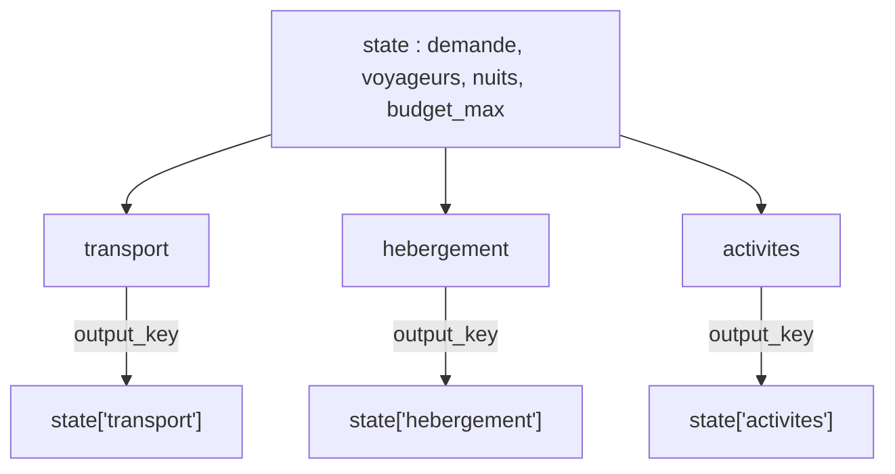

# Outils et agents de recherche en parallèle

> [!NOTE]
> Dans cette leçon, vous allez écrire les trois outils de recherche (données fictives), les trois agents spécialistes qui les utilisent, et les réunir dans un `ParallelAgent` dont chaque branche écrit son résultat dans l'état de session.

## 1. Les données : un catalogue fictif

Le fichier [donnees.py](../files/donnees.py) contient trois listes de dictionnaires : `TRANSPORTS`, `HEBERGEMENTS`, `ACTIVITES`. Chaque entrée a un **identifiant stable** (`T2`, `H2`, `A1`…) : c'est lui qui circulera entre les agents, pas le prix.

```python title="files/donnees.py (extrait)"
TRANSPORTS = [  # prix aller-retour par voyageur
    {"id": "T2", "mode": "avion low-cost", "compagnie": "VolMini", "origine": "Lyon",
     "destination": "Lisbonne", "duree_h": 2.4, "prix_eur": 96},
    ...
]
```

## 2. Les outils : des fonctions Python ordinaires

Dans ADK, un **outil** (*function tool*) est une fonction Python. ADK lit son nom, ses paramètres typés et sa *docstring* pour fabriquer la description envoyée au modèle. Une bonne docstring dit **quoi**, **dans quelle unité** et **quelles valeurs** sont attendues.

```python title="files/agent.py (outils)"
def chercher_hebergements(ville: str, prix_nuit_max: int) -> dict:
    """Liste les hébergements d'une ville dont le prix par nuit est <= prix_nuit_max (euros)."""
    res = [h for h in HEBERGEMENTS
           if h["ville"].lower() == ville.lower() and h["prix_nuit"] <= prix_nuit_max]
    return {"options": res} if res else {"erreur": f"Aucun hébergement à {ville} sous {prix_nuit_max} EUR/nuit"}


def chercher_activites(ville: str, centres_interet: list[str]) -> dict:
    """Liste les activités d'une ville. centres_interet : catégories parmi culture, gastronomie, musique, sport."""
    ...
```

> [!TIP]
> Renvoyez toujours un **dictionnaire**, et une clé `erreur` lisible plutôt qu'une exception quand la recherche est vide : le modèle peut alors réagir (élargir le prix maximum, proposer une autre ville) au lieu de faire échouer toute l'exécution.

| Choix | Pourquoi |
| --- | --- |
| Paramètres typés (`str`, `int`, `list[str]`) | ADK en déduit le schéma JSON de l'outil |
| Filtre insensible à la casse | le modèle écrira « lisbonne » ou « Lisbonne » |
| Liste des valeurs permises dans la docstring | évite les catégories inventées (« bien-être ») |
| Un outil par agent | chaque spécialiste ne voit que ce dont il a besoin |

## 3. Les spécialistes et `output_key`

Chaque spécialiste est un `Agent` avec **un seul outil** et une **clé de sortie**. Son instruction contient `{demande}` : ADK remplace ce motif par `state["demande"]` au moment de l'appel (c'est l'*injection d'état* dans l'instruction).

```python title="files/agent.py (spécialistes)"
transport = Agent(
    name="transport", model=m("transport"), tools=[chercher_transports], output_key="transport",
    instruction="Tu es l'expert transport. Demande : {demande}. Appelle chercher_transports, puis "
                "recommande 1 option principale et 1 alternative moins chère, avec leur identifiant T..., "
                "leur durée et leur prix par voyageur. Réponds en 3 lignes maximum.")
hebergement = Agent(
    name="hebergement", model=m("hebergement"), tools=[chercher_hebergements], output_key="hebergement",
    instruction="Tu es l'expert hébergement. Demande : {demande}. Budget total : {budget_max} EUR pour "
                "{nuits} nuits. Appelle chercher_hebergements avec un prix_nuit_max raisonnable ...")
```

`m(...)` est une petite fonction qui renvoie le modèle à utiliser pour un agent donné : le nom lu dans la variable `MODEL` en temps normal, un **faux modèle** dans les tests (leçon 4).

```quiz
question: "Que contient state[\"hebergement\"] après l'exécution de l'agent hebergement ?"
options:
  - "La liste brute renvoyée par l'outil chercher_hebergements"
  - "Le texte de la réponse finale de l'agent (ses 2 recommandations)"
  - "Rien : output_key n'est utilisé que par les ParallelAgent"
answer: 1
explanation: "output_key copie la réponse finale de l'agent (son texte, ou l'objet validé s'il a un output_schema) dans l'état. Le résultat brut de l'outil reste dans l'historique des événements."
```

## 4. Le `ParallelAgent`

```python title="files/agent.py (assemblage)"
return SequentialAgent(name="planificateur_voyage", sub_agents=[
    ParallelAgent(name="recherches", sub_agents=[transport, hebergement, activites]),
    assembleur,
    ControleBudget(name="controle_budget"),
])
```



Trois points à retenir :

1. **Branches isolées** : pendant l'exécution, un spécialiste ne voit pas la conversation des deux autres. Ils partagent seulement l'**état** de session.
2. **Clés distinctes** : si deux branches écrivaient la même `output_key`, la dernière arrivée écraserait l'autre, dans un ordre imprévisible.
3. **Ordre non garanti** : les événements arrivent dans l'ordre où les modèles répondent.

> [!WARNING]
> Un agent ne peut avoir **qu'un seul parent**. Si vous réutilisez la même instance `transport` dans deux pipelines, ADK lève une erreur. C'est pour cela que tout est créé dans une fonction `construire()` qui fabrique de nouvelles instances à chaque appel.

```quiz
question: "Deux sous-agents d'un ParallelAgent ont tous deux output_key=\"resultat\". Que se passe-t-il ?"
options:
  - "ADK fusionne les deux textes"
  - "ADK refuse de démarrer"
  - "Les deux écrivent la même clé : la valeur finale dépend de celui qui termine en dernier"
answer: 2
explanation: "Rien ne l'interdit techniquement, mais le résultat devient non déterministe. Donnez une clé unique à chaque branche."
```

## 5. La session de départ

Les paramètres chiffrés de la demande sont mis dans l'état **dès la création de la session** : ainsi le code (le contrôle budgétaire) les lit sans avoir à les extraire du texte.

```python title="files/agent.py (planifier)"
session = await runner.session_service.create_session(
    app_name="voyage", user_id="u1",
    state={"demande": demande["texte"], "voyageurs": demande["voyageurs"],
           "nuits": demande["nuits"], "budget_max": demande["budget_max"]})
```

## Exercice : un quatrième spécialiste « météo »

Ajoutez un outil `prevision_meteo(ville: str) -> dict` qui renvoie une prévision fictive (`{"ville": ..., "ciel": "ensoleillé", "temp_max_c": 24}`) et un agent `meteo` en parallèle des trois autres, avec `output_key="meteo"`. Que faut-il changer pour que l'assembleur en tienne compte ?

<details>
<summary>Voir la solution</summary>

```python title="files/agent.py (ajout)"
def prevision_meteo(ville: str) -> dict:
    """Prévision météo FICTIVE pour les prochains jours dans une ville."""
    return {"ville": ville, "ciel": "ensoleillé", "temp_max_c": 24}

meteo = Agent(name="meteo", model=m("meteo"), tools=[prevision_meteo], output_key="meteo",
              instruction="Demande : {demande}. Appelle prevision_meteo et résume en une ligne.")

ParallelAgent(name="recherches", sub_agents=[transport, hebergement, activites, meteo])
```

Puis ajoutez `MÉTÉO : {meteo}` dans l'instruction de l'assembleur (sinon il ne la voit jamais) et, dans les tests, un faux modèle pour `"meteo"`.

</details>

## Résultat obtenu

Sorties réelles des trois spécialistes (2026-10-15, `gemini-3.5-flash`), telles qu'écrites dans l'état :

```text title="python agent.py (extrait)"
  [transport] Option principale : Vol direct AirExemple (**T1**) - Durée : 2h18 (2,3h) - **189 €** par voyageur.
Alternative économique : Vol low-cost VolMini (**T2**) - Durée : 2h24 (2,4h) - **96 €** par voyageur.
  [activites] - A1 : Visite guidée de l'Alfama — Durée : 3h — 25 € / voyageur
- A2 : Atelier pastel de nata — Durée : 2h — 45 € / voyageur
- A3 : Excursion à Sintra — Durée : 8h — 79 € / voyageur
- A6 : Musée des Azulejos — Durée : 2h — 8 € / voyageur
  [hebergement] - H2 (Alfama) : 98 €/nuit, note 8.4/10, idéal pour l'histoire et la culture.
- H3 (Bairro Alto) : 62 €/nuit, note 7.6/10, parfait pour la gastronomie et la vie de quartier.
```

Le spécialiste hébergement a choisi seul `prix_nuit_max=120`, conforme à sa consigne (40 % de 900 EUR divisé par 3 nuits).

## Je sais faire

- [ ] J'écris un outil ADK typé avec une docstring utile au modèle
- [ ] J'injecte des valeurs de l'état dans une instruction avec `{cle}`
- [ ] Je donne une `output_key` unique à chaque branche d'un `ParallelAgent`
- [ ] Je crée les agents dans une fonction pour pouvoir les instancier plusieurs fois
