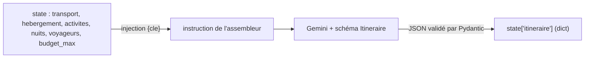

# Assembleur structuré et contrôle du budget

> [!NOTE]
> Dans cette leçon, vous allez écrire l'agent qui assemble l'itinéraire sous forme d'objet validé (`output_schema`), puis un agent personnalisé en pur Python qui recalcule le budget à partir du catalogue et signale les identifiants inventés.

## 1. Un schéma pour la sortie

Une **sortie structurée** oblige le modèle à répondre en JSON conforme à un schéma. Avec ADK, on décrit ce schéma par une classe **Pydantic** (bibliothèque Python de validation de données) et on la passe dans `output_schema`. ADK valide la réponse et range le **dictionnaire** obtenu dans `state[output_key]`.

```python title="files/agent.py (schéma)"
class Jour(BaseModel):
    jour: int
    programme: str = Field(description="Programme du jour en une ou deux phrases")
    activite_ids: list[str] = Field(default_factory=list, description="Identifiants A... prévus ce jour")


class Itineraire(BaseModel):
    titre: str
    transport_id: str = Field(description="Identifiant T... retenu")
    hebergement_id: str = Field(description="Identifiant H... retenu")
    jours: list[Jour]
    conseils: str
```

Le schéma ne contient **aucun prix** : volontairement. Le modèle choisit des identifiants ; les montants viendront du catalogue.

## 2. L'assembleur lit l'état

```python title="files/agent.py (assembleur)"
assembleur = Agent(
    name="assembleur", model=m("assembleur"), output_schema=Itineraire, output_key="itineraire",
    instruction="Tu assembles un itinéraire de {nuits} nuits pour {voyageurs} voyageur(s), budget total "
                "{budget_max} EUR. Propositions reçues :\nTRANSPORT : {transport}\nHÉBERGEMENT : {hebergement}\n"
                "ACTIVITÉS : {activites}\nChoisis UNIQUEMENT des identifiants présents ci-dessus. Calcule "
                "mentalement le total (transport x voyageurs + nuit x nuits + activités x voyageurs) et "
                "choisis des options qui tiennent dans le budget. N'invente aucun prix.")
```



> [!TIP]
> Si une clé citée entre accolades n'existe pas dans l'état, ADK lève une erreur au moment de construire l'instruction. Pour une clé facultative, écrivez `{meteo?}` : elle est alors remplacée par une chaîne vide si elle manque.

```quiz
question: "Pourquoi le schéma Itineraire ne contient-il aucun champ de prix ?"
options:
  - "Parce que Pydantic ne sait pas valider les nombres décimaux"
  - "Pour que le modèle ne puisse pas écrire de montant : le coût est recalculé par le code à partir des identifiants"
  - "Pour réduire le nombre de tokens de la réponse"
answer: 1
explanation: "Ce qu'on ne demande pas au modèle, il ne peut pas l'inventer. Les montants viennent d'une seule source de vérité, le catalogue."
```

## 3. Le contrôle du budget : un `BaseAgent` sans LLM

Tout agent ADK hérite de `BaseAgent`. Pour écrire le sien, on implémente la méthode asynchrone `_run_async_impl(ctx)` qui **produit des événements** (`Event`). Un événement peut porter du texte (`content`) et des **actions**, dont `state_delta` : les clés à écrire dans l'état.

D'abord, la logique, sous forme de fonction pure (facile à tester) :

```python title="files/agent.py (calcul)"
def calculer_budget(itineraire: dict, voyageurs: int, nuits: int, budget_max: float) -> dict:
    """Recalcule le coût à partir du CATALOGUE (jamais à partir des prix écrits par le LLM)."""
    t = {x["id"]: x for x in TRANSPORTS}.get(itineraire.get("transport_id"))
    h = {x["id"]: x for x in HEBERGEMENTS}.get(itineraire.get("hebergement_id"))
    cat_a = {x["id"]: x for x in ACTIVITES}
    ids_a = [i for j in itineraire.get("jours", []) for i in j.get("activite_ids", [])]
    erreurs = [f"identifiant inconnu : {i}" for i in ids_a if i not in cat_a]
    ...
    postes = {
        "transport": (t["prix_eur"] * voyageurs) if t else 0,
        "hebergement": (h["prix_nuit"] * nuits) if h else 0,
        "activites": sum(cat_a[i]["prix_eur"] for i in set(ids_a) if i in cat_a) * voyageurs,
    }
    total = sum(postes.values())
    return {"postes": postes, "total": total, "budget_max": budget_max,
            "respecte": total <= budget_max and not erreurs, "erreurs": erreurs}
```

Puis l'agent, qui ne fait que lire l'état, appeler la fonction et publier le verdict :

```python title="files/agent.py (agent personnalisé)"
class ControleBudget(BaseAgent):
    async def _run_async_impl(self, ctx: InvocationContext) -> AsyncGenerator[Event, None]:
        s = ctx.session.state
        verdict = calculer_budget(s.get("itineraire") or {}, s["voyageurs"], s["nuits"], s["budget_max"])
        etat = "OK" if verdict["respecte"] else "À REVOIR"
        texte = f"Budget {etat} : {verdict['total']} EUR pour {verdict['budget_max']} EUR max. ..."
        yield Event(author=self.name, invocation_id=ctx.invocation_id,
                    content=types.Content(role="model", parts=[types.Part(text=texte)]),
                    actions=EventActions(state_delta={"controle_budget": verdict}))
```

| | Agent LLM | `BaseAgent` personnalisé |
| --- | --- | --- |
| Résultat | probable, varie d'un appel à l'autre | déterministe |
| Coût | un ou plusieurs appels au modèle | nul |
| Bon pour | choisir, rédiger, résumer | calculer, vérifier, router selon une règle |
| Se teste | avec un faux modèle | avec un simple `assert` |

> [!WARNING]
> Écrivez dans l'état **via `state_delta`** d'un événement, pas en modifiant directement `ctx.session.state[...]` : c'est l'événement qui est enregistré par le service de session, donc la seule écriture qui survit (et qui est rejouée si vous persistez les sessions en base).

```quiz
question: "L'assembleur choisit l'activité A99, qui n'existe pas dans le catalogue. Que renvoie calculer_budget ?"
options:
  - "respecte = True, car A99 n'a pas de prix et ne coûte donc rien"
  - "respecte = False et l'erreur « identifiant inconnu : A99 »"
  - "Une exception KeyError qui arrête le pipeline"
answer: 1
explanation: "Les identifiants inconnus sont collectés dans erreurs et rendent le verdict négatif. Le pipeline va jusqu'au bout et le problème est visible dans le résultat."
```

## Exercice : replanifier en cas de dépassement

Quand `respecte` vaut `False`, on voudrait relancer l'assembleur avec une consigne « réduis le coût de X EUR », au plus 2 fois. Quelle structure ADK utiliseriez-vous, et comment le contrôle budgétaire arrêterait-il la boucle quand tout va bien ?

<details>
<summary>Voir la solution</summary>

Placez l'assembleur et le contrôle dans un `LoopAgent(max_iterations=3)`, après le `ParallelAgent`. Le contrôle écrit une consigne dans l'état et, si le budget est respecté, **escalade** pour sortir de la boucle :

```python title="files/agent.py (variante)"
depassement = verdict["total"] - verdict["budget_max"]
yield Event(author=self.name, invocation_id=ctx.invocation_id,
            actions=EventActions(
                escalate=verdict["respecte"],           # True = sortir du LoopAgent
                state_delta={"controle_budget": verdict,
                             "consigne_budget": f"Réduis le coût d'au moins {depassement} EUR."
                             if depassement > 0 else ""}))
```

Et ajoutez `{consigne_budget?}` dans l'instruction de l'assembleur. Le lab « Rédacteur et critique en boucle » détaille ce mécanisme.

</details>

## Résultat obtenu

Itinéraire réel produit le 2026-10-15 (`gemini-3.5-flash`), puis vérifié par le code :

```json title="python agent.py (extrait)"
{
  "itineraire": {
    "titre": "Séjour culturel et gourmand à Lisbonne",
    "transport_id": "T2",
    "hebergement_id": "H2",
    "jours": [
      {"jour": 1, "programme": "Arrivée à Lisbonne, installation dans l'Alfama et découverte du quartier historique avec une visite guidée.", "activite_ids": ["A1"]},
      {"jour": 2, "programme": "Matinée culturelle au Musée des Azulejos suivie d'un atelier gourmand ...", "activite_ids": ["A6", "A2"]},
      {"jour": 3, "programme": "Journée d'excursion féerique à Sintra ...", "activite_ids": ["A3"]},
      {"jour": 4, "programme": "Dernière promenade le long du Tage ...", "activite_ids": []}
    ]
  },
  "controle_budget": {
    "postes": {"transport": 192, "hebergement": 294, "activites": 314},
    "total": 800, "budget_max": 900, "respecte": true, "erreurs": []
  }
}
```

Vérification à la main : 2 × 96 = 192 ; 3 × 98 = 294 ; (25 + 8 + 45 + 79) × 2 = 314 ; total 800 EUR.

## Je sais faire

- [ ] Je décris une sortie avec une classe Pydantic et je la passe dans `output_schema`
- [ ] J'injecte les résultats d'agents précédents dans une instruction avec `{cle}` et `{cle?}`
- [ ] J'écris un `BaseAgent` qui lit l'état et publie un `state_delta`
- [ ] Je sépare la logique (fonction pure) de l'agent qui l'appelle
