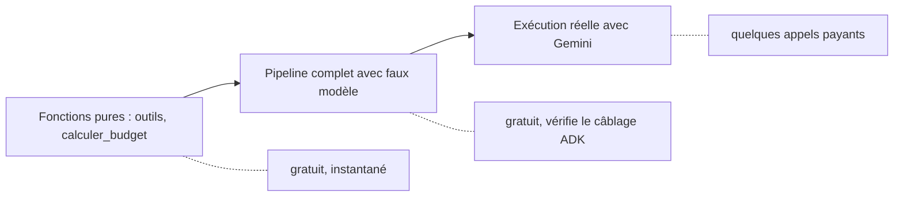

# Tester sans clé, exécuter pour de vrai, exploiter

> [!NOTE]
> Dans cette leçon, vous allez tester tout le pipeline sans clé d'API grâce à un faux modèle, l'exécuter avec Gemini, puis le servir en HTTP avec `adk api_server` et voir ce qu'il faudrait changer pour passer en production.

## 1. Trois niveaux de tests



| Niveau | Ce qu'il prouve | Clé d'API ? |
| --- | --- | --- |
| Fonctions pures | les filtres et le calcul du budget sont justes | non |
| Faux modèle | l'état circule bien : `output_key`, injection `{cle}`, ordre des agents | non |
| Exécution réelle | les instructions suffisent au vrai modèle | oui |

## 2. Un faux modèle pour ADK

Un modèle, pour ADK, est un objet qui hérite de `BaseLlm` et implémente `generate_content_async`. Notre faux modèle rejoue un **script** : un tuple = un appel d'outil, une chaîne = une réponse texte. Il mémorise aussi l'instruction système reçue, pour vérifier l'injection d'état.

```python title="files/test_agent.py (faux modèle)"
class FauxModele(BaseLlm):
    model: str = "faux"
    script: list = []
    vus: list = []  # instructions système reçues

    async def generate_content_async(self, llm_request, stream=False):
        self.vus.append(llm_request.config.system_instruction)
        item = self.script.pop(0)
        part = (types.Part(function_call=types.FunctionCall(name=item[0], args=item[1]))
                if isinstance(item, tuple) else types.Part(text=item))
        yield LlmResponse(content=types.Content(role="model", parts=[part]))
```

Comme `construire(model)` accepte une **fonction nom d'agent → modèle**, on donne un faux modèle différent à chaque agent :

```python title="files/test_agent.py (pipeline)"
def test_pipeline_complet_avec_faux_modele():
    modeles, fabrique = faux(itineraire())
    etat = asyncio.run(a.planifier(a.DEMANDE_EXEMPLE, agent=a.construire(fabrique)))
    assert etat["transport"] == "T2 à 96 EUR" and etat["hebergement"] == "H2 à 98 EUR"
    # l'assembleur a reçu les sorties des 3 agents dans son instruction
    assert "T2 à 96 EUR" in modeles["assembleur"].vus[-1] and "A1, A2" in modeles["assembleur"].vus[-1]
    assert etat["controle_budget"]["total"] == 626 and etat["controle_budget"]["respecte"]
```

> [!TIP]
> Avec le faux modèle, les outils sont **vraiment exécutés** par ADK : le test vérifie donc aussi que les noms et les arguments des outils correspondent aux fonctions Python.

```quiz
question: "Le test du pipeline avec faux modèle passe. Qu'est-ce qu'il ne prouve PAS ?"
options:
  - "Que l'assembleur reçoit bien les sorties des 3 spécialistes"
  - "Que Gemini choisira des options qui tiennent dans le budget"
  - "Que le contrôle budgétaire lit l'itinéraire dans l'état"
answer: 1
explanation: "Le faux modèle répond ce qu'on lui dicte. La qualité des choix du vrai modèle ne se vérifie qu'avec une exécution réelle (et, à plus grande échelle, un jeu d'évaluation)."
```

## 3. Lancer les tests et l'exécution réelle

```bash title="terminal"
cd files
python -m venv .venv && . .venv/bin/activate
pip install -r requirements.txt
pytest -q                          # sans clé
cp .env.example .env               # puis mettez votre vraie clé dans .env
python agent.py                    # exécution réelle (5 à 8 appels au modèle)
```

> [!WARNING]
> Le code lit la clé dans l'environnement ou dans `.env` (via `python-dotenv`) : n'écrivez jamais la clé dans `agent.py` et ajoutez `.env` à votre `.gitignore`. En cas d'erreur 429 (quota) ou 503 (surcharge), `planifier()` réessaie jusqu'à 4 fois avec une attente croissante.

## 4. Servir le pipeline en HTTP

Les commandes `adk web` (interface de développement) et `adk api_server` (API REST) attendent un **dossier par agent**, qui est un package Python exposant `root_agent` :

```bash title="terminal"
mkdir -p apps/voyage && cp files/agent.py files/donnees.py apps/voyage/
echo "from . import agent" > apps/voyage/__init__.py
cd apps && adk api_server --port 8000 .
```

Le pipeline a besoin d'un **état initial** (`demande`, `voyageurs`, `nuits`, `budget_max`). On le passe à la création de la session, puis on envoie le message :

```bash title="terminal (deuxième fenêtre)"
curl -s -X POST localhost:8000/apps/voyage/users/u1/sessions -H 'Content-Type: application/json' \
  -d '{"state": {"demande": "2 voyageurs, Lyon vers Lisbonne, 3 nuits, culture et gastronomie, 900 euros",
                 "voyageurs": 2, "nuits": 3, "budget_max": 900}}'
# -> {"id": "<SESSION_ID>", ...}
curl -s -X POST localhost:8000/run -H 'Content-Type: application/json' \
  -d '{"appName": "voyage", "userId": "u1", "sessionId": "<SESSION_ID>",
       "newMessage": {"role": "user", "parts": [{"text": "Planifie ce voyage."}]}}'
```

```quiz
question: "Vous ouvrez adk web et envoyez directement un message, sans créer la session avec un état. Que risque-t-il de se passer ?"
options:
  - "Rien de spécial, ADK devine nuits et budget_max"
  - "Une erreur KeyError : l'instruction cite {demande} et {budget_max}, absents de l'état"
  - "Le ParallelAgent s'exécute en séquentiel"
answer: 1
explanation: "L'injection {cle} exige que la clé existe (sauf {cle?}). Il faut créer la session avec son état, comme le fait planifier() ou l'appel POST /sessions."
```

## 5. Vers la production

| Sujet | Dans le lab | En production |
| --- | --- | --- |
| Données | catalogue Python fictif | API de réservation réelles, derrière les **mêmes** outils |
| Sessions | `InMemoryRunner` (perdues à l'arrêt) | service de session persistant (base SQL ou Vertex AI) |
| Budget | vérifié, simplement signalé | boucle de replanification (exercice de la leçon 3) |
| Hébergement | poste local | Cloud Run ou Vertex AI Agent Engine, modèle via Vertex AI |
| Suivi | `print` des événements | traces OpenTelemetry, coût par demande |

## Exercice : tester le dépassement de budget

Écrivez un test qui fait choisir à l'assembleur (faux modèle) `T1`, `H1` et les activités `A3` et `A2`, et vérifiez que le verdict final est négatif. Combien coûte cet itinéraire ?

<details>
<summary>Voir la solution</summary>

```python title="files/test_agent.py (ajout)"
def test_pipeline_signale_le_depassement():
    _, fabrique = faux(itineraire("T1", "H1", ("A3", "A2")))
    etat = asyncio.run(a.planifier(a.DEMANDE_EXEMPLE, agent=a.construire(fabrique)))
    v = etat["controle_budget"]
    assert v["total"] == 2 * 189 + 3 * 145 + 2 * (79 + 45) == 1061
    assert not v["respecte"]
```

1061 EUR : 378 de transport, 435 d'hôtel, 248 d'activités, soit 161 EUR au-dessus du budget.

</details>

## Résultat obtenu

Tests sans clé (2026-10-15) :

```text title="pytest -v"
test_agent.py::test_outils_filtrent_le_catalogue PASSED
test_agent.py::test_budget_recalcule_depuis_le_catalogue PASSED
test_agent.py::test_identifiant_invente_refuse PASSED
test_agent.py::test_pipeline_complet_avec_faux_modele PASSED
============================== 4 passed in 1.27s ===============================
```

Exécution réelle via `adk api_server` le même jour (`gemini-3.5-flash`) : 11 événements, dont les auteurs montrent les branches parallèles entrelacées puis la séquence finale.

```text title="POST /run (auteurs des événements, dernier texte)"
11 événements
['transport', 'transport', 'activites', 'activites', 'hebergement', 'hebergement', 'hebergement',
 'transport', 'activites', 'assembleur', 'controle_budget']
Budget OK : 800 EUR pour 900 EUR max. Détail : {'transport': 192, 'hebergement': 294, 'activites': 314}
```

## Je sais faire

- [ ] J'écris un faux modèle `BaseLlm` qui rejoue des appels d'outils et des réponses
- [ ] Je teste le câblage d'un pipeline ADK sans clé d'API
- [ ] Je lance un vrai test de bout en bout et je lis les événements
- [ ] Je sers un agent avec `adk api_server` en créant la session avec son état initial
