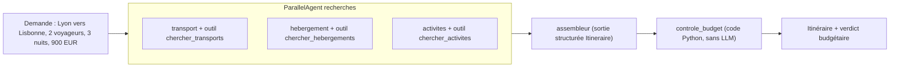

Organiser un déplacement, c'est trois recherches **indépendantes** (comment y aller, où dormir, quoi faire) suivies d'un travail d'**assemblage** et d'une **vérification** du budget. C'est exactement la forme d'un pipeline multi-agents : on parallélise ce qui est indépendant, on enchaîne ce qui dépend du reste, et on confie au code ce qui doit être exact.

Dans ce lab, vous construisez ce pipeline avec **Google ADK** (Agent Development Kit, le framework open source de Google pour écrire des agents en Python) et un modèle **Gemini** appelé avec une simple clé d'API. Les données (vols, hôtels, activités) sont **fictives** et servies par des outils Python : tout tourne sur votre poste.

## Ce que vous allez construire

- **Un `ParallelAgent`** lance les trois spécialistes en même temps ; chacun écrit son résultat dans l'**état de session** (un dictionnaire partagé).
- **Un assembleur** lit ces trois résultats et produit un itinéraire **validé par un schéma Pydantic**.
- **Un agent personnalisé** (`BaseAgent`) recalcule le coût à partir du catalogue, jamais à partir des chiffres écrits par le modèle.

## Pour qui ?

- Développeurs Python à l'aise avec `async`/`await`, les dictionnaires et `pip`.
- Vous avez déjà écrit un agent ADK simple avec un outil (sinon, commencez par un lab ADK de niveau intermédiaire).

## Prérequis

- Python 3.10 ou plus récent, `pip install -r files/requirements.txt` (google-adk 2.10.0).
- Une clé d'API Gemini créée dans Google AI Studio, placée dans un fichier `.env` (modèle : [.env.example](./files/.env.example)).
- Aucune connaissance de Google Cloud n'est nécessaire.

## Programme

| Module | Leçon | Ce que vous faites |
| --- | --- | --- |
| 1. Cas d'usage et architecture | Pourquoi un pipeline parallèle puis séquentiel | Découper le problème, choisir les agents de workflow |
| 2. Construire pas à pas | Outils et agents de recherche en parallèle | Écrire les outils, les 3 spécialistes, `output_key` |
| 2. Construire pas à pas | Assembleur structuré et contrôle du budget | `output_schema`, injection d'état, `BaseAgent` déterministe |
| 3. Tester, évaluer, exploiter | Tester sans clé, exécuter pour de vrai, exploiter | Faux modèle, test réel, `adk web`, pistes de production |

## En local ou sur GCP ?

| | En local (ce lab) | Sur Google Cloud (pour aller plus loin) |
| --- | --- | --- |
| Modèle | Gemini via clé d'API (`GOOGLE_GENAI_USE_VERTEXAI=FALSE`) | Gemini via Vertex AI (`GOOGLE_GENAI_USE_VERTEXAI=TRUE` + projet) |
| Exécution | `python agent.py` ou `adk web` | Cloud Run ou Vertex AI Agent Engine |
| Données | Catalogue fictif en Python | Vos API de réservation réelles derrière les mêmes outils |
| Coût | Quelques appels au modèle | Appels au modèle + hébergement |

Le code ne change pas entre les deux : seules les variables d'environnement changent.

## Le code

Tout est dans le dossier `files/` : [agent.py](./files/agent.py), [donnees.py](./files/donnees.py), [test_agent.py](./files/test_agent.py), [requirements.txt](./files/requirements.txt).
