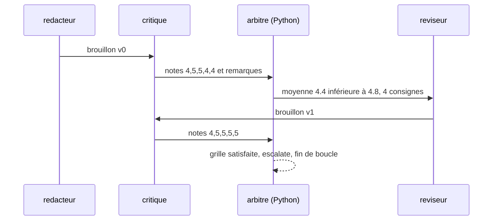

# La boucle générer, critiquer, réviser

> [!NOTE]
> Dans cette leçon, vous allez comprendre pourquoi une boucle rédacteur ↔ critique améliore un texte, définir une grille de qualité utilisable par une machine, et choisir une condition d'arrêt qui ne dépend pas de la bonne volonté du modèle.

## Le besoin

Une équipe commerciale rédige des dizaines d'offres par mois à partir de briefs courts : l'entreprise, l'offre, la cible, le problème du client, l'action attendue. Elle veut un premier texte **publiable**, pas un brouillon à reprendre entièrement. Ses exigences sont connues : clair, concret, une seule action à la fin, un ton professionnel, sans faute, lisible sur un téléphone.

## L'idée : séparer celui qui écrit de celui qui juge

L'article *Self-Refine* (Madaan et al., 2023) a montré qu'un modèle qui **critique** son propre texte puis le **révise** produit souvent une meilleure version que son premier jet. On sépare ici les rôles en agents distincts : chacun a une instruction courte et focalisée.



| Rôle | Type d'agent | Pourquoi ce choix |
| --- | --- | --- |
| Rédacteur | LLM, modèle léger | un premier jet n'a pas besoin du modèle le plus cher |
| Critique | LLM, sortie structurée | des notes chiffrées, exploitables par du code |
| Arbitre | `BaseAgent` en Python | la décision d'arrêter doit être **prévisible** |
| Réviseur | LLM, modèle léger | applique des consignes précises |

## Une grille qu'une machine peut appliquer

Une bonne grille mélange deux types de critères :

1. **Jugés par le modèle** (subjectifs, notés de 1 à 5) : clarté, concret, appel à l'action, ton, correction de la langue.
2. **Mesurés par le code** (objectifs, vrai ou faux) : nombre de mots entre 90 et 150, aucun mot interdit (« révolutionnaire », « leader »…), présence des mentions obligatoires (le prix exact, le lien de réservation).

> [!TIP]
> Tout ce qui peut être **mesuré** doit l'être en code. Un LLM compte mal les mots et peut « oublier » qu'une mention est obligatoire ; une expression régulière, jamais.

```quiz
question: "Lequel de ces critères faut-il vérifier en code plutôt que par le critique LLM ?"
options:
  - "Le texte est chaleureux sans être familier"
  - "Le texte contient exactement « 89 EUR HT »"
  - "L'appel à l'action est convaincant"
answer: 1
explanation: "La présence d'une chaîne exacte se vérifie avec un simple test « in ». Les deux autres demandent un jugement : c'est le rôle du critique."
```

## Quand arrêter la boucle ?

Une boucle sans condition d'arrêt fiable coûte cher et peut ne jamais finir. Il en faut **deux** :

- **Arrêt sur succès** : la grille est satisfaite (chaque note ≥ 4, moyenne ≥ 4,8, tous les contrôles en code passent).
- **Arrêt de sécurité** : un nombre maximal de tours (`max_iterations=4`). Atteint, on rend le dernier texte **marqué non validé**, pour relecture humaine.

Dans ADK, un `LoopAgent` répète ses sous-agents dans l'ordre et s'arrête dès qu'un événement porte `actions.escalate = True`, ou quand `max_iterations` est atteint. Il y a deux façons de produire cet événement :

| Méthode | Qui décide ? | Avantage | Limite |
| --- | --- | --- | --- |
| Outil intégré `exit_loop` donné à un agent LLM | le modèle | une ligne de code | le modèle peut l'appeler trop tôt, ou jamais |
| Agent `BaseAgent` qui émet `escalate=True` | votre code | décision prévisible et testable | quelques lignes de plus |

Le lab utilise la seconde ; l'exercice de la leçon 3 vous fait écrire la première.

> [!WARNING]
> Un critique LLM a tendance à être **indulgent** avec un texte bien tourné : lors de nos essais, il a validé plusieurs premiers jets dès le tour 1 avec un seuil de moyenne à 4,5. C'est pour cela que la grille combine un seuil exigeant et des contrôles en code. Calibrez vos seuils sur quelques exemples avant de faire confiance à la boucle.

```quiz
question: "La boucle atteint max_iterations sans que la grille soit satisfaite. Que doit faire le système ?"
options:
  - "Publier le dernier texte, puisqu'il a été révisé 4 fois"
  - "Relancer automatiquement la boucle avec max_iterations=8"
  - "Rendre le dernier texte avec un statut « non validé » pour qu'un humain tranche"
answer: 2
explanation: "max_iterations est une sécurité de coût, pas un gage de qualité. Le texte final n'a pas passé la grille : on le signale (valide=False) et un humain décide."
```

## Exercice : écrire la grille d'un autre contenu

Vous adaptez la boucle à des **fiches produit** pour une boutique en ligne. Proposez 4 critères jugés par le modèle et 3 contrôles en code.

<details>
<summary>Voir la solution</summary>

Critères jugés (1 à 5) :

- **exactitude** : aucune caractéristique absente de la fiche technique ;
- **bénéfice client** : chaque caractéristique est traduite en usage ;
- **lisibilité** : phrases courtes, une idée par phrase ;
- **ton de marque** : conforme au guide éditorial fourni.

Contrôles en code :

- longueur entre 60 et 120 mots ;
- la référence produit et le prix apparaissent tels quels ;
- aucune allégation interdite (« garanti à vie », « médical », etc.).

</details>

## Résultat obtenu

Trace réelle du 2026-10-15 (`gemini-3.5-flash-lite` pour écrire, `gemini-3.5-flash` pour critiquer) : le premier jet est refusé, la révision est validée au tour 2.

```text title="python agent.py (extrait)"
  [redacteur] Expert-comptable, ne laissez pas une panne informatique paralyser votre cabinet en pleine période fiscale ! ...
  [critique] {"clarte":4,"concret":5,"appel_action":5,"ton":4,"correction":4,"remarques":["Corriger la faute d'élision dans 'en cas de incident' ...
  [arbitre] Tour 1 : 4 consigne(s)
  [reviseur] Expert-comptable, ne laissez pas une panne informatique paralyser votre cabinet en période fiscale ! ...
  [critique] {"clarte":4,"concret":5,"appel_action":5,"ton":5,"correction":5,"remarques":[...]}
  [arbitre] Tour 2 : VALIDÉ
```

## Je sais faire

- [ ] J'explique pourquoi séparer rédacteur, critique et arbitre
- [ ] Je construis une grille qui mélange critères jugés et contrôles mesurés
- [ ] Je prévois un arrêt sur succès ET un arrêt de sécurité
- [ ] Je compare `exit_loop` et un arbitre déterministe
