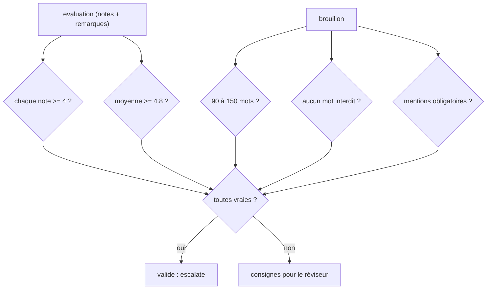

# La grille et l'arbitre

> [!NOTE]
> Dans cette leçon, vous allez écrire la grille de qualité en Python, le schéma de sortie du critique, la fonction `arbitrer()` qui transforme des notes en consignes, et l'agent `Arbitre` qui arrête la boucle avec `escalate=True`.

## 1. La grille, en données

La grille n'est pas cachée dans un prompt : c'est un **dictionnaire** Python. Le même objet sert à écrire l'instruction du critique et à fabriquer les consignes du réviseur.

```python title="files/agent.py (grille)"
CRITERES = {
    "clarte": "Le lecteur comprend l'offre en une lecture ; phrases courtes, pas de jargon.",
    "concret": "Bénéfices chiffrés ou exemples précis tirés du brief, pas de promesses vagues.",
    "appel_action": "Une seule action claire et facile pour le lecteur à la fin.",
    "ton": "Professionnel et chaleureux, vouvoiement, pas de superlatifs creux.",
    "correction": "Orthographe, grammaire et accords irréprochables.",
}
SEUIL = 4                          # note minimale (sur 5) pour CHAQUE critère
MOYENNE_MIN = 4.8                  # et moyenne minimale sur l'ensemble des critères
MOTS_MIN, MOTS_MAX = 90, 150       # longueur attendue : lisible sur un écran de téléphone
MOTS_INTERDITS = ["révolutionnaire", "incroyable", "leader", "n°1", "meilleur du marché"]
MENTIONS_OBLIGATOIRES = ["89 EUR HT", "nimbus.example/audit"]  # prix exact et lien de réservation du brief
```

## 2. Le critique répond dans un schéma

Avec `output_schema`, la réponse du critique est validée par Pydantic : chaque note est un entier entre 1 et 5 (`Field(ge=1, le=5)`), sinon ADK lève une erreur de validation au lieu de laisser passer un « 4/5 » en texte libre.

```python title="files/agent.py (schéma du critique)"
class Evaluation(BaseModel):
    clarte: int = Field(ge=1, le=5)
    concret: int = Field(ge=1, le=5)
    appel_action: int = Field(ge=1, le=5)
    ton: int = Field(ge=1, le=5)
    correction: int = Field(ge=1, le=5)
    remarques: list[str] = Field(description="Corrections précises et actionnables, une par problème")
```

```quiz
question: "Pourquoi donner un output_schema au critique plutôt que lui demander « une note sur 5 » en texte ?"
options:
  - "Parce qu'un texte libre coûte plus de tokens"
  - "Pour que l'arbitre lise des entiers fiables dans state[\"evaluation\"] sans analyser du texte"
  - "Parce que LoopAgent n'accepte que des sous-agents avec output_schema"
answer: 1
explanation: "La sortie structurée donne un dictionnaire validé (clarte: 4, ...). L'arbitre peut alors comparer des nombres. LoopAgent, lui, accepte n'importe quel sous-agent."
```

## 3. `arbitrer()` : de la note à la consigne

```python title="files/agent.py (arbitrer)"
def arbitrer(evaluation: dict, texte: str) -> tuple[bool, list[str]]:
    consignes = [f"{c} : note {evaluation.get(c, 0)}/5 < {SEUIL}. {CRITERES[c]}"
                 for c in CRITERES if evaluation.get(c, 0) < SEUIL]
    moyenne = sum(evaluation.get(c, 0) for c in CRITERES) / len(CRITERES)
    if moyenne < MOYENNE_MIN:
        consignes.append(f"moyenne : {moyenne:.1f}/5 < {MOYENNE_MIN}. Traitez en priorité les remarques ci-dessous.")
    nb_mots = len(re.findall(r"\w+", texte))
    if not MOTS_MIN <= nb_mots <= MOTS_MAX:
        consignes.append(f"longueur : {nb_mots} mots, il en faut entre {MOTS_MIN} et {MOTS_MAX}.")
    consignes += [f"mot interdit : « {m} »" for m in MOTS_INTERDITS if m in texte.lower()]
    consignes += [f"mention obligatoire absente : « {m} »" for m in MENTIONS_OBLIGATOIRES if m not in texte]
    if consignes:  # les remarques du critique ne comptent que si la grille n'est pas satisfaite
        consignes += evaluation.get("remarques", [])
    return not consignes, consignes
```

Trois décisions de conception :

- **Une note manquante vaut 0** (`evaluation.get(c, 0)`) : un critère oublié fait échouer la grille, il ne passe pas en silence.
- **Les consignes sont des phrases** : le réviseur les reçoit telles quelles. Une consigne qui rappelle la définition du critère est plus utile qu'un simple « clarté : 3 ».
- **Les remarques du critique s'ajoutent seulement en cas d'échec** : un critique trouve *toujours* quelque chose à redire ; ce n'est pas une raison de boucler encore.



## 4. L'agent `Arbitre`

```python title="files/agent.py (Arbitre)"
class Arbitre(BaseAgent):
    async def _run_async_impl(self, ctx: InvocationContext) -> AsyncGenerator[Event, None]:
        s = ctx.session.state
        ok, consignes = arbitrer(s.get("evaluation") or {}, s.get("brouillon", ""))
        tours = s.get("tours", 0) + 1
        historique = s.get("historique", []) + [{"tour": tours, "evaluation": s.get("evaluation"), "valide": ok}]
        texte = f"Tour {tours} : {'VALIDÉ' if ok else f'{len(consignes)} consigne(s)'}"
        yield Event(author=self.name, invocation_id=ctx.invocation_id,
                    content=types.Content(role="model", parts=[types.Part(text=texte)]),
                    actions=EventActions(escalate=ok, state_delta={
                        "consignes": "\n".join(f"- {c}" for c in consignes),
                        "tours": tours, "historique": historique, "valide": ok}))
```

`EventActions(escalate=ok)` est la condition d'arrêt. Dans le code source de `LoopAgent` (ADK 2.10), la boucle lit chaque événement de ses sous-agents et sort dès que `event.actions.escalate` est vrai : le réviseur, placé **après** l'arbitre, n'est donc pas appelé quand le texte est validé.

> [!TIP]
> L'outil intégré `google.adk.tools.exit_loop` fait exactement la même chose, mais depuis un agent LLM : son code met `tool_context.actions.escalate = True` (et `skip_summarization = True` pour ne pas relancer le modèle après l'appel). Vous l'utiliserez dans l'exercice de la leçon suivante.

```quiz
question: "Dans la boucle [critique, arbitre, reviseur], l'arbitre émet escalate=True au tour 2. Combien de fois le réviseur a-t-il été appelé ?"
options:
  - "0"
  - "1"
  - "2"
answer: 1
explanation: "Tour 1 : critique, arbitre (non validé), reviseur. Tour 2 : critique, arbitre (validé, escalate) et la boucle s'arrête avant le réviseur. Le test test_boucle_s_arrete_des_que_la_grille_est_satisfaite le vérifie."
```

## Exercice : un contrôle de phrases trop longues

Ajoutez à `arbitrer()` un contrôle en code : aucune phrase ne doit dépasser 25 mots. La consigne doit citer le début de la phrase fautive.

<details>
<summary>Voir la solution</summary>

```python title="files/agent.py (ajout dans arbitrer)"
MOTS_PAR_PHRASE_MAX = 25

for phrase in re.split(r"(?<=[.!?])\s+", texte):
    n = len(re.findall(r"\w+", phrase))
    if n > MOTS_PAR_PHRASE_MAX:
        consignes.append(f"phrase trop longue ({n} mots) : « {phrase[:40]}… » ; coupez-la en deux.")
```

Ajoutez un test : un texte valide par ailleurs mais avec une phrase de 30 mots doit renvoyer `ok == False` et une consigne qui commence par « phrase trop longue ».

</details>

## Résultat obtenu

Tests sans clé (2026-10-15), dont celui de la grille :

```text title="pytest -v"
test_agent.py::test_grille_valide_et_refuse PASSED
test_agent.py::test_boucle_s_arrete_des_que_la_grille_est_satisfaite PASSED
test_agent.py::test_boucle_bornee_par_max_iterations PASSED
============================== 3 passed in 1.27s ===============================
```

Évaluation réelle du premier jet par `gemini-3.5-flash` le même jour : chaque note est au moins à 4, mais la moyenne (4,4) est sous 4,8. Résultat : 4 consignes (la moyenne plus 3 remarques du critique).

```text title="historique, tour 1"
{'tour': 1, 'evaluation': {'clarte': 4, 'concret': 5, 'appel_action': 5, 'ton': 4, 'correction': 4,
 'remarques': ["Corriger la faute d'élision dans 'en cas de incident' en écrivant 'en cas d'incident'.", ...]},
 'valide': False}
```

## Je sais faire

- [ ] Je décris une grille de qualité sous forme de données Python
- [ ] Je contrains les notes d'un critique LLM avec un schéma Pydantic
- [ ] J'écris une fonction d'arbitrage testable qui produit des consignes
- [ ] J'arrête un `LoopAgent` en émettant un événement `escalate=True`
