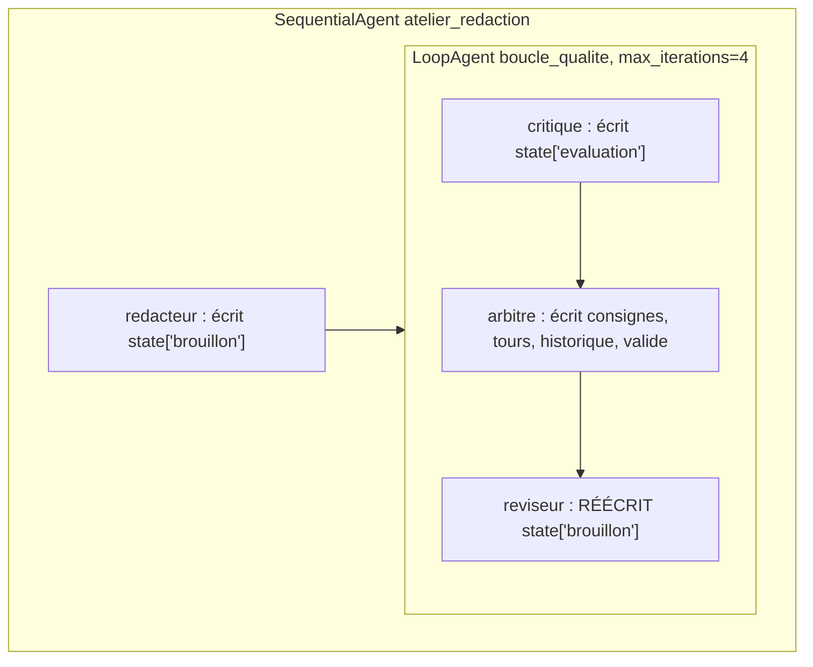

# Le LoopAgent complet

> [!NOTE]
> Dans cette leçon, vous allez écrire le rédacteur, le critique et le réviseur, contrôler ce que chacun voit avec `include_contents="none"`, assembler le tout dans un `SequentialAgent` qui contient un `LoopAgent`, et choisir un modèle différent selon le rôle.

## 1. L'assemblage

```python title="files/agent.py (construire)"
def construire(model=None) -> SequentialAgent:
    m = model if callable(model) else (lambda nom: model or (MODEL_REDACTEUR if nom != "critique" else MODEL))
    redacteur = Agent(name="redacteur", model=m("redacteur"), output_key="brouillon", include_contents="none", ...)
    critique = Agent(name="critique", model=m("critique"), output_schema=Evaluation, output_key="evaluation",
                     include_contents="none", ...)
    reviseur = Agent(name="reviseur", model=m("reviseur"), output_key="brouillon", include_contents="none", ...)
    boucle = LoopAgent(name="boucle_qualite", max_iterations=MAX_TOURS,
                       sub_agents=[critique, Arbitre(name="arbitre"), reviseur])
    return SequentialAgent(name="atelier_redaction", sub_agents=[redacteur, boucle])
```



Le rédacteur et le réviseur écrivent **la même clé** `brouillon` : c'est voulu. Chaque révision remplace la précédente, et le critique du tour suivant lit toujours la dernière version. L'historique des notes, lui, est conservé par l'arbitre dans `historique`.

## 2. Ce que chaque agent voit : `include_contents="none"`

Par défaut, un agent LLM reçoit l'**historique de la conversation** (les messages et réponses des agents précédents). Dans une boucle, cet historique grossit à chaque tour : coût en hausse, et un critique qui relit les anciennes versions risque de les confondre avec la nouvelle.

Avec `include_contents="none"`, l'agent ne reçoit que son instruction. On lui passe exactement ce dont il a besoin par **injection d'état** :

```python title="files/agent.py (critique et réviseur)"
critique = Agent(
    name="critique", ..., include_contents="none",
    instruction=f"Tu es un relecteur exigeant. Note ce texte de 1 à 5 sur chaque critère :\n{GRILLE}\n"
                "Sois sévère : 5 = rien à améliorer. Donne des remarques concrètes (quoi changer, où).\n"
                "BRIEF :\n{brief}\n\nTEXTE À ÉVALUER :\n{brouillon}")
reviseur = Agent(
    name="reviseur", ..., include_contents="none",
    instruction="Réécris le texte en appliquant TOUTES les consignes, sans rien inventer hors du brief. "
                f"Réponds uniquement par le nouveau texte ({MOTS_MIN} à {MOTS_MAX} mots, texte brut).\n"
                "BRIEF :\n{brief}\n\nCONSIGNES :\n{consignes}\n\nTEXTE ACTUEL :\n{brouillon}")
```

> [!WARNING]
> Attention au mélange f-string et injection ADK. Dans une **f-string**, Python remplace `{MOTS_MIN}` tout de suite ; pour laisser `{brief}` à ADK, il faut doubler les accolades : `{{brief}}` (c'est le cas dans l'instruction du rédacteur). Dans une chaîne normale, `{brief}` est laissé tel quel et ADK le remplace à l'exécution.

| Agent | Voit l'historique ? | Reçoit par l'état |
| --- | --- | --- |
| redacteur | non | `brief` |
| critique | non | `brief`, `brouillon` |
| arbitre (Python) | lit l'état directement | `evaluation`, `brouillon`, `tours`, `historique` |
| reviseur | non | `brief`, `consignes`, `brouillon` |

```quiz
question: "Que se passerait-il si le critique gardait include_contents par défaut ?"
options:
  - "Rien : un critique ne lit jamais l'historique"
  - "Il recevrait les brouillons et évaluations des tours précédents, ce qui augmente le coût et peut fausser sa note"
  - "ADK refuserait, car output_schema impose include_contents=\"none\""
answer: 1
explanation: "L'historique contient les versions précédentes : le prompt grossit à chaque tour et le critique peut juger un mélange. La combinaison output_schema + include_contents par défaut reste autorisée."
```

## 3. Un modèle par rôle

```python title="files/agent.py (modèles)"
MODEL = os.environ.get("MODEL", "gemini-3.5-flash")
MODEL_REDACTEUR = os.environ.get("MODEL_REDACTEUR", "gemini-3.5-flash-lite")  # brouillons : modèle léger
```

Le rédacteur et le réviseur utilisent le modèle léger, le critique le modèle principal. Raisonnement : écrire selon des consignes précises est une tâche plus simple que juger finement un texte. Les noms viennent de variables d'environnement : vous pouvez tout passer sur un seul modèle sans toucher au code.

## 4. Lancer

```python title="files/agent.py (rediger)"
session = await runner.session_service.create_session(
    app_name="redaction", user_id="u1", state={"brief": brief})
msg = types.Content(role="user", parts=[types.Part(text="Rédige l'offre décrite dans le brief.")])
```

Le brief est placé dans l'état à la création de la session ; le message utilisateur ne sert qu'à déclencher l'exécution.

```quiz
question: "Avec MAX_TOURS=4, combien d'appels au modèle au maximum pour une offre ?"
options:
  - "4"
  - "9 : 1 rédacteur + 4 critiques + 4 réviseurs"
  - "12"
answer: 1
explanation: "Le rédacteur tourne une fois. Chaque tour appelle le critique puis, si la grille n'est pas satisfaite, le réviseur. L'arbitre est du code : 0 appel. Au pire 1 + 4 × 2 = 9."
```

## Exercice : la variante avec `exit_loop`

Remplacez l'arbitre Python par l'outil intégré `exit_loop` : un critique **sans** `output_schema`, qui appelle `exit_loop` quand le texte lui convient, et sinon répond par ses remarques (rangées dans `state["consignes"]`).

<details>
<summary>Voir la solution</summary>

```python title="variante_exit_loop.py"
from google.adk.agents import Agent, LoopAgent
from google.adk.tools import exit_loop

critique = Agent(
    name="critique", model=MODEL, tools=[exit_loop], output_key="consignes", include_contents="none",
    instruction=f"Évalue ce texte selon la grille :\n{GRILLE}\n"
                "Si CHAQUE critère mérite au moins 4/5, appelle l'outil exit_loop et ne réponds rien d'autre. "
                "Sinon, réponds uniquement par la liste des corrections à faire.\n"
                "TEXTE :\n{brouillon}")
boucle = LoopAgent(name="boucle_qualite", max_iterations=4, sub_agents=[critique, reviseur])
```

Nous avons vérifié ce mécanisme avec un faux modèle : au 2ᵉ tour, l'appel à `exit_loop` produit un événement `escalate=True` et le réviseur n'est plus appelé. Inconvénients par rapport à l'arbitre : la décision dépend du modèle (il peut valider trop tôt), et les contrôles de longueur ou de mentions obligatoires ne sont plus garantis. Un compromis courant : garder l'arbitre Python **et** donner `exit_loop` au critique seulement pour les cas où il estime le brief impossible à satisfaire.

</details>

## Résultat obtenu

Texte final réel (2026-10-15), validé au tour 2 :

```text title="python agent.py (=== TEXTE FINAL ===)"
Expert-comptable, ne laissez pas une panne informatique paralyser votre cabinet en période fiscale ! Vos saisies
ne peuvent pas attendre. Avec le contrat « Sérénité » d'Atelier Nimbus, PME de maintenance informatique à Nantes,
sécurisez votre infrastructure.

Notre offre s'adresse aux structures de 5 à 20 postes. Pour 89 EUR HT par poste et par mois, elle inclut la
supervision de vos équipements, la gestion de vos sauvegardes et une intervention sur site garantie sous 4 heures
ouvrées en cas d'incident. Profitez d'une formule flexible, sans engagement au-delà de 12 mois.

Anticipez les risques techniques qui menacent votre productivité. Réservez un audit gratuit de 30 minutes sur
nimbus.example/audit pour protéger l'activité de votre cabinet.

Tours : 2 | validé : True
```

Les deux mentions obligatoires sont présentes, et aucun chiffre n'a été inventé hors du brief.

## Je sais faire

- [ ] J'imbrique un `LoopAgent` dans un `SequentialAgent`
- [ ] J'utilise `include_contents="none"` et l'injection d'état pour contrôler ce que voit chaque agent
- [ ] Je distingue `{{cle}}` (f-string) et `{cle}` (chaîne normale) dans une instruction
- [ ] Je sais remplacer l'arbitre par l'outil `exit_loop` et j'en connais les limites
