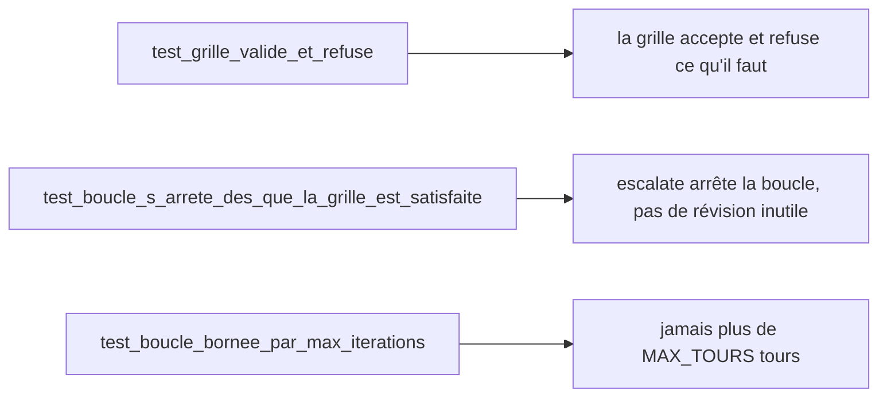

# Tester, mesurer, exploiter

> [!NOTE]
> Dans cette leçon, vous allez tester la boucle sans clé d'API (arrêt sur succès, arrêt de sécurité), l'exécuter avec Gemini, lire son historique pour mesurer ce que chaque tour apporte, et préparer son exploitation.

## 1. Ce qu'il faut prouver



Les trois propriétés qui comptent dans une boucle : **elle juge juste**, **elle s'arrête quand c'est bon**, **elle s'arrête toujours**.

## 2. Des faux modèles qui comptent leurs appels

```python title="files/test_agent.py (faux modèle)"
class FauxModele(BaseLlm):
    model: str = "faux"
    script: list = []
    appels: int = 0

    async def generate_content_async(self, llm_request, stream=False):
        self.appels += 1
        yield LlmResponse(content=types.Content(role="model", parts=[types.Part(text=self.script.pop(0))]))
```

Le critique « répond » des notes en JSON, comme le ferait Gemini avec le schéma :

```python title="files/test_agent.py (arrêt sur succès)"
def test_boucle_s_arrete_des_que_la_grille_est_satisfaite():
    modeles, f = faux([note(3), note(5)], ["v1 " + TEXTE_OK, "jamais utilisé"])
    etat = asyncio.run(a.rediger("brief", agent=a.construire(f)))
    assert etat["valide"] and etat["tours"] == 2
    assert etat["brouillon"].startswith("v1")
    assert modeles["reviseur"].appels == 1             # pas de réécriture après validation
    assert [h["valide"] for h in etat["historique"]] == [False, True]
```

```python title="files/test_agent.py (arrêt de sécurité)"
def test_boucle_bornee_par_max_iterations():
    n = a.MAX_TOURS
    modeles, f = faux([note(2)] * n, [f"v{i} " + TEXTE_OK for i in range(1, n + 1)])
    etat = asyncio.run(a.rediger("brief", agent=a.construire(f)))
    assert not etat["valide"] and etat["tours"] == n and modeles["critique"].appels == n
```

> [!TIP]
> Si un faux modèle est appelé une fois de trop, `script.pop(0)` lève `IndexError` : le test échoue bruyamment. C'est une façon gratuite de détecter une boucle qui ne s'arrête pas.

```quiz
question: "Dans test_boucle_bornee_par_max_iterations, que vaut etat[\"valide\"] et pourquoi ?"
options:
  - "True, car le texte a été révisé MAX_TOURS fois"
  - "False, car la grille n'a jamais été satisfaite : la boucle s'est arrêtée sur max_iterations"
  - "None, car l'arbitre n'est pas appelé au dernier tour"
answer: 1
explanation: "Le critique donne 2/5 à chaque tour : l'arbitre ne valide jamais. LoopAgent s'arrête après MAX_TOURS, et valide reste False : le texte doit passer par un humain."
```

## 3. Exécution réelle

```bash title="terminal"
cd files && pip install -r requirements.txt
pytest -q                     # sans clé
cp .env.example .env          # mettez votre clé dans .env
python agent.py               # 3 à 9 appels au modèle
```

## 4. Mesurer avec l'historique

L'arbitre range chaque tour dans `state["historique"]`. Sur plusieurs briefs, c'est votre tableau de bord :

| Indicateur | Comment le calculer | Ce qu'il révèle |
| --- | --- | --- |
| Taux de validation | part des exécutions avec `valide=True` | grille trop dure si trop bas |
| Tours moyens | moyenne de `tours` | coût : 2 × tours appels si validé, 1 + 2 × tours sinon |
| Gain par tour | différence de moyenne des notes entre tours | utile de boucler ? |
| Validé au tour 1 | part des premiers jets acceptés | grille trop indulgente si proche de 100 % |

> [!WARNING]
> Le juge et le rédacteur sont des modèles de la même famille : ce n'est pas une évaluation indépendante. Pour calibrer la grille, faites noter **les mêmes textes** par deux ou trois relecteurs humains et vérifiez que les notes du critique vont dans le même sens avant d'automatiser la publication.

```quiz
question: "Sur 50 briefs, 49 textes sont validés dès le tour 1. Que conclure en priorité ?"
options:
  - "Le rédacteur est parfait, on peut supprimer la boucle"
  - "La grille est probablement trop indulgente : à recalibrer avec des notes humaines"
  - "Il faut augmenter max_iterations"
answer: 1
explanation: "Une boucle qui ne boucle jamais ne sert à rien. Soit le premier jet est vraiment excellent (à confirmer par des humains), soit le seuil est trop bas. C'est ce qui nous est arrivé avec une moyenne minimale à 4,5."
```

## 5. Exploiter

- **Brief en entrée, texte et historique en sortie** : stockez les deux. L'historique explique pourquoi un texte a été accepté.
- **Statut non validé** : envoyez-le dans une file de relecture humaine plutôt que de le publier.
- **Mentions obligatoires** : dans le lab elles sont en dur ; en production, mettez-les dans le brief (`state["mentions"]`) et lisez-les dans `arbitrer()`.
- **Sur Google Cloud** : le même pipeline tourne sur Cloud Run ou Vertex AI Agent Engine avec `GOOGLE_GENAI_USE_VERTEXAI=TRUE`, sans modifier le code.

## Exercice : rendre les mentions obligatoires paramétrables

Modifiez le code pour que les mentions obligatoires viennent de l'état de session (`state["mentions"]`, une liste) au lieu de la constante.

<details>
<summary>Voir la solution</summary>

```python title="files/agent.py (modifications)"
def arbitrer(evaluation: dict, texte: str, mentions: list[str]) -> tuple[bool, list[str]]:
    ...
    consignes += [f"mention obligatoire absente : « {m} »" for m in mentions if m not in texte]
    ...

# dans Arbitre._run_async_impl
ok, consignes = arbitrer(s.get("evaluation") or {}, s.get("brouillon", ""), s.get("mentions", []))

# dans rediger()
state={"brief": brief, "mentions": mentions}
```

Pensez à mettre à jour les appels à `arbitrer()` dans `test_agent.py`.

</details>

## Résultat obtenu

Tests sans clé (2026-10-15) :

```text title="pytest -v"
test_agent.py::test_grille_valide_et_refuse PASSED
test_agent.py::test_boucle_s_arrete_des_que_la_grille_est_satisfaite PASSED
test_agent.py::test_boucle_bornee_par_max_iterations PASSED
============================== 3 passed in 1.27s ===============================
```

Historique de l'exécution réelle du même jour : 2 tours, 4 appels au modèle (1 rédacteur, 2 critiques, 1 réviseur ; l'arbitre est du code). La moyenne passe de 4,4 à 4,8 ; seul le critère `clarte` reste à 4.

```text title="python agent.py (historique)"
{'tour': 1, 'evaluation': {'clarte': 4, 'concret': 5, 'appel_action': 5, 'ton': 4, 'correction': 4, ...}, 'valide': False}
{'tour': 2, 'evaluation': {'clarte': 4, 'concret': 5, 'appel_action': 5, 'ton': 5, 'correction': 5, ...}, 'valide': True}
```

## Je sais faire

- [ ] Je teste l'arrêt sur succès et l'arrêt de sécurité d'une boucle sans clé d'API
- [ ] Je compte les appels d'un faux modèle pour détecter une boucle qui tourne trop
- [ ] J'exploite l'historique pour mesurer le taux de validation et le coût par texte
- [ ] Je route les textes non validés vers une relecture humaine
