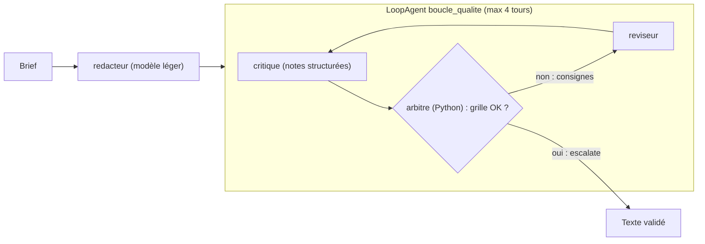

Un premier jet écrit par un modèle est souvent correct… et rarement excellent. Les rédacteurs humains le savent : on écrit, on relit avec une grille, on corrige, on recommence. Ce lab automatise ce cycle avec **Google ADK** : un agent **rédacteur**, un agent **critique** qui note le texte sur une grille, un **arbitre** écrit en Python qui décide s'il faut continuer, et un **réviseur** qui applique les consignes. Le tout dans un `LoopAgent`, avec une limite stricte de tours.

Fil rouge : une **offre commerciale** pour une entreprise fictive (contrat de maintenance informatique), à partir d'un brief de quelques lignes. Le même code sert pour un article, une fiche produit ou un e-mail : seuls le brief et la grille changent.

## Ce que vous allez construire

- **Une grille de qualité** : 5 critères notés de 1 à 5 par le critique, plus des contrôles **mesurables** faits en code (longueur, mots interdits, mentions obligatoires).
- **Une condition d'arrêt explicite** : l'arbitre émet un événement `escalate=True`, le mécanisme que `LoopAgent` surveille (c'est aussi ce que fait l'outil intégré `exit_loop`).
- **Un historique** de chaque tour (notes, validé ou non) pour comprendre et améliorer la grille.

## Pour qui ?

- Développeurs Python qui ont déjà écrit un agent ADK avec `output_key`.
- Équipes marketing ou communication qui veulent industrialiser une relecture, avec des règles explicites.

## Prérequis

- Python 3.10+, `pip install -r files/requirements.txt` (google-adk 2.10.0).
- Une clé d'API Gemini dans un fichier `.env` (modèle : [.env.example](./files/.env.example)).

## Programme

| Module | Leçon | Ce que vous faites |
| --- | --- | --- |
| 1. Cas d'usage et architecture | La boucle générer, critiquer, réviser | Grille, conditions d'arrêt, risques d'une boucle |
| 2. Construire pas à pas | La grille et l'arbitre | `output_schema` du critique, `arbitrer()`, `escalate` |
| 2. Construire pas à pas | Le LoopAgent complet | Rédacteur, réviseur, `include_contents="none"`, `exit_loop` |
| 3. Tester, évaluer, exploiter | Tester, mesurer, exploiter | Faux modèles, exécution réelle, coût par tour |

## En local ou sur GCP ?

| | En local (ce lab) | Sur Google Cloud |
| --- | --- | --- |
| Modèles | Gemini via clé d'API : `gemini-3.5-flash-lite` (brouillons) et `gemini-3.5-flash` (critique) | Les mêmes via Vertex AI (`GOOGLE_GENAI_USE_VERTEXAI=TRUE`) |
| Exécution | `python agent.py` | Cloud Run ou Vertex AI Agent Engine |
| Brief | une chaîne dans le code | formulaire ou outil de CRM, même fonction `rediger()` |

## Le code

Dans le dossier `files/` : [agent.py](./files/agent.py) (pipeline et grille), [test_agent.py](./files/test_agent.py) (3 tests sans clé), [requirements.txt](./files/requirements.txt).
