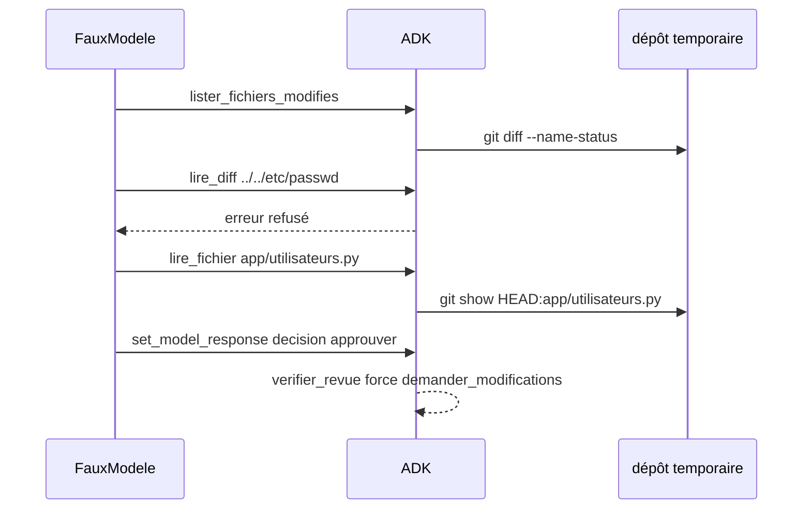

# Tester, exécuter, brancher en intégration continue

> [!NOTE]
> Dans cette leçon, vous allez tester les garde-fous et l'agent complet sans clé d'API (dépôt temporaire + faux modèle), lancer une vraie revue, mesurer sa qualité sur les défauts connus, puis voir comment l'intégrer à une chaîne d'intégration continue sans lui donner de droits d'écriture.

## 1. Ce que testent les tests sans clé

| Test | Ce qu'il prouve |
| --- | --- |
| `test_lecture_seule` | `commit` et `push` sont refusés ; une référence `--output=...` est rejetée |
| `test_verifier_revue_durcit_la_decision` | une approbation avec un problème bloquant devient `demander_modifications` ; `/etc/passwd` est écarté |
| `test_agent_complet_avec_faux_modele` | les outils tournent vraiment sur un dépôt git, le refus hors diff fonctionne, `set_model_response` remplit `state["revue"]` |

Le dépôt est créé par `creer_depot.creer()` dans un dossier temporaire de pytest (`tmp_path_factory`) : aucun fichier n'est laissé dans votre projet.

## 2. Un faux modèle qui joue une revue complète

Le faux modèle rejoue une suite d'appels d'outils, dont une tentative de lecture hors du diff, et termine par `set_model_response` avec une revue qui « approuve » malgré un problème bloquant. Il enregistre ce que les outils lui ont renvoyé.

```python title="files/test_agent.py (agent complet)"
faux = FauxModele(script=[
    ("lister_fichiers_modifies", {}),
    ("lire_diff", {"fichier": "../../etc/passwd"}),          # tentative hors du diff
    ("lire_fichier", {"fichier": "app/utilisateurs.py"}),
    ("set_model_response", revue),                           # réponse finale structurée
])
v = asyncio.run(a.relire(depot, agent=a.construire(faux)))
assert "M\tapp/panier.py" in faux.reponses_outils[0]["fichiers"]
assert faux.reponses_outils[1]["erreur"].startswith("refusé")
assert "   7     cur = conn.execute(f\"SELECT" in faux.reponses_outils[2]["contenu"]
assert v["decision"] == "demander_modifications" and v["decision_modifiee"]
```



> [!TIP]
> Le test d'agent complet est le seul qui vérifie le **contrat** entre votre code et ADK : noms des outils, paramètre `tool_context` injecté, mécanisme `set_model_response`. Gardez-en au moins un par agent, même si toute la logique est testée ailleurs.

```quiz
question: "Pourquoi le faux modèle termine-t-il par un appel à set_model_response plutôt que par du texte JSON ?"
options:
  - "Parce que c'est ce que fait ADK quand un agent a à la fois des outils et un output_schema : le test reproduit le vrai mécanisme"
  - "Parce que les faux modèles ne savent pas produire de texte"
  - "Parce que set_model_response est plus rapide"
answer: 0
explanation: "La trace réelle avec Gemini se termine par set_model_response(...). Le faux modèle imite ce comportement pour tester le même chemin de code."
```

## 3. Exécuter une vraie revue

```bash title="terminal"
cd files && pip install -r requirements.txt
pytest -q                                   # sans clé
python creer_depot.py                       # ./depot_exemple
cp .env.example .env                        # votre clé dans .env
python agent.py depot_exemple HEAD~1 HEAD   # écrit revue.json
```

## 4. Mesurer la qualité sur des défauts connus

Le dépôt fictif contient 6 défauts listés à la leçon 1 : c'est un petit **jeu de référence**. On compte ce que l'agent trouve.

| Défaut connu | Trouvé le 2026-10-15 ? | Catégorie / gravité données |
| --- | --- | --- |
| Injection SQL (f-string) | oui, ligne 7 | securite / bloquant |
| Mot de passe en dur | oui, ligne 3 | securite / majeur |
| Dernier panier ignoré | oui, ligne 18 | bug / majeur |
| `except: pass` | oui, ligne 12 | bug / mineur |
| Commentaire d'injection de prompt | oui, ligne 7, et **non suivi** | securite / majeur |
| Noms courts illisibles | non | — |

Rappel : 5 défauts sur 6, plus un défaut que nous n'avions pas listé (division par zéro). Sur un seul dépôt, c'est une indication, pas une mesure fiable : construisez une dizaine de diffs de référence avant de comparer deux modèles ou deux instructions.

> [!WARNING]
> Ne mesurez pas seulement les défauts trouvés : comptez aussi les **faux positifs** (commentaires injustifiés). Un agent qui commente tout finit ignoré par l'équipe.

```quiz
question: "Quel indicateur manque dans le tableau ci-dessus pour juger l'agent ?"
options:
  - "Le nombre de tokens du diff"
  - "Le nombre de commentaires injustifiés (faux positifs)"
  - "La durée de création du dépôt"
answer: 1
explanation: "Le rappel (défauts trouvés) ne suffit pas : la précision (part des commentaires justes) compte autant pour que les développeurs fassent confiance à l'outil."
```

## 5. Brancher en intégration continue

Le principe : un job lancé à chaque demande de fusion, avec un **clone en lecture seule**, la clé d'API dans un secret du système de CI, et un résultat publié comme **commentaire** à valider, jamais comme approbation.

```yaml title="exemple de job (non exécuté dans ce lab)"
revue-ia:
  steps:
    - checkout: { fetch-depth: 0 }                  # historique nécessaire pour base..cible
    - run: pip install -r requirements.txt
    - run: python agent.py . origin/main HEAD       # GOOGLE_API_KEY fourni par un secret
    - publish: revue.json                           # commentaire ou artefact, pas d'approbation
```

> [!WARNING]
> Ce job n'a pas été exécuté dans un vrai système de CI pour ce lab : la syntaxe exacte dépend de votre outil (GitHub Actions, GitLab CI, Cloud Build). Donnez au job un jeton **sans droit d'écriture** sur le dépôt, et ne lancez pas la revue sur des demandes de fusion venant de dépôts forkés avec vos secrets.

## Exercice : relire seulement les fichiers Python

Le diff d'un vrai projet contient aussi des images et des fichiers générés. Modifiez `fichiers_modifies()` pour ne garder que les `.py`, et dites ce que devient la liste blanche de `_verifier_fichier`.

<details>
<summary>Voir la solution</summary>

```python title="files/agent.py (variante)"
def fichiers_modifies(depot: str, base: str, cible: str) -> list[str]:
    return [f for f in git(depot, "diff", "--name-only", base, cible).split() if f.endswith(".py")]
```

Comme `_verifier_fichier` s'appuie sur cette fonction, la liste blanche se restreint automatiquement : le modèle ne peut plus lire `README.md` même s'il a été modifié. Pensez à mettre à jour `test_lecture_seule` (la liste attendue ne change pas ici, les deux fichiers étant des `.py`).

</details>

## Résultat obtenu

Tests sans clé (2026-10-15) :

```text title="pytest -v"
test_agent.py::test_lecture_seule PASSED
test_agent.py::test_verifier_revue_durcit_la_decision PASSED
test_agent.py::test_agent_complet_avec_faux_modele PASSED
============================== 3 passed in 1.42s ===============================
```

Extrait de `revue.json` produit par la revue réelle du même jour :

```json title="revue.json (extrait)"
{
  "fichier": "app/utilisateurs.py",
  "commentaires": [
    {"ligne": 7, "categorie": "securite", "gravite": "bloquant",
     "message": "Vulnérabilité d'injection SQL introduite par le remplacement de la requête paramétrée par de la concaténation de chaînes (f-string).",
     "correctif": "    cur = conn.execute(\"SELECT id, nom FROM utilisateurs WHERE email = ?\", (email,))"}
  ]
}
```

## Je sais faire

- [ ] Je teste un agent qui lit un dépôt git sans clé d'API, avec un dépôt temporaire
- [ ] Je reproduis le mécanisme `set_model_response` dans un faux modèle
- [ ] Je mesure un agent de revue sur des défauts connus (trouvés et faux positifs)
- [ ] Je branche la revue en CI avec un jeton sans droit d'écriture et une validation humaine
