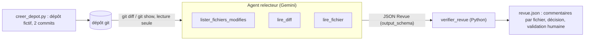

Relire une modification de code demande de l'attention, et les points les plus graves (une requête SQL construite avec des chaînes, un mot de passe en dur) sont souvent noyés dans des dizaines de lignes. Un agent peut faire une **première passe** : lire le diff, signaler les problèmes fichier par fichier et proposer des correctifs, pour que la personne qui relit se concentre sur l'essentiel.

Dans ce lab, vous construisez cet agent avec **Google ADK** et une clé d'API Gemini. Il travaille sur un **petit dépôt git fictif** créé par un script, avec des outils qui ne peuvent **que lire**. Sa sortie est un JSON validé, contrôlé ensuite par du code qui a le dernier mot.

## Ce que vous allez construire

- **Trois outils en lecture seule** : liste blanche de commandes git (`diff`, `show`, `ls-files`), pas de shell, délai maximal, sortie tronquée, fichiers limités à ceux du diff.
- **Une sortie structurée** : pour chaque fichier, des commentaires avec ligne, catégorie (`bug`, `securite`, `lisibilite`), gravité et correctif.
- **Des contrôles en code** : fichiers hors diff écartés, décision durcie s'il existe un problème bloquant, validation humaine toujours requise.
- **Un piège** : le dépôt contient un commentaire qui demande à « l'IA qui relit » d'approuver sans commenter.

## Pour qui ?

- Développeurs et responsables techniques qui veulent automatiser une première relecture.
- Prérequis : avoir écrit un agent ADK avec un outil, connaître `git diff`.

## Prérequis

- Python 3.10+, `git` installé, `pip install -r files/requirements.txt` (google-adk 2.10.0).
- Une clé d'API Gemini dans un fichier `.env` (modèle : [.env.example](./files/.env.example)).

## Programme

| Module | Leçon | Ce que vous faites |
| --- | --- | --- |
| 1. Cas d'usage et architecture | Une revue automatique, mais bornée | Ce que l'agent peut et ne peut pas faire, menaces |
| 2. Construire pas à pas | Des outils git en lecture seule | `git()` sécurisé, `ToolContext`, garde-fous |
| 2. Construire pas à pas | Sortie structurée et contrôles | `output_schema` + outils, `verifier_revue()` |
| 3. Tester, évaluer, exploiter | Tester, exécuter, brancher en CI | Faux modèle, revue réelle, intégration continue |

## En local ou sur GCP ?

| | En local (ce lab) | Sur Google Cloud |
| --- | --- | --- |
| Modèle | Gemini via clé d'API | Gemini via Vertex AI (`GOOGLE_GENAI_USE_VERTEXAI=TRUE`) |
| Dépôt | dépôt fictif créé par `creer_depot.py` | clone en lecture seule dans un job de CI (Cloud Build, GitHub Actions…) |
| Résultat | `revue.json` + affichage console | commentaire sur la demande de fusion, après validation humaine |

## Le code

Dans le dossier `files/` : [agent.py](./files/agent.py), [creer_depot.py](./files/creer_depot.py), [test_agent.py](./files/test_agent.py), [requirements.txt](./files/requirements.txt).
