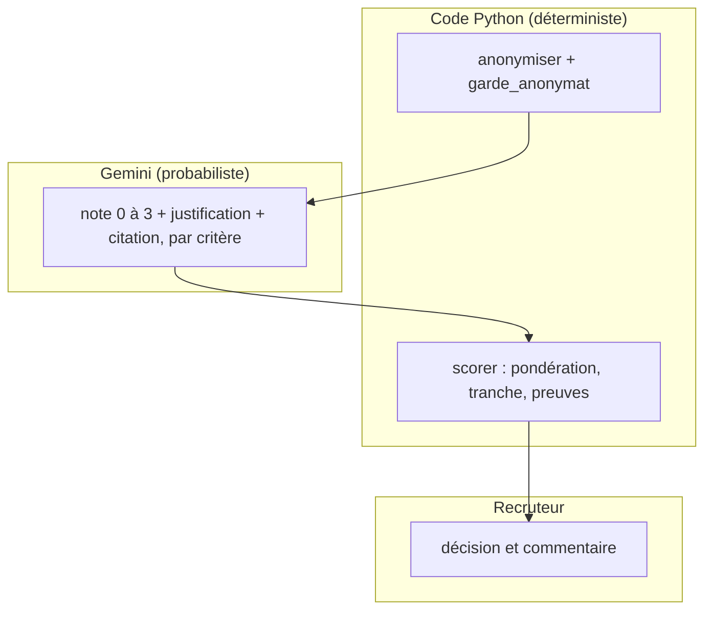

# Un outil d'aide, pas de décision

> [!NOTE]
> Dans cette leçon, vous allez cadrer ce qu'un assistant de présélection a le droit de faire, identifier les sources de biais (attributs sensibles et leurs « proxies »), découvrir les données fictives du lab et l'architecture qui sépare le jugement du modèle de la décision humaine.

## Le besoin

Une équipe de recrutement reçoit des dizaines de candidatures pour un poste de développeur back-end Python. Elle veut un outil qui, pour chaque CV :

- note chaque critère de la fiche de poste et **justifie** sa note par une citation du CV ;
- propose des **questions à poser en entretien** ;
- trie les dossiers pour que les recruteurs lisent d'abord les plus pertinents.

Elle ne veut **pas** d'un outil qui rejette des candidats automatiquement.

## Ce qui peut mal tourner

Un **attribut sensible** est une caractéristique qui ne doit pas influencer la décision (et dont l'usage discriminatoire est interdit par la loi) : genre, âge, origine, nationalité, situation familiale, adresse, etc. Un **proxy** est une information apparemment neutre qui permet de deviner un attribut sensible.

| Information du CV | Attribut sensible deviné | Traitement dans le lab |
| --- | --- | --- |
| Nom, prénom | genre, origine | retiré (identité) et remplacé par `[NOM]` dans le texte |
| Date de naissance | âge | retirée |
| Situation familiale, adresse, nationalité | famille, origine | retirées |
| « Développeuse », « diplômée » | genre | ramené à une forme unique |
| Loisirs (« parents d'élèves ») | situation familiale | section entière non transmise |
| Langues (« wolof », « vietnamien ») | origine | **transmise** : limite discutée plus bas |
| Années de diplôme | âge | **transmises** : limite discutée plus bas |

```quiz
question: "Lequel de ces éléments est un « proxy » d'un attribut sensible ?"
options:
  - "« 5 ans d'expérience en FastAPI »"
  - "« Bénévole dans une association de parents d'élèves »"
  - "« Tests automatisés avec pytest »"
answer: 1
explanation: "Cette activité révèle indirectement la situation familiale. Les deux autres informations décrivent des compétences liées au poste."
```

> [!WARNING]
> Retirer le nom ne suffit pas. Un modèle peut déduire le genre d'un accord grammatical, l'âge d'une année de diplôme, l'origine d'une langue parlée. L'anonymisation réduit le risque ; seule une **mesure** (leçon 4) dit si elle suffit.

## Le principe : le modèle juge, le code compte, l'humain décide



| Étape | Qui | Pourquoi |
| --- | --- | --- |
| Retirer les attributs sensibles | code | doit être garanti et vérifiable |
| Lire le CV et noter chaque critère | modèle | comprendre un texte libre |
| Pondérer, calculer le score | code | règle connue, identique pour tous |
| Vérifier les citations | code | détecter une justification inventée |
| Décider | humain | responsabilité, contexte, droit des candidats |

```quiz
question: "Pourquoi le score global est-il calculé en Python plutôt que demandé au modèle ?"
options:
  - "Parce que Gemini ne sait pas multiplier"
  - "Pour que la même pondération, connue et documentée, s'applique à tous les candidats"
  - "Pour économiser un appel au modèle"
answer: 1
explanation: "Un score demandé au modèle mélange critères et impressions de façon opaque. Calculé en code, il découle des notes par critère avec des poids publiés : on peut l'expliquer à un candidat."
```

## Les données fictives

[cvs.json](../files/cvs.json) contient 6 CV inventés, avec une partie `identite` (nom, genre, date de naissance, nationalité, situation familiale, adresse, contacts) et des `sections` (titre, expérience, compétences, formation, langues, loisirs). [fiche_poste.json](../files/fiche_poste.json) décrit 5 critères pondérés :

| Critère | Poids | Attendu |
| --- | --- | --- |
| `python_backend` | 3 | au moins 3 ans de Python côté serveur (API REST) |
| `bases_donnees` | 2 | SQL, bases relationnelles, migrations |
| `cloud_devops` | 2 | Docker, intégration continue, cloud |
| `qualite` | 2 | tests automatisés, revue de code |
| `communication` | 1 | documentation, équipe, anglais écrit |

[reference.json](../files/reference.json) contient l'appréciation d'un recruteur fictif (fort, moyen, faible), écrite **avant** de lancer le modèle : c'est la base de comparaison de la leçon 4.

> [!TIP]
> Écrire la référence humaine avant de voir les sorties du modèle évite de « s'aligner » inconsciemment sur lui. Notez-la, datez-la, ne la modifiez plus.

## Exercice : compléter la fiche de risques

Pour le critère `communication` (« anglais technique écrit »), quel risque de biais voyez-vous, et comment le limiter ?

<details>
<summary>Voir la solution</summary>

- **Risque** : le modèle peut valoriser une langue maternelle ou un parcours à l'étranger (proxy d'origine), ou pénaliser une formulation maladroite en français alors que le critère porte sur l'anglais écrit.
- **Limiter** : rédiger un attendu **observable** (« a rédigé de la documentation technique en anglais »), exiger une citation comme preuve, donner un poids faible (1) au critère, et vérifier en entretien plutôt que sur le CV.

</details>

## Résultat obtenu

Texte réellement envoyé au modèle pour le CV C3 le 2026-10-15 (après anonymisation) : plus de nom, de contact, de loisirs ni d'accord féminin (« ingénieure » devient « ingénieur »). La langue « vietnamien » est encore là : c'est la limite assumée du lab.

```text title="anonymiser(C3)"
EXPERIENCE : 2024-2026 : ingénieur données dans un cabinet d'études fictif. Scripts Python (pandas) de nettoyage
de données, requêtes SQL sur PostgreSQL, tableaux de bord. Pas de développement d'API. Utilisation de Git en équipe.
COMPETENCES : Python, pandas, SQL, PostgreSQL, Git, notions de Docker.
FORMATION : Diplômé d'une école d'ingénieurs (2023).
LANGUES : Anglais courant, vietnamien.
```

## Je sais faire

- [ ] Je distingue un attribut sensible et un proxy, avec un exemple de chaque
- [ ] Je répartis les rôles : le modèle juge, le code compte, l'humain décide
- [ ] Je sais pourquoi le recrutement est un usage « à haut risque » au sens de l'AI Act
- [ ] Je prépare une référence humaine avant d'évaluer un modèle
