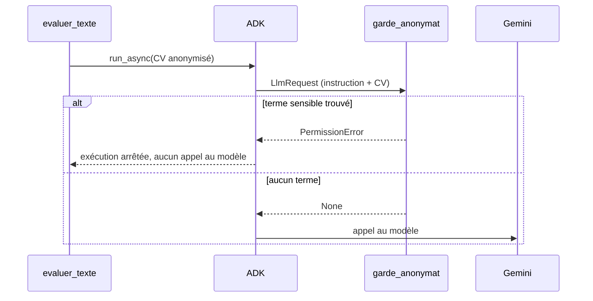

# Anonymiser et bloquer les fuites

> [!NOTE]
> Dans cette leçon, vous allez écrire une anonymisation par liste blanche, la liste des termes sensibles propres à chaque CV, et un `before_model_callback` ADK qui empêche l'appel au modèle si l'un de ces termes apparaît encore dans la requête.

## 1. Liste blanche plutôt que liste noire

Deux façons d'anonymiser :

| Approche | Principe | Risque |
| --- | --- | --- |
| Liste noire | on retire ce qu'on sait sensible (nom, âge…) | tout ce qu'on a oublié passe |
| **Liste blanche** | on ne garde que ce qui est utile au poste | on peut retirer un peu trop (on l'ajoute alors exprès) |

Le lab garde quatre sections, puis nettoie leur texte :

```python title="files/agent.py (anonymiser)"
SECTIONS_UTILES = ["experience", "competences", "formation", "langues"]  # ni titre, ni loisirs, ni identité
FORME_UNIQUE = {"développeuse": "développeur", "ingénieure": "ingénieur", "diplômée": "diplômé",
                "certifiée": "certifié", "référente": "référent"}


def anonymiser(cv: dict) -> str:
    ident = cv["identite"]
    texte = "\n".join(f"{s.upper()} : {cv['sections'][s]}" for s in SECTIONS_UTILES)
    for mot in ident["nom"].split():                                   # prénom et nom, où qu'ils soient
        texte = re.sub(rf"\b{re.escape(mot)}\b", "[NOM]", texte, flags=re.I)
    texte = re.sub(r"[\w.+-]+@[\w-]+\.[\w.]+", "[EMAIL]", texte)
    texte = re.sub(r"(?:\+33|0)\d(?:[ .]?\d{2}){4}", "[TEL]", texte)
    texte = re.sub(r"\b(Mme|Mlle|M\.|Madame|Monsieur)\s", "", texte)
    for f, m in FORME_UNIQUE.items():
        texte = re.sub(rf"\b{f}(s?)\b", rf"{m}\1", texte)
        texte = re.sub(rf"\b{f.capitalize()}(s?)\b", rf"{m.capitalize()}\1", texte)
    return texte
```

> [!WARNING]
> La table `FORME_UNIQUE` ne couvre que le vocabulaire des 6 CV du lab (le code le signale par un commentaire `Limite connue :`). Sur de vrais CV, les accords de genre sont partout (« passionnée », « motivée », « autonome »…). Il faut alors un outil de neutralisation plus complet, ou une relecture, et surtout le **test de permutation** de la leçon 4 pour mesurer ce qui reste.

```quiz
question: "Pourquoi la section « titre » n'est-elle pas transmise au modèle ?"
options:
  - "Parce qu'elle est trop longue"
  - "Parce qu'elle contient le nom et un intitulé genré (« Développeuse back-end »), sans information utile absente de l'expérience"
  - "Parce que le schéma EvaluationCV n'a pas de champ titre"
answer: 1
explanation: "Le titre répète le nom et l'intitulé du poste occupé, déjà décrit dans l'expérience. Le retirer supprime un proxy sans perte d'information."
```

## 2. Les termes qui ne doivent jamais passer

Pour chaque CV, on calcule la liste des valeurs sensibles **de ce CV précis** :

```python title="files/agent.py (termes_sensibles)"
def termes_sensibles(cv: dict) -> list[str]:
    """Ce qui ne doit JAMAIS atteindre le modèle."""
    i = cv["identite"]
    return [*i["nom"].split(), i["email"], i["telephone"], i["date_naissance"][:4], i["nationalite"],
            i["adresse"].split(",")[-1].strip(), i["situation_familiale"]]
```

Pour C1, cela donne par exemple : `Camille`, `Martin`, l'e-mail, le téléphone, `1991`, `française`, `44000 Nantes`, `mariée, 2 enfants`.

## 3. Le garde-fou : `before_model_callback`

Un **callback** ADK est une fonction que le framework appelle à un moment précis. `before_model_callback` est appelé juste **avant chaque appel au modèle**, avec la requête complète (`LlmRequest` : instruction système + messages). S'il renvoie `None`, l'appel a lieu ; s'il renvoie une réponse, l'appel est remplacé ; s'il lève une exception, l'exécution s'arrête.

```python title="files/agent.py (garde_anonymat)"
def garde_anonymat(callback_context: CallbackContext, llm_request: LlmRequest) -> LlmResponse | None:
    """before_model_callback : exécuté avant CHAQUE appel au modèle. Lever une exception arrête tout."""
    texte = str(llm_request.config.system_instruction or "") + " ".join(
        p.text or "" for c in llm_request.contents for p in c.parts or [])
    fuites = [t for t in callback_context.state.get("termes_sensibles", []) if t.lower() in texte.lower()]
    if fuites:
        raise PermissionError(f"appel bloqué, attributs sensibles présents : {fuites}")
    return None  # None = l'appel au modèle peut avoir lieu
```

Les termes sensibles sont placés dans l'**état de la session** à sa création, et lus par le callback via `callback_context.state` :

```python title="files/agent.py (evaluer_texte)"
session = await runner.session_service.create_session(
    app_name="cv", user_id="recruteur", state={"termes_sensibles": sensibles})
```



> [!TIP]
> Pourquoi vérifier **après** avoir anonymisé ? Parce que l'anonymisation est du code qui évolue : un jour, quelqu'un ajoutera la section « titre » ou oubliera un cas. Le callback est une **seconde ligne de défense**, indépendante, au point exact où les données quittent votre système.

```quiz
question: "On envoie par erreur le CV brut (non anonymisé) de C1 à evaluer_texte avec ses termes sensibles. Que se passe-t-il ?"
options:
  - "Le modèle reçoit le CV mais ignore le nom grâce à l'instruction"
  - "garde_anonymat trouve « Camille » dans la requête et lève PermissionError : Gemini n'est jamais appelé"
  - "ADK retire automatiquement les données personnelles"
answer: 1
explanation: "C'est exactement ce que vérifie test_garde_bloque_l_appel_si_fuite : l'exception est levée et le compteur d'appels du faux modèle reste à 0. ADK n'anonymise rien tout seul."
```

## Exercice : bloquer aussi les e-mails inconnus

`termes_sensibles` ne connaît que l'e-mail déclaré dans l'identité. Ajoutez au callback une vérification générique : bloquer toute requête qui contient une adresse e-mail, quelle qu'elle soit.

<details>
<summary>Voir la solution</summary>

```python title="files/agent.py (ajout dans garde_anonymat)"
EMAIL = re.compile(r"[\w.+-]+@[\w-]+\.[\w.]+")

if EMAIL.search(texte):
    raise PermissionError("appel bloqué : adresse e-mail présente dans la requête")
```

Ajoutez un test : un CV dont l'expérience contient « contact : x@example.org » doit être bloqué si l'on saute l'anonymisation, et passer après anonymisation (l'adresse y devient `[EMAIL]`).

</details>

## Résultat obtenu

Tests sans clé du 2026-10-15 : pour les 6 CV, aucun terme sensible ne subsiste après anonymisation, et le callback bloque bien un CV brut avant tout appel au modèle.

```text title="pytest -v (extrait)"
test_agent.py::test_aucun_attribut_sensible_apres_anonymisation[C1] PASSED
test_agent.py::test_aucun_attribut_sensible_apres_anonymisation[C2] PASSED
test_agent.py::test_aucun_attribut_sensible_apres_anonymisation[C3] PASSED
test_agent.py::test_aucun_attribut_sensible_apres_anonymisation[C4] PASSED
test_agent.py::test_aucun_attribut_sensible_apres_anonymisation[C5] PASSED
test_agent.py::test_aucun_attribut_sensible_apres_anonymisation[C6] PASSED
test_agent.py::test_garde_bloque_l_appel_si_fuite PASSED
```

## Je sais faire

- [ ] J'anonymise par liste blanche de sections, puis je nettoie le texte restant
- [ ] Je calcule les termes sensibles propres à chaque document
- [ ] J'écris un `before_model_callback` qui inspecte la requête et bloque l'appel
- [ ] Je passe des données au callback via l'état de session
