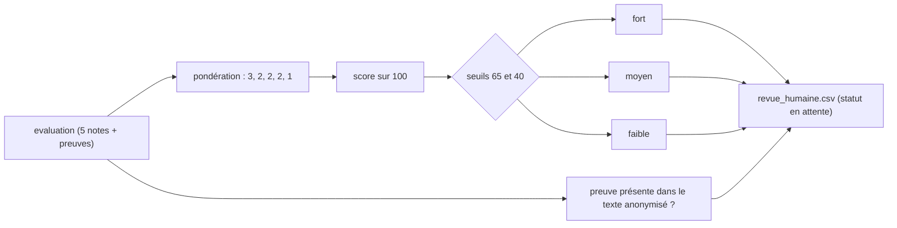

# Noter par critère, scorer en code

> [!NOTE]
> Dans cette leçon, vous allez définir la sortie structurée de l'évaluateur (une note, une justification et une citation par critère), écrire son instruction, puis calculer en Python le score pondéré, la tranche suggérée et la vérification des citations, avant d'écrire le fichier de revue humaine.

## 1. Une note par critère, avec sa preuve

```python title="files/agent.py (schéma)"
class NoteCritere(BaseModel):
    critere: Literal["python_backend", "bases_donnees", "cloud_devops", "qualite", "communication"]
    note: int = Field(ge=0, le=3, description="0 absent, 1 faible, 2 conforme, 3 au-delà de l'attendu")
    justification: str = Field(description="Une phrase factuelle")
    preuve: str = Field(description="Citation EXACTE et courte du CV, ou chaîne vide si rien")


class EvaluationCV(BaseModel):
    notes: list[NoteCritere]
    points_a_verifier: list[str] = Field(description="Questions à poser en entretien")
```

Une échelle courte (0 à 3) avec une définition par niveau donne des notes plus stables qu'une note sur 10 : le modèle hésite moins entre deux valeurs voisines.

```quiz
question: "À quoi sert le champ preuve, une citation exacte du CV ?"
options:
  - "À rendre la réponse plus longue"
  - "À permettre au code de vérifier que la note s'appuie sur un passage qui existe vraiment dans le CV transmis"
  - "À entraîner le modèle"
answer: 1
explanation: "Une citation se vérifie avec un simple test « est-ce une sous-chaîne ? ». Une justification sans preuve vérifiable peut être inventée."
```

## 2. L'instruction et l'agent

```python title="files/agent.py (instruction et agent)"
GRILLE = "\n".join(f"- {c['id']} (poids {c['poids']}) : {c['attendu']}" for c in FICHE["criteres"])
INSTRUCTION = f"""Tu aides un recruteur à PRÉSÉLECTIONNER des CV pour le poste : {FICHE['intitule']}.
Note chaque critère de 0 à 3 UNIQUEMENT à partir des compétences et expériences décrites :
{GRILLE}
Règles : une note par critère, une justification factuelle, une preuve citée mot pour mot du CV.
N'infère jamais l'âge, le genre, l'origine ou la situation familiale, et ne les utilise pas.
Tu ne décides pas : un humain relit chaque dossier."""


def construire(model=None) -> Agent:
    return Agent(name="evaluateur", model=model or MODEL, instruction=INSTRUCTION, output_schema=EvaluationCV,
                 output_key="evaluation", include_contents="default", before_model_callback=garde_anonymat,
                 generate_content_config=types.GenerateContentConfig(temperature=0))
```

> [!TIP]
> L'instruction est construite **à partir de la fiche de poste** : changer de poste, c'est changer un fichier JSON, pas le code. Gardez une copie datée de chaque version de fiche et d'instruction : en cas de contestation, il faut pouvoir dire avec quelles règles un dossier a été noté.

## 3. Le score, la tranche, les preuves : en Python

```python title="files/agent.py (scorer)"
def scorer(evaluation: dict, texte_anonyme: str) -> dict:
    poids = {c["id"]: c["poids"] for c in FICHE["criteres"]}
    notes = {n["critere"]: n for n in evaluation["notes"]}
    manquants = [c for c in poids if c not in notes]
    sans_preuve = [c for c, n in notes.items()
                   if n["note"] > 0 and (not n["preuve"] or n["preuve"].lower() not in texte_anonyme.lower())]
    score = round(100 * sum(poids[c] * notes[c]["note"] for c in poids if c in notes) / (3 * sum(poids.values())))
    tranche = "fort" if score >= 65 else "moyen" if score >= 40 else "faible"
    return {"score": score, "tranche": tranche, "criteres_manquants": manquants, "preuves_introuvables": sans_preuve,
            "statut": "en_attente_revue_humaine"}  # aucune décision automatique, jamais
```

Le score est la moyenne pondérée des notes, ramenée sur 100 :

$$
\text{score} = 100 \times \frac{\sum_c \text{poids}_c \times \text{note}_c}{3 \times \sum_c \text{poids}_c}
$$

Exemple réel (C5) : notes 3, 2, 3, 2, 3 avec les poids 3, 2, 2, 2, 1 donnent $(9 + 4 + 6 + 4 + 3) / 30 = 26/30$, soit **87**.

| Contrôle en code | Ce qu'il détecte | Effet |
| --- | --- | --- |
| `criteres_manquants` | un critère oublié par le modèle | compté 0, signalé au recruteur |
| `preuves_introuvables` | une note positive sans citation présente dans le CV | signalé dans la revue humaine |
| `statut` | — | toujours `en_attente_revue_humaine` |



```quiz
question: "Un CV obtient 3 sur tous les critères sauf communication (0). Quel est son score ?"
options:
  - "80"
  - "90"
  - "100"
answer: 1
explanation: "Somme pondérée : 3×3 + 2×3 + 2×3 + 2×3 + 1×0 = 27, sur un maximum de 3 × 10 = 30. 27/30 = 0,9, soit 90."
```

## 4. Le fichier de revue humaine

```python title="files/agent.py (ecrire_revue_humaine)"
w.writerow(["id", "score", "tranche_suggeree", "preuves_introuvables", "statut",
            "decision_recruteur", "commentaire_recruteur"])
for r in sorted(resultats, key=lambda r: -r["score"]):
    w.writerow([r["id"], r["score"], r["tranche"], ";".join(r["preuves_introuvables"]), r["statut"], "", ""])
```

Les colonnes `decision_recruteur` et `commentaire_recruteur` sont **vides** : c'est au recruteur de les remplir. La tranche est intitulée « suggérée ». Le tri sert à organiser la lecture, pas à couper la liste.

> [!WARNING]
> Ne transformez pas la tranche « faible » en refus automatique, même « pour gagner du temps ». Un candidat atypique (reconversion, parcours non linéaire) peut être mal noté par une grille pensée pour un parcours classique : c'est précisément ce que la relecture humaine doit rattraper.

## Exercice : un critère éliminatoire ?

Le service RH demande d'ajouter « éliminer automatiquement les CV avec moins de 2 sur `python_backend` ». Que répondez-vous, et que proposez-vous à la place ?

<details>
<summary>Voir la solution</summary>

Refuser l'élimination automatique : ce serait une décision produite par un système automatisé, à partir d'une note elle-même produite par un modèle, sans relecture. Proposer à la place :

- un **filtre d'affichage** (« montrer d'abord les dossiers avec `python_backend >= 2` ») qui ne supprime rien ;
- un champ « exigence non remplie » affiché au recruteur, avec la justification et la preuve du modèle ;
- un suivi : combien de dossiers « non prioritaires » ont finalement été retenus après lecture humaine (si ce nombre n'est pas nul, le filtre aurait éliminé de bons candidats).

</details>

## Résultat obtenu

Évaluation réelle de C3 le 2026-10-15 (`gemini-3.5-flash`, `temperature=0`) : chaque note est justifiée, chaque preuve est une citation exacte, et le critère sans élément reçoit 0 avec une preuve vide.

```json title="evaluer_cv(C3) (extrait)"
{"id": "C3", "score": 20, "tranche": "faible", "preuves_introuvables": [], "statut": "en_attente_revue_humaine",
 "evaluation": {"notes": [
   {"critere": "python_backend", "note": 0,
    "justification": "Le candidat n'a pas d'expérience en développement back-end Python ni en API, avec uniquement des scripts d'analyse de données.",
    "preuve": "Pas de développement d'API."},
   {"critere": "bases_donnees", "note": 1, "justification": "Expérience limitée aux requêtes SQL sur PostgreSQL, sans mention de modélisation ni de migrations.", "preuve": "requêtes SQL sur PostgreSQL"},
   {"critere": "qualite", "note": 0, "justification": "Aucune mention de tests automatisés, de pytest ou de démarche qualité dans le CV.", "preuve": ""}],
  "points_a_verifier": ["Motivation et capacité à monter en compétences sur le développement d'API REST et les frameworks Python (FastAPI/Django/Flask).", "..."]}}
```

Fichier de revue humaine produit par `python agent.py` le même jour :

```text title="revue_humaine.csv"
id,score,tranche_suggeree,preuves_introuvables,statut,decision_recruteur,commentaire_recruteur
C5,87,fort,,en_attente_revue_humaine,,
C1,83,fort,,en_attente_revue_humaine,,
C2,60,moyen,,en_attente_revue_humaine,,
C4,37,faible,,en_attente_revue_humaine,,
C3,20,faible,,en_attente_revue_humaine,,
C6,13,faible,,en_attente_revue_humaine,,
```

## Je sais faire

- [ ] Je décris une évaluation par critère avec note bornée, justification et preuve
- [ ] Je construis l'instruction à partir d'une fiche de poste versionnée
- [ ] Je calcule un score pondéré et des contrôles de preuves en Python
- [ ] Je produis un fichier de revue où la décision reste humaine
