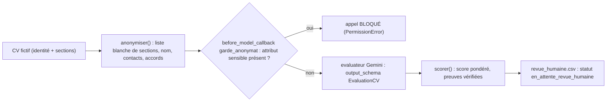

Trier des candidatures prend du temps, et un modèle de langage peut aider à lire vite et à **justifier** une première appréciation. Mais un outil de présélection peut aussi reproduire, à grande échelle, des discriminations liées au nom, au genre, à l'âge ou à l'origine. Ce lab construit un assistant **utile et contrôlé** : il note des CV **fictifs** critère par critère, ne voit jamais les attributs sensibles, cite ses preuves, et ne décide de rien.

> [!IMPORTANT]
> Dans l'Union européenne, les systèmes d'IA utilisés pour **trier ou filtrer des candidatures** figurent dans l'annexe III du règlement sur l'IA (AI Act) parmi les systèmes **à haut risque**, avec des obligations de gestion des risques, de qualité des données, de traçabilité et de contrôle humain. Ce lab est un exercice technique sur des données fictives, pas un dispositif conforme clé en main : faites valider tout usage réel par vos équipes juridique et RH et par vos instances représentatives.

## Ce que vous allez construire

- **Anonymisation par liste blanche** : seules les sections expérience, compétences, formation et langues passent ; le nom, les contacts et les accords grammaticaux de genre sont neutralisés.
- **Un callback qui bloque** l'appel au modèle si un attribut sensible du CV d'origine apparaît encore dans la requête.
- **Une sortie structurée** : une note de 0 à 3 et une justification **avec citation** par critère de la fiche de poste.
- **Le score et la tranche sont calculés en Python**, et chaque dossier reste **en attente de revue humaine**.
- **Une évaluation réelle** : accord avec un recruteur fictif et test de cohérence en permutant noms et genres.

## Pour qui ?

- Développeurs et équipes data qui conçoivent des outils RH, et toute personne qui veut voir concrètement ce que « contrôles d'équité » veut dire dans du code.
- Prérequis : un agent ADK avec `output_schema`, les bases de pytest.

## Prérequis

- Python 3.10+, `pip install -r files/requirements.txt` (google-adk 2.10.0).
- Une clé d'API Gemini dans un fichier `.env` (modèle : [.env.example](./files/.env.example)).

## Programme

| Module | Leçon | Ce que vous faites |
| --- | --- | --- |
| 1. Cas d'usage et architecture | Un outil d'aide, pas de décision | Risques, cadre, architecture, données fictives |
| 2. Construire pas à pas | Anonymiser et bloquer les fuites | Liste blanche, `before_model_callback` |
| 2. Construire pas à pas | Noter par critère, scorer en code | `output_schema`, preuves vérifiées, revue humaine |
| 3. Tester, évaluer, exploiter | Évaluer l'équité pour de vrai | Tests sans clé, permutations, accord avec un recruteur |

## En local ou sur GCP ?

| | En local (ce lab) | Sur Google Cloud |
| --- | --- | --- |
| Modèle | Gemini via clé d'API | Gemini via Vertex AI, données traitées dans la région choisie |
| Données | 6 CV fictifs en JSON | CV réels : base légale, information des candidats, durée de conservation |
| Traçabilité | `rapport_evaluation.json`, `revue_humaine.csv` | journalisation des versions de prompt, de modèle et des décisions humaines |

## Le code

Dans le dossier `files/` : [agent.py](./files/agent.py), [evaluation.py](./files/evaluation.py), [test_agent.py](./files/test_agent.py), [cvs.json](./files/cvs.json), [fiche_poste.json](./files/fiche_poste.json), [reference.json](./files/reference.json), [rapport_evaluation.json](./files/rapport_evaluation.json) (résultat réel), [requirements.txt](./files/requirements.txt).
