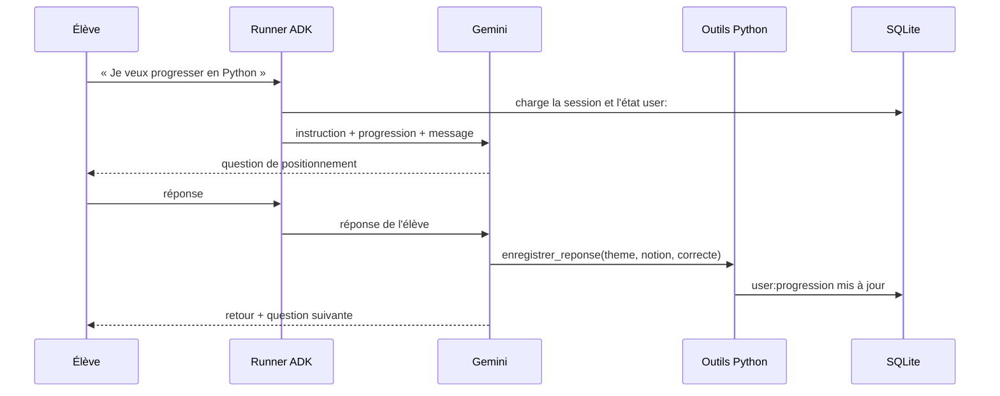

# Un tuteur adaptatif : besoin et architecture

> [!NOTE]
> Dans cette leçon, vous allez comprendre ce que doit faire un tuteur pédagogique, décider ce qui revient au modèle et ce qui revient au code, et découvrir les trois niveaux de mémoire d'ADK.

## Le besoin

Une équipe de formation interne veut un assistant qui fait réviser les nouvelles recrues (Python, SQL, outils maison). Trois exigences reviennent dans tous les entretiens :

1. **Évaluer** : ne pas assommer un expert de questions faciles, ni décourager un débutant.
2. **Adapter** : monter ou descendre la difficulté selon les réponses, pas au hasard.
3. **Se souvenir** : l'élève revient trois jours plus tard ; le tuteur doit connaître son niveau et ses points faibles.

Un LLM seul sait poser et corriger des questions. Il ne sait **pas** se souvenir d'une conversation fermée, et il n'applique pas une règle de progression de façon parfaitement régulière. C'est là qu'interviennent les outils et l'état de session.

## Qui fait quoi ?

| Tâche | Qui s'en charge | Pourquoi |
| --- | --- | --- |
| Rédiger une question adaptée au niveau | le modèle (Gemini) | génération de contenu : c'est son point fort |
| Juger si la réponse est juste | le modèle | compréhension du langage, réponses ouvertes |
| Calculer le nouveau niveau | **une fonction Python** (`ajuster_niveau`) | règle métier : elle doit être identique pour tous |
| Mémoriser la progression | **l'état de session ADK** + SQLite | survit à la fermeture du programme |
| Choisir quand enregistrer | le modèle, via un outil | il sait quand l'élève vient de répondre |

> [!TIP]
> Règle générale : tout ce qui doit être **reproductible** (un calcul, un seuil, un barème) va dans du code appelé comme outil. Le modèle décide *quand* appeler l'outil, le code décide *quoi* calculer.

```quiz
question: "Pourquoi la règle « deux bonnes réponses d'affilée : niveau +1 » est-elle codée en Python plutôt que décrite dans le prompt ?"
options:
  - "Parce que Gemini ne sait pas compter jusqu'à deux"
  - "Pour qu'elle s'applique exactement de la même façon à chaque élève, et qu'on puisse la tester"
  - "Parce qu'ADK interdit les règles dans les instructions"
answer: 1
explanation: "Un modèle suit généralement bien une consigne, mais pas avec la régularité d'une fonction. En Python, la règle est identique pour tous et vérifiable par un test unitaire (test_ajuster_niveau)."
```

## L'architecture



Le **Runner** est le chef d'orchestre d'ADK : il charge la session, appelle le modèle, exécute les outils demandés et enregistre chaque événement via un **service de session**.

## Les trois portées de l'état dans ADK

L'**état** (`session.state`) est un dictionnaire attaché à une session. Un préfixe dans la clé change sa portée :

| Clé | Portée | Exemple dans ce lab |
| --- | --- | --- |
| `question_en_cours` (sans préfixe) | cette session seulement | non utilisé |
| `user:progression` | **toutes les sessions de cet utilisateur**, pour cette application | niveau, score, notions à revoir |
| `app:...` | tous les utilisateurs de l'application | une banque de questions partagée |
| `temp:...` | l'invocation en cours, jamais sauvegardée | calculs intermédiaires |

C'est le préfixe `user:` qui permet au tuteur de « se souvenir » quand l'élève ouvre une **nouvelle** session. Encore faut-il que le service de session écrive sur disque : `InMemorySessionService` oublie tout à l'arrêt du programme, `SqliteSessionService` écrit dans un fichier.

```quiz
question: "Un élève ferme le terminal puis relance « python main.py --user alice » (nouvelle session). Quelles clés retrouve-t-il, avec SqliteSessionService ?"
options:
  - "Aucune : une nouvelle session repart de zéro"
  - "Les clés user: (et app:), mais pas les clés sans préfixe de l'ancienne session"
  - "Toutes les clés, y compris temp:"
answer: 1
explanation: "Les clés user: sont partagées par toutes les sessions d'un même utilisateur ; les clés sans préfixe appartiennent à l'ancienne session (récupérable avec --reprendre) ; temp: n'est jamais persisté."
```

## Exercice : découper un autre tuteur

Une école de langues veut un tuteur de vocabulaire anglais. Pour chacune des tâches suivantes, dites si elle revient au modèle, à une fonction Python ou à l'état, et avec quel préfixe :

1. proposer une phrase à traduire adaptée au niveau ;
2. retenir les 20 derniers mots ratés de l'élève ;
3. appliquer « 5 réussites sur un mot : il sort de la liste à revoir » ;
4. connaître la liste des mots du programme officiel, la même pour tous.

<details>
<summary>Voir la solution</summary>

1. **Le modèle** : génération adaptée, à partir du niveau injecté dans l'instruction.
2. **L'état `user:mots_rates`**, mis à jour par un outil : propre à l'élève, conservé entre sessions.
3. **Une fonction Python** appelée par l'outil : règle reproductible et testable.
4. **L'état `app:programme`** (ou un simple fichier lu par un outil) : identique pour tous les élèves.

</details>

## Résultat obtenu

Extrait réel de la démonstration du 2026-10-15 (`python main.py --user alice --demo 1 1 1 1 0`, puis une nouvelle session) :

```text
ÉLÈVE (juste) > La réponse exacte est la C) `[4, 16]`. [...]
   [outil] definir_niveau {'niveau': 3, 'theme': 'python'}
[...]
   [outil] enregistrer_reponse {'theme': 'python', 'notion': 'méthode dictionnaire get', 'correcte': True}
TUTEUR > Parfait ! [...] 🎉 **Félicitations ! Tu passes au niveau 4 (avancé) !**
[...]
== session 2
Nouvelle session 33944140-c04d-42eb-a750-4c1e465229b3 (1 session(s) précédente(s))
TUTEUR > Salut ! Content de te retrouver. Tu es actuellement au **niveau 4 (avancé)** en Python,
et nous avons la notion des **décorateurs de fonction** à revoir.
```

> [!WARNING]
> Les questions générées varient d'une exécution à l'autre : c'est normal. Ce qui doit rester stable, c'est la **progression enregistrée** (niveau, score), car elle est calculée par du code.

## Je sais faire

- [ ] Expliquer les trois besoins d'un tuteur : évaluer, adapter, se souvenir
- [ ] Répartir les tâches entre modèle, fonctions Python et état
- [ ] Choisir le bon préfixe d'état (`user:`, `app:`, `temp:` ou aucun)
- [ ] Expliquer pourquoi `InMemorySessionService` ne suffit pas ici
