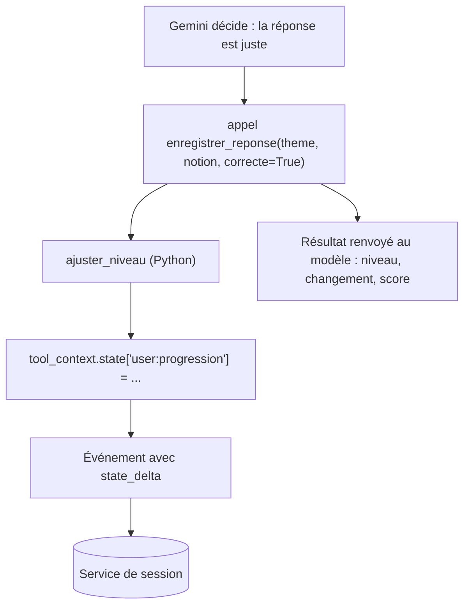

# Les outils et l'état `user:`

> [!NOTE]
> Dans cette leçon, vous allez écrire la règle d'adaptation, les deux outils qui modifient l'état `user:progression`, et l'instruction qui injecte cette progression dans chaque requête au modèle.

## 1. Installer

```bash
python -m venv .venv && source .venv/bin/activate
pip install -r requirements.txt
cp .env.example .env   # puis mettez votre clé dans GOOGLE_API_KEY
```

Le fichier [.env.example](../files/.env.example) contient des valeurs factices. `python-dotenv` lit le `.env` au démarrage ; ne le versionnez jamais.

## 2. La règle d'adaptation, en pur Python

```python title="files/agent.py"
def ajuster_niveau(niveau: int, serie: list[bool]) -> tuple[int, list[bool]]:
    """Règle déterministe : 2 bonnes réponses d'affilée -> +1, 2 erreurs d'affilée -> -1."""
    if serie[-2:] == [True, True] and niveau < 5:
        return niveau + 1, []
    if serie[-2:] == [False, False] and niveau > 1:
        return niveau - 1, []
    return niveau, serie[-2:]
```

La **série** (les dernières réponses depuis le dernier changement) repart de zéro quand le niveau change : sans cela, une troisième bonne réponse ferait monter l'élève une seconde fois.

```quiz
question: "Avec cette règle, un élève au niveau 2 répond juste, juste, juste. Quel est son niveau ?"
options:
  - "3, et sa série vaut [True]"
  - "4, car il a trois bonnes réponses"
  - "2, car la série est remise à zéro"
answer: 0
explanation: "Après deux bonnes réponses, il passe au niveau 3 et la série repart de []. La troisième bonne réponse donne une série [True] : il faudra une quatrième bonne réponse pour monter au niveau 4."
```

## 3. Des outils qui écrivent dans l'état

Un **outil** ADK est une fonction Python ordinaire : ADK lit sa signature et sa docstring pour décrire l'outil au modèle. Si la fonction déclare un paramètre `tool_context: ToolContext`, ADK le remplit automatiquement (le modèle ne le voit pas) : il donne accès à `tool_context.state`.

```python title="files/agent.py"
def enregistrer_reponse(theme: str, notion: str, correcte: bool, tool_context: ToolContext) -> dict:
    """Enregistre la réponse de l'élève et recalcule le niveau du thème.

    Args:
        theme: le thème de la question (ex. "python").
        notion: la notion testée, en 2 à 4 mots (ex. "compréhension de liste").
        correcte: True si la réponse de l'élève est juste.
    """
    progression = dict(tool_context.state.get("user:progression", {}))
    fiche = dict(progression.get(theme.lower()) or {"niveau": 2, "serie": [], "bonnes": 0, "total": 0, "a_revoir": []})
    ancien = fiche["niveau"]
    fiche["total"] += 1
    fiche["bonnes"] += int(correcte)
    a_revoir = [n for n in fiche["a_revoir"] if n != notion]
    fiche["a_revoir"] = a_revoir if correcte else (a_revoir + [notion])[-5:]
    fiche["niveau"], fiche["serie"] = ajuster_niveau(ancien, fiche["serie"] + [correcte])
    progression[theme.lower()] = fiche
    tool_context.state["user:progression"] = progression
    return {"niveau": fiche["niveau"], "libelle": NIVEAUX[fiche["niveau"]],
            "changement": fiche["niveau"] - ancien, "score": f"{fiche['bonnes']}/{fiche['total']}"}
```

> [!WARNING]
> Réaffectez toujours la clé (`tool_context.state["user:progression"] = progression`). ADK enregistre une modification quand vous **écrivez** une clé : il la range dans le `state_delta` de l'événement, que le service de session sauvegarde. Modifier en place un dictionnaire déjà présent dans l'état n'est pas un usage documenté : ne comptez pas dessus.

L'outil `definir_niveau(theme, niveau)` suit le même modèle : il crée la fiche du thème après le test de positionnement. Le code complet est dans [agent.py](../files/agent.py).



## 4. L'instruction et l'injection d'état

Dans l'instruction d'un agent, `{cle}` est remplacé par la valeur de `session.state["cle"]` à chaque tour ; `{cle?}` (avec un point d'interrogation) ne lève pas d'erreur si la clé est absente.

```python title="files/agent.py"
INSTRUCTION = f"""Tu es un tuteur patient qui parle français et tutoie l'élève.
Niveaux : {NIVEAUX}.
Progression mémorisée de l'élève (vide = nouvel élève) : {{user:progression?}}

Déroulé :
1. Si le thème demandé n'est pas dans la progression : pose 2 questions de positionnement
   (une facile, une plus difficile), UNE à la fois, puis appelle definir_niveau.
   Si le thème est connu : salue l'élève, rappelle son niveau et ses notions à revoir.
2. Pose UNE question à la fois, adaptée au niveau du thème. Privilégie les notions à revoir.
3. Quand l'élève répond : juge la réponse, appelle enregistrer_reponse, puis donne un retour
   court (pourquoi c'est juste ou faux) et enchaîne avec la question suivante au niveau renvoyé.
   Si "changement" vaut 1 ou -1, annonce le changement de niveau.
Ne donne jamais la réponse avant que l'élève ait essayé. Reste concis (moins de 120 mots)."""

root_agent = Agent(
    name="tuteur",
    model=os.environ.get("MODEL", "gemini-3.5-flash"),
    instruction=INSTRUCTION,
    tools=[definir_niveau, enregistrer_reponse],
)
```

Les doubles accolades `{{user:progression?}}` sont nécessaires parce que la chaîne est une f-string Python : après formatage, ADK reçoit bien `{user:progression?}`. Le dictionnaire `{1: 'débutant', ...}` produit par `{NIVEAUX}` contient lui aussi des accolades, mais ce n'est pas un nom de clé valide : ADK le laisse tel quel.

> [!TIP]
> Injecter la progression dans l'instruction évite un outil `lire_progression` et donc un aller-retour avec le modèle à chaque début de session. Gardez cette technique pour des données **courtes** : un gros dictionnaire injecté à chaque tour coûte des jetons.

```quiz
question: "Que voit le modèle si l'instruction contient {user:progression?} et que l'élève est nouveau ?"
options:
  - "Une erreur KeyError, l'agent ne démarre pas"
  - "Le texte {user:progression?} tel quel"
  - "Une valeur vide à la place du marqueur, ce qui signifie « nouvel élève »"
answer: 2
explanation: "Le point d'interrogation rend la variable optionnelle : ADK la remplace par une chaîne vide si la clé n'existe pas. Sans « ? », une clé absente provoque une erreur."
```

## Exercice : un compteur de séances

Ajoutez à l'état `user:` le nombre de questions posées **aujourd'hui** et faites dire au tuteur « Bravo, 10 questions aujourd'hui ! » à la dixième. Quelle clé, quel outil modifier, et que faut-il ajouter à l'instruction ?

<details>
<summary>Voir la solution</summary>

Stockez une clé `user:jour` (date ISO) et `user:questions_du_jour`, mises à jour dans `enregistrer_reponse` :

```python
from datetime import date

aujourdhui = date.today().isoformat()
if tool_context.state.get("user:jour") != aujourdhui:
    tool_context.state["user:jour"] = aujourdhui
    tool_context.state["user:questions_du_jour"] = 0
tool_context.state["user:questions_du_jour"] = tool_context.state["user:questions_du_jour"] + 1
```

Renvoyez la valeur dans le dictionnaire de résultat (`"questions_du_jour": ...`) et ajoutez à l'instruction : « Si questions_du_jour vaut 10, félicite l'élève. » Le calcul reste dans le code, le modèle ne fait que le formuler.

</details>

## Résultat obtenu

Appels d'outils réellement émis par Gemini pendant la démonstration du 2026-10-15 :

```text
   [outil] definir_niveau {'niveau': 3, 'theme': 'python'}
   [outil] enregistrer_reponse {'notion': 'argument par défaut mutable', 'theme': 'python', 'correcte': True}
   [outil] enregistrer_reponse {'theme': 'python', 'notion': 'méthode dictionnaire get', 'correcte': True}
   [outil] enregistrer_reponse {'theme': 'python', 'notion': 'décorateurs de fonction', 'correcte': False}
Progression enregistrée : {'python': {'niveau': 4, 'serie': [False], 'bonnes': 2, 'total': 3,
                           'a_revoir': ['décorateurs de fonction']}}
```

Deux bonnes réponses au niveau 3 ont fait passer l'élève au niveau 4, puis l'erreur a démarré une nouvelle série `[False]` et ajouté la notion à revoir.

## Je sais faire

- [ ] Écrire un outil ADK qui reçoit `tool_context` et modifie l'état
- [ ] Expliquer pourquoi on réaffecte la clé d'état au lieu de la modifier en place
- [ ] Injecter une clé d'état dans l'instruction avec `{cle?}`
- [ ] Garder les règles métier dans des fonctions testables
