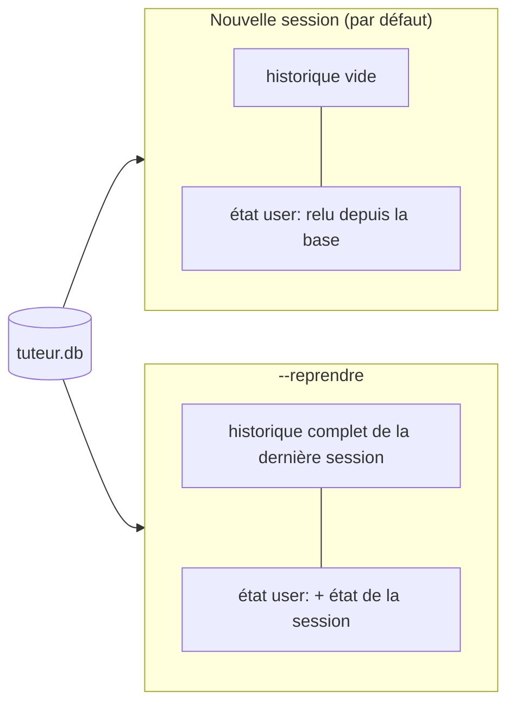

# La mémoire entre sessions avec SQLite

> [!NOTE]
> Dans cette leçon, vous allez brancher le tuteur sur un service de session qui écrit dans un fichier SQLite, reprendre une session précédente, et regarder ce qu'ADK stocke réellement sur le disque.

## Quel service de session choisir ?

Un **service de session** est l'objet qui crée, relit et sauvegarde les sessions et leur état. ADK 2.10 en propose plusieurs :

| Service | Où sont les données | Dépendance | Quand l'utiliser |
| --- | --- | --- | --- |
| `InMemorySessionService` | mémoire du processus | aucune | tests, démonstrations |
| `SqliteSessionService` | un fichier `.db` local | `aiosqlite` (installé avec ADK) | un poste, un petit service |
| `DatabaseSessionService` | PostgreSQL, MySQL, SQLite… | `sqlalchemy` + un pilote asynchrone | serveur partagé, Cloud SQL |
| `VertexAiSessionService` | service managé Google Cloud | un projet GCP | déploiement sur Vertex AI |

> [!WARNING]
> Dans `google-adk` 2.10.0, `DatabaseSessionService` n'est importable que si `sqlalchemy` est installé (sinon ADK lève une erreur qui vous invite à installer l'extra `db`). Pour un fichier SQLite local, `SqliteSessionService` suffit et ne demande rien de plus : c'est le choix de ce lab. On l'importe depuis son module : `from google.adk.sessions.sqlite_session_service import SqliteSessionService`.

```quiz
question: "Vous déployez le tuteur sur trois instances Cloud Run derrière un équilibreur de charge. Quel service de session choisir ?"
options:
  - "SqliteSessionService, chaque instance a son fichier"
  - "Un service partagé : DatabaseSessionService sur Cloud SQL, ou VertexAiSessionService"
  - "InMemorySessionService, c'est le plus rapide"
answer: 1
explanation: "Avec trois instances, un élève peut tomber sur une instance différente à chaque requête : il faut une base commune. Un fichier SQLite local n'est vu que par une instance (et disparaît au redémarrage du conteneur)."
```

## Brancher SQLite dans le Runner

```python title="files/main.py"
DB = os.environ.get("TUTEUR_DB", "tuteur.db")

service = SqliteSessionService(DB)
runner = Runner(agent=root_agent, app_name=APP_NAME, session_service=service)
sessions = (await service.list_sessions(app_name=APP_NAME, user_id=args.user)).sessions
if args.reprendre and sessions:
    session = sessions[-1]  # triées de la plus ancienne à la plus récente
    print(f"Reprise de la session {session.id}")
else:
    session = await service.create_session(app_name=APP_NAME, user_id=args.user)
```

Deux façons de « se souvenir » :



- **Nouvelle session** : la conversation repart de zéro (moins de jetons envoyés au modèle) mais `user:progression` est là. C'est le mode normal d'un tuteur : chaque séance est une session.
- **`--reprendre`** : la session précédente est rechargée avec tous ses événements ; le modèle relit toute la conversation. Pratique après une coupure, coûteux si la session est longue.

`list_sessions` renvoie les sessions **sans** leurs événements ni leur état (c'est un index) ; le `Runner` recharge la session complète avec `get_session` à chaque message.

## Ce qu'il y a dans le fichier

`SqliteSessionService` crée quatre tables : `app_states`, `user_states`, `sessions` et `events`. Les clés `user:` sont rangées **sans leur préfixe** dans `user_states`, une ligne par couple (application, utilisateur) :

```python title="inspecter.py"
import sqlite3

c = sqlite3.connect("tuteur.db")
print(c.execute("SELECT app_name, user_id, state FROM user_states").fetchall())
print(c.execute("SELECT session_id, COUNT(*) FROM events GROUP BY session_id").fetchall())
```

> [!TIP]
> Les événements (`events`) contiennent tout le dialogue, en JSON : c'est une trace précieuse pour comprendre pourquoi le tuteur a jugé une réponse fausse. C'est aussi une donnée personnelle de l'élève : prévoyez une durée de conservation et une suppression (`service.delete_session(...)`).

```quiz
question: "Dans quelle table trouvez-vous la progression d'Alice, et sous quelle clé ?"
options:
  - "sessions, sous la clé user:progression"
  - "user_states, sous la clé progression (sans le préfixe user:)"
  - "events uniquement, il faut rejouer tous les événements"
answer: 1
explanation: "Le service sépare l'état par portée : les clés user: vont dans user_states, sans le préfixe, et sont fusionnées dans session.state à la lecture. Les événements gardent aussi chaque state_delta, mais la table user_states donne directement la valeur courante."
```

## Exercice : effacer la mémoire d'un élève

Un élève demande l'effacement de ses données. Écrivez une fonction asynchrone `oublier(user_id)` qui supprime toutes ses sessions avec l'API du service, puis vérifiez avec `inspecter.py` ce qui reste. Que constatez-vous pour `user_states` ?

<details>
<summary>Voir la solution</summary>

```python
async def oublier(service, user_id: str) -> None:
    for s in (await service.list_sessions(app_name=APP_NAME, user_id=user_id)).sessions:
        await service.delete_session(app_name=APP_NAME, user_id=user_id, session_id=s.id)
```

Les sessions et leurs événements disparaissent (suppression en cascade), mais la ligne de `user_states` **subsiste** (vérifié avec ADK 2.10.0 : 0 session, 0 événement, 1 ligne `user_states`) : l'état utilisateur n'est rattaché à aucune session précise. Pour un effacement complet, supprimez aussi cette ligne (`DELETE FROM user_states WHERE app_name=? AND user_id=?`) et vérifiez avec `inspecter.py`. Documentez cette procédure : c'est elle que vous appliquerez pour une demande d'effacement.

</details>

## Résultat obtenu

Contenu réel de `tuteur.db` après les deux sessions de démonstration du 2026-10-15 :

```text
[('tuteur', 'alice', '{"progression":{"python":{"niveau":4,"serie":[false],"bonnes":2,"total":3,
  "a_revoir":["d\\u00e9corateurs de fonction"]}}}')]
[(2, '33944140-c04d-42eb-a750-4c1e465229b3'), (20, 'cb275b42-e4fe-4b0e-9bdb-e0ea0eda016c')]
```

La première session compte 20 événements (messages, appels et réponses d'outils), la seconde 2. Une seule ligne `user_states` porte la progression : c'est elle que la deuxième session a relue pour saluer l'élève au niveau 4.

## Je sais faire

- [ ] Choisir entre `InMemorySessionService`, `SqliteSessionService` et `DatabaseSessionService`
- [ ] Créer une nouvelle session ou reprendre la dernière avec `list_sessions`
- [ ] Retrouver l'état `user:` dans le fichier SQLite
- [ ] Prévoir la suppression des données d'un élève
