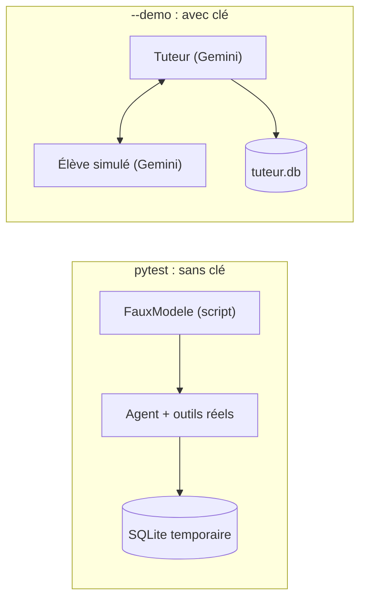

# Tester sans clé, simuler un élève, mettre en service

> [!NOTE]
> Dans cette leçon, vous allez tester le tuteur sans appeler Gemini grâce à un faux modèle, le tester de bout en bout avec un « élève simulé », puis voir comment l'exploiter en local et sur Google Cloud.

## Deux niveaux de tests

| | Tests unitaires (`pytest`) | Test de bout en bout (`--demo`) |
| --- | --- | --- |
| Clé d'API | non | oui |
| Modèle | `FauxModele` qui rejoue un script | Gemini, tuteur **et** élève |
| Ce qu'on vérifie | règle d'adaptation, écriture de l'état, persistance SQLite | comportement réel : positionnement, retours, reprise |
| Durée, coût | 2 secondes, gratuit | environ une minute, une quinzaine d'appels |
| Déterministe | oui | non |



## Un faux modèle pour ADK

ADK accepte comme `model` n'importe quel objet qui hérite de `BaseLlm`. Il suffit d'implémenter `generate_content_async` :

```python title="files/test_tuteur.py"
class FauxModele(BaseLlm):
    """Rejoue une liste de réponses : un appel d'outil puis un texte, etc."""
    script: list = []

    async def generate_content_async(self, llm_request, stream=False):
        yield LlmResponse(content=types.Content(role="model", parts=[self.script.pop(0)]))
```

Le test fait jouer au faux modèle les appels `definir_niveau` puis trois `enregistrer_reponse`, avec un **vrai** `SqliteSessionService` sur un fichier temporaire. Ensuite, il crée un **nouveau** service et une **nouvelle** session sur le même fichier, comme le ferait un second lancement du programme :

```python title="files/test_tuteur.py"
etat = asyncio.run(_discuter(db, ["python", "r1", "r2", "r3"], script))
assert etat["user:progression"]["python"]["niveau"] == 3  # 2 bonnes d'affilée -> +1
assert etat["user:progression"]["python"]["a_revoir"] == ["dict"]

# Nouvelle session, nouveau service (= nouveau processus) : la progression « user: » est relue du disque.
etat2 = asyncio.run(_discuter(db, ["re-bonjour"], [types.Part(text="Bon retour !")]))
assert etat2["user:progression"]["python"]["bonnes"] == 2
```

```quiz
question: "Que prouve test_progression_persiste_entre_sessions que test_ajuster_niveau ne prouve pas ?"
options:
  - "Que Gemini juge correctement les réponses"
  - "Que les outils écrivent bien l'état user: via ADK et que SqliteSessionService le relit dans une nouvelle session"
  - "Que la règle d'adaptation est juste"
answer: 1
explanation: "test_ajuster_niveau teste la règle seule. Le second test fait passer de vrais appels d'outils par le Runner, l'écriture de state_delta et la relecture depuis le disque. Aucun des deux ne juge la qualité pédagogique de Gemini : c'est le rôle du test de bout en bout et de la relecture humaine."
```

## L'élève simulé

Pour tester sans taper les réponses, `main.py --demo 1 1 1 1 0` fait répondre un second appel Gemini, qui joue un élève juste (`1`) ou faux (`0`) :

```python title="files/main.py"
def eleve_simule(question: str, juste: bool) -> str:
    """Un « faux élève » : un appel Gemini direct qui répond juste ou faux exprès."""
    consigne = "correctement" if juste else "en faisant une erreur typique de débutant"
    client = genai.Client()  # garder une référence : sinon le client est fermé avant la requête
    r = client.models.generate_content(
        model=os.environ.get("MODEL", "gemini-3.5-flash"),
        contents=f"Tu joues un élève. Réponds en une ou deux phrases, {consigne}, "
                 f"à la DERNIÈRE question de ce message du tuteur :\n{question}")
    return r.text.strip()
```

> [!WARNING]
> Écrire `genai.Client().models.generate_content(...)` sur une seule ligne a échoué pendant nos essais avec `RuntimeError: Cannot send a request, as the client has been closed.` : le client temporaire est libéré (et sa connexion fermée) avant la fin de la requête. Gardez le client dans une variable.

Ce que l'on vérifie à la lecture : le positionnement a bien lieu, le tuteur appelle `enregistrer_reponse` avec `correcte` cohérent avec la consigne donnée à l'élève, il annonce les changements de niveau, et la session 2 rappelle le niveau et les notions à revoir.

## Résultat obtenu

Tests du 2026-10-15, sans clé d'API :

```text
test_tuteur.py::test_ajuster_niveau PASSED                               [ 50%]
test_tuteur.py::test_progression_persiste_entre_sessions PASSED          [100%]
============================== 2 passed in 1.85s ===============================
```

Test de bout en bout du même jour (extrait) : l'élève simulé « faux » a répondu `A) 7` à une question sur les décorateurs ; le tuteur a appelé `enregistrer_reponse {'theme': 'python', 'notion': 'décorateurs de fonction', 'correcte': False}`, expliqué la bonne réponse `B) 14`, puis proposé une nouvelle question sur la même notion. Dans la session suivante : « Tu es actuellement au **niveau 4 (avancé)** en Python, et nous avons la notion des **décorateurs de fonction** à revoir. »

## Mettre en service

**En local** : `python main.py --user <identifiant>` suffit pour un usage individuel. Le fichier `tuteur.db` est la seule chose à sauvegarder.

**Sur Google Cloud** (non exécuté dans ce lab sans GCP) : remplacez le modèle par Vertex AI (`GOOGLE_GENAI_USE_VERTEXAI=TRUE`, `GOOGLE_CLOUD_PROJECT`, `GOOGLE_CLOUD_LOCATION`), servez l'agent avec `adk deploy cloud_run` et passez à un service de session partagé (`DatabaseSessionService` sur Cloud SQL, ou `VertexAiSessionService`). Le code des outils ne change pas : seul le service de session est remplacé.

> [!TIP]
> Avant d'ouvrir le tuteur à une équipe, faites relire 20 à 30 échanges réels par un formateur : le modèle peut juger « fausse » une réponse juste mais formulée autrement. Ajoutez ces cas dans un jeu de tests et, si besoin, demandez au tuteur de justifier son jugement avant d'appeler l'outil.

```quiz
question: "Vous passez le tuteur sur Cloud Run avec plusieurs instances. Que faut-il changer dans agent.py ?"
options:
  - "Réécrire les outils definir_niveau et enregistrer_reponse"
  - "Rien : seul le service de session (dans main.py ou la configuration du serveur) et les variables du modèle changent"
  - "Remplacer le préfixe user: par app:"
answer: 1
explanation: "Les outils ne manipulent que tool_context.state : ils ignorent où l'état est stocké. On remplace SqliteSessionService par un service partagé et on bascule le modèle sur Vertex AI par variables d'environnement."
```

## Exercice : tester la descente de niveau

Écrivez un test pytest qui place un élève au niveau 3 puis lui fait rater deux questions, et vérifiez qu'il redescend au niveau 2 avec deux notions à revoir.

<details>
<summary>Voir la solution</summary>

```python
def test_descente(tmp_path):
    script = [appel("definir_niveau", theme="sql", niveau=3), types.Part(text="Q1"),
              appel("enregistrer_reponse", theme="sql", notion="jointures", correcte=False), types.Part(text="Q2"),
              appel("enregistrer_reponse", theme="sql", notion="group by", correcte=False), types.Part(text="Q3")]
    etat = asyncio.run(_discuter(str(tmp_path / "t.db"), ["sql", "r1", "r2"], script))
    fiche = etat["user:progression"]["sql"]
    assert fiche["niveau"] == 2 and fiche["serie"] == []
    assert fiche["a_revoir"] == ["jointures", "group by"]
```

Chaque message utilisateur consomme deux réponses du script : l'appel d'outil, puis le texte final.

</details>

## Je sais faire

- [ ] Écrire un faux modèle `BaseLlm` pour tester un agent sans clé
- [ ] Tester la persistance avec un vrai `SqliteSessionService` sur un fichier temporaire
- [ ] Simuler un utilisateur avec un second appel au modèle
- [ ] Expliquer ce qui change (et ce qui ne change pas) pour passer sur Google Cloud
