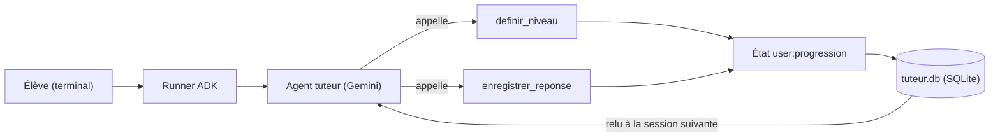

Un bon tuteur ne pose pas la même question à tout le monde. Il commence par **évaluer** où vous en êtes, il **adapte** la difficulté à vos réponses, et la semaine suivante il **se souvient** que vous butiez sur les décorateurs Python. Dans ce lab, vous construisez exactement cela avec Google ADK (Agent Development Kit, le framework open source de Google pour écrire des agents) et une simple clé d'API Gemini.

## Pour qui ?

- Vous savez écrire une fonction Python et lancer `pip install`.
- Vous avez déjà vu un agent ADK minimal (un `Agent`, un outil, un `Runner`). Sinon, lisez d'abord un lab de niveau débutant.
- Aucun projet Google Cloud n'est nécessaire.

## Ce que vous allez construire

Un tuteur en ligne de commande qui :

1. fait passer un **test de positionnement** de deux questions sur un thème (Python, SQL…) ;
2. pose ensuite **une question à la fois**, au niveau de l'élève (de 1 « débutant » à 5 « expert ») ;
3. applique une **règle de progression déterministe** (deux bonnes réponses d'affilée : niveau +1 ; deux erreurs : niveau -1) ;
4. range la progression dans l'**état de session** ADK avec le préfixe `user:` et la **persiste dans un fichier SQLite** : en relançant le programme le lendemain, le tuteur reprend là où l'élève s'était arrêté.

## Prérequis techniques

- Python 3.10 ou plus récent.
- Une clé d'API Gemini (gratuite pour tester) créée dans Google AI Studio.
- Les dépendances de [requirements.txt](./files/requirements.txt) : `google-adk==2.10.0`, `aiosqlite`, `python-dotenv`, `pytest`.

## Programme

| Module | Leçon | Durée indicative |
| --- | --- | --- |
| 1. Le cas d'usage | Un tuteur adaptatif : besoin, architecture, choix techniques | 30 min |
| 2. Construire | Les outils et l'état `user:` ; la mémoire SQLite entre sessions | 1h15 |
| 3. Tester et exploiter | Tests sans clé, élève simulé, mise en service | 45 min |

## En local ou sur Google Cloud ?

| | En local (ce lab) | Sur Google Cloud (pour aller plus loin) |
| --- | --- | --- |
| Modèle | API Gemini avec une clé (`GOOGLE_API_KEY`) | Vertex AI (`GOOGLE_GENAI_USE_VERTEXAI=TRUE`) |
| Stockage des sessions | `SqliteSessionService` : un fichier `tuteur.db` | `DatabaseSessionService` sur Cloud SQL, ou `VertexAiSessionService` |
| Exécution | `python main.py` dans un terminal | Cloud Run (`adk deploy cloud_run`) |
| Coût | quelques appels au modèle par question | idem + base managée |

Le code complet est dans [files/](./files/) : [agent.py](./files/agent.py), [main.py](./files/main.py), [test_tuteur.py](./files/test_tuteur.py). Tout a été exécuté le 2026-10-15 avec `google-adk` 2.10.0 et le modèle `gemini-3.5-flash`.
