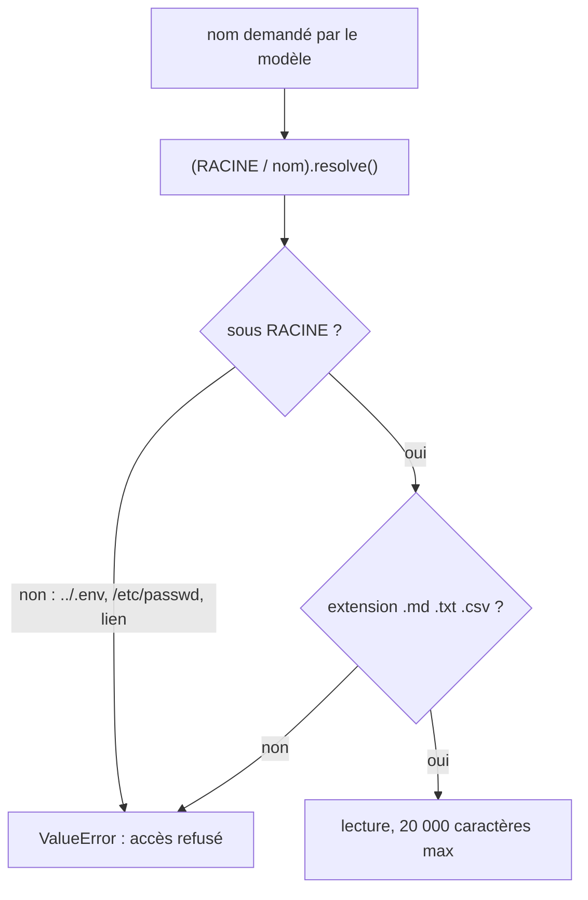

# Écrire deux serveurs MCP en Python

> [!NOTE]
> Dans cette leçon, vous allez écrire un serveur MCP qui expose une base SQLite en lecture seule, puis un serveur de fichiers confiné à un dossier, avec le SDK Python `mcp` 2.x.

## Un serveur MCP en dix lignes

Avec le SDK `mcp` 2.x, un serveur est un objet `MCPServer` ; chaque fonction décorée par `@mcp.tool()` devient un outil. Le SDK lit la signature et la docstring pour produire le **schéma d'entrée** (JSON Schema) annoncé au client.

```python title="files/commandes_server.py"
from mcp.server.mcpserver import MCPServer
from mcp.types import ToolAnnotations

mcp = MCPServer("commandes", instructions="Base de commandes d'une boutique de vélos fictive.")

@mcp.tool(annotations=ToolAnnotations(read_only_hint=True))
def lister_tables() -> dict:
    """Liste les tables de la base et leurs colonnes (nom et type)."""
    ...

if __name__ == "__main__":
    mcp.run()  # transport stdio par défaut
```

Les **annotations** (`readOnlyHint`, `destructiveHint`… dans la spécification ; en Python, le SDK 2.x les nomme `read_only_hint`, `destructive_hint`) décrivent le comportement d'un outil au client. La spécification MCP les présente comme des **indications** : un client ne doit pas leur faire confiance si le serveur n'est pas de confiance. Ici, c'est nous qui écrivons le serveur : on peut s'en servir pour filtrer (voir la leçon suivante).

> [!TIP]
> Le décorateur renvoie la fonction d'origine : `commandes_server.executer_select("SELECT 1")` reste appelable directement en Python. C'est ce qui permet de tester les garde-fous sans démarrer de serveur.

## La base de commandes

`creer_base()` crée une petite base **fictive** : 4 clients, 5 produits, 8 commandes (tables `clients`, `produits`, `commandes`). L'outil principal exécute une requête en lecture seule :

```python title="files/commandes_server.py"
def _lecture_seule() -> sqlite3.Connection:
    if not DB.exists():
        creer_base()
    # mode=ro : même si une requête d'écriture passait le filtre, SQLite la refuserait.
    return sqlite3.connect(f"file:{DB}?mode=ro", uri=True)


@mcp.tool(annotations=ToolAnnotations(read_only_hint=True))
def executer_select(sql: str) -> dict:
    """Exécute UNE requête SQL SELECT (SQLite) en lecture seule et renvoie au plus 50 lignes.

    Args:
        sql: une requête SELECT ou WITH ... SELECT. Toute autre instruction est refusée.
    """
    requete = sql.strip().rstrip(";")
    if ";" in requete or not re.match(r"(?is)^\s*(select|with)\b", requete):
        return {"erreur": "Seules les requêtes SELECT uniques sont autorisées."}
    try:
        with _lecture_seule() as c:
            cur = c.execute(requete)
            lignes = cur.fetchmany(MAX_LIGNES + 1)
            return {"colonnes": [d[0] for d in cur.description], "lignes": lignes[:MAX_LIGNES],
                    "tronque": len(lignes) > MAX_LIGNES}
    except sqlite3.Error as e:
        return {"erreur": f"SQLite : {e}"}  # renvoyée au modèle, qui peut corriger sa requête
```

Trois choix à retenir :

| Choix | Pourquoi |
| --- | --- |
| Erreur renvoyée **comme résultat** (`{"erreur": ...}`) | le modèle lit le message et corrige sa requête au tour suivant, au lieu d'un échec brutal |
| `fetchmany(51)` puis `tronque` | le modèle sait qu'il manque des lignes et peut affiner (agrégat, `LIMIT`) |
| Pas de `;` interne | `execute` refuse déjà plusieurs instructions, mais en Python 3.10 il lève `sqlite3.Warning`, qui n'hérite pas de `sqlite3.Error` : sans ce filtre, l'erreur ne serait pas convertie en message lisible |

Le serveur expose aussi `annuler_commande(commande_id)`, annoté `destructive_hint=True`. Il existe pour d'autres clients (un back-office, par exemple) ; notre agent ne le recevra pas.

```quiz
question: "Le modèle envoie « SELECT * FROM commande » (table inexistante). Que se passe-t-il ?"
options:
  - "Le serveur MCP plante et l'agent s'arrête"
  - "L'outil renvoie {erreur: SQLite : no such table: commande} et le modèle peut corriger sa requête"
  - "SQLite crée la table automatiquement"
answer: 1
explanation: "L'exception sqlite3.Error est convertie en résultat lisible. Le modèle voit l'erreur dans la réponse de l'outil, appelle souvent lister_tables, puis réessaie avec le bon nom."
```

## Le serveur de fichiers confiné

```python title="files/fichiers_server.py"
RACINE = Path(os.environ.get("DOCS_ROOT", Path(__file__).with_name("docs"))).resolve()
EXTENSIONS = {".md", ".txt", ".csv"}

def _chemin_sur(nom: str) -> Path:
    """Résout `nom` sous RACINE et refuse toute sortie du dossier (../, chemin absolu, lien)."""
    chemin = (RACINE / nom).resolve()
    if not chemin.is_relative_to(RACINE):
        raise ValueError(f"Accès refusé hors de {RACINE.name}/ : {nom}")
    if chemin.suffix not in EXTENSIONS:
        raise ValueError(f"Extension non autorisée : {chemin.suffix or '(aucune)'}")
    return chemin

@mcp.tool(annotations=ToolAnnotations(read_only_hint=True))
def lire_document(nom: str) -> str:
    """Renvoie le contenu texte d'un document du dossier partagé."""
    return _chemin_sur(nom).read_text(encoding="utf-8")[:TAILLE_MAX]
```



`resolve()` transforme le chemin en chemin absolu **après** avoir suivi les `..` et les liens symboliques : c'est ce qui rend la comparaison fiable. Comparer des chaînes (`nom.startswith("docs/")`) ne suffirait pas : `docs/../.env` commence bien par `docs/`.

> [!WARNING]
> `RACINE / "/etc/passwd"` donne `/etc/passwd` : en Python, joindre un chemin absolu **remplace** la base. Sans la vérification `is_relative_to`, un nom absolu sortirait du dossier.

```quiz
question: "Quels noms sont refusés par _chemin_sur ? (plusieurs réponses)"
options:
  - "politique-retours.md"
  - "../agent.py"
  - "/etc/passwd"
  - "sous-dossier/note.txt (s'il existe dans docs/)"
answer: [1, 2]
explanation: "../agent.py sort du dossier et a une extension .py ; /etc/passwd est un chemin absolu hors racine. Un fichier .txt d'un sous-dossier de docs/ reste sous la racine et est autorisé."
```

## Exercice : un outil de recherche

Ajoutez à `fichiers_server.py` un outil `chercher(mot: str) -> list[dict]` qui renvoie, pour chaque document contenant le mot (sans tenir compte de la casse), son nom et la première ligne qui le contient. Il doit réutiliser les mêmes protections.

<details>
<summary>Voir la solution</summary>

```python
@mcp.tool(annotations=ToolAnnotations(read_only_hint=True))
def chercher(mot: str) -> list[dict]:
    """Cherche un mot (insensible à la casse) dans les documents et renvoie la première ligne trouvée."""
    resultats = []
    for nom in lister_documents():
        for ligne in _chemin_sur(nom).read_text(encoding="utf-8").splitlines():
            if mot.lower() in ligne.lower():
                resultats.append({"document": nom, "ligne": ligne.strip()[:200]})
                break
    return resultats[:20]
```

Passer par `lister_documents()` puis `_chemin_sur()` garantit qu'on ne lit que des fichiers autorisés. N'oubliez pas d'ajouter un test (`chercher("30 jours")` doit trouver `politique-retours.md`).

</details>

## Résultat obtenu

Tests des garde-fous du 2026-10-15 (appel direct des fonctions, sans serveur ni clé) :

```text
test_mcp.py::test_select_autorise PASSED
test_mcp.py::test_ecritures_refusees[DELETE FROM commandes] PASSED
test_mcp.py::test_ecritures_refusees[SELECT 1; DROP TABLE clients] PASSED
test_mcp.py::test_ecritures_refusees[UPDATE commandes SET statut='x'] PASSED
test_mcp.py::test_connexion_en_lecture_seule PASSED
test_mcp.py::test_fichiers_hors_dossier_refuses[../agent.py] PASSED
test_mcp.py::test_fichiers_hors_dossier_refuses[/etc/passwd] PASSED
test_mcp.py::test_fichiers_hors_dossier_refuses[../../.env] PASSED
test_mcp.py::test_lecture_document PASSED
```

## Je sais faire

- [ ] Écrire un serveur MCP avec `MCPServer` et `@mcp.tool()` (SDK `mcp` 2.x)
- [ ] Renvoyer les erreurs comme résultats lisibles par le modèle
- [ ] Ouvrir SQLite en lecture seule avec `mode=ro`
- [ ] Confiner un accès fichiers avec `resolve()` et `is_relative_to()`
