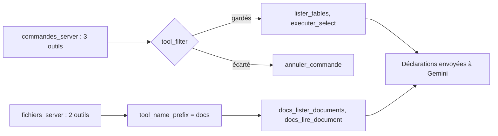

# Brancher les serveurs avec `McpToolset` et filtrer les outils

> [!NOTE]
> Dans cette leçon, vous allez connecter les deux serveurs MCP à un agent ADK, choisir précisément les outils que le modèle peut voir, éviter les collisions de noms et fermer proprement les sous-processus.

## `McpToolset` : un ensemble d'outils venu d'un serveur

Un **toolset** ADK est un objet qui fournit une *liste* d'outils au lieu d'un seul. `McpToolset` se connecte à un serveur MCP, appelle `tools/list` et transforme chaque outil MCP en outil ADK. Dans ADK 2.10, son constructeur accepte notamment :

| Paramètre | Rôle |
| --- | --- |
| `connection_params` | comment joindre le serveur : `StdioConnectionParams`, `SseConnectionParams` ou `StreamableHTTPConnectionParams` |
| `tool_filter` | liste de noms à garder, **ou** fonction `(outil, contexte) -> bool` |
| `tool_name_prefix` | préfixe ajouté aux noms vus par le modèle (`docs` donne `docs_lire_document`) |
| `require_confirmation` | demande une confirmation avant chaque appel (booléen ou fonction) |

```python title="files/agent.py"
def serveur(script: str, **env: str) -> StdioConnectionParams:
    """Paramètres pour lancer un serveur MCP Python comme sous-processus (même interpréteur)."""
    return StdioConnectionParams(
        # env : ajouté aux seules variables « sûres » (PATH, HOME...) ; la clé d'API n'est PAS transmise.
        server_params=StdioServerParameters(command=sys.executable, args=[str(ICI / script)], env=env),
        timeout=20,  # secondes pour démarrer le serveur et répondre
    )


commandes = McpToolset(
    connection_params=serveur("commandes_server.py",
                              COMMANDES_DB=os.environ.get("COMMANDES_DB", str(ICI / "commandes.db"))),
    tool_filter=["lister_tables", "executer_select"],  # annuler_commande n'est PAS exposé au modèle
)

fichiers = McpToolset(
    connection_params=serveur("fichiers_server.py", DOCS_ROOT=os.environ.get("DOCS_ROOT", str(ICI / "docs"))),
    tool_name_prefix="docs",  # les outils deviennent docs_lister_documents, docs_lire_document
)
```

`sys.executable` lance le serveur avec **le même Python** que l'agent, donc avec le même environnement virtuel : pas de surprise du type « module mcp introuvable ».

> [!TIP]
> Le SDK `mcp` ne transmet au sous-processus qu'une liste courte de variables d'environnement jugées sûres (`PATH`, `HOME`, `USER`…), complétée par le dictionnaire `env` que vous fournissez. Votre `GOOGLE_API_KEY` n'arrive donc pas jusqu'au serveur de commandes : il n'en a pas besoin.



## Liste de noms ou prédicat ?

Une **liste** est explicite et lisible en revue de code : un outil ajouté plus tard au serveur n'apparaîtra pas sans modification de l'agent. Un **prédicat** (une fonction qui renvoie vrai ou faux) s'adapte automatiquement, par exemple « tous les outils annotés en lecture seule » :

```python title="variante (non utilisée dans files/)"
def lecture_seule(outil, contexte=None) -> bool:
    annotations = outil.raw_mcp_tool.annotations
    return bool(annotations and annotations.read_only_hint)

commandes = McpToolset(connection_params=..., tool_filter=lecture_seule)
```

> [!WARNING]
> Un prédicat fondé sur les annotations n'est sûr que si **vous** contrôlez le serveur : un serveur tiers peut annoncer « lecture seule » sur un outil qui écrit. Notez aussi qu'avec le SDK `mcp` 2.x l'attribut Python s'écrit `read_only_hint` : `annotations.readOnlyHint` lève une `AttributeError` (erreur rencontrée en écrivant ce lab). Pour un serveur que vous ne maîtrisez pas, préférez une liste blanche de noms, relue à chaque mise à jour du serveur.

```quiz
question: "Le serveur de commandes gagne demain un outil exporter_clients (lecture seule, annoté readOnlyHint). Que voit l'agent sans modification de agent.py ?"
options:
  - "Il voit exporter_clients, car tool_filter ne s'applique qu'au démarrage"
  - "Il ne le voit pas : la liste blanche ne contient que lister_tables et executer_select"
  - "Il le voit seulement si l'utilisateur le demande"
answer: 1
explanation: "Avec une liste de noms, tout nouvel outil est exclu par défaut. Avec le prédicat lecture_seule, il serait apparu automatiquement : pratique, mais c'est une décision à prendre consciemment."
```

## L'agent et son instruction

```python title="files/agent.py"
root_agent = Agent(
    name="analyste_commandes",
    model=os.environ.get("MODEL", "gemini-3.5-flash"),
    instruction="""Tu es l'analyste des commandes d'une boutique de vélos. Réponds en français.
- Pour les chiffres : appelle d'abord lister_tables pour connaître le schéma, puis executer_select.
  N'invente jamais un chiffre : chaque nombre cité vient d'une requête.
- Pour les règles (retours, livraison, promotions) : docs_lister_documents puis docs_lire_document.
- Tu ne peux rien modifier. Si on te demande une action (annuler, rembourser), explique ce que
  disent les règles et indique qu'un humain doit la faire.
- Termine par une ligne « Sources : » listant les tables et documents utilisés.""",
    tools=[commandes, fichiers],
)
```

## Fermer proprement

Les serveurs stdio sont des sous-processus : il faut les arrêter. `runner.close()` ferme les toolsets de l'agent, donc les sessions MCP :

```python title="files/main.py"
runner = InMemoryRunner(agent=root_agent, app_name="mcp_lab")
try:
    for q in sys.argv[1:] or DEMO:
        ...
finally:
    await runner.close()  # ferme proprement les sous-processus MCP
```

```quiz
question: "Pourquoi le préfixe docs est-il utile, même si les noms ne se chevauchent pas aujourd'hui ?"
options:
  - "Il accélère les appels MCP"
  - "Il évite les collisions si un autre serveur expose un outil du même nom, et indique au modèle d'où vient l'outil"
  - "Il est obligatoire pour le transport stdio"
answer: 1
explanation: "Deux serveurs peuvent très bien exposer chacun un outil lister ou lire. Le préfixe rend les noms uniques et parlants pour le modèle (docs_lire_document)."
```

## Exercice : un troisième serveur

Vous voulez brancher le serveur de fichiers une seconde fois, sur un dossier `archives/`, avec uniquement l'outil de lecture et le préfixe `archives`. Écrivez le `McpToolset` correspondant. Quel nom d'outil faut-il mettre dans `tool_filter` : avec ou sans préfixe ?

<details>
<summary>Voir la solution</summary>

```python
archives = McpToolset(
    connection_params=serveur("fichiers_server.py", DOCS_ROOT=str(ICI / "archives")),
    tool_filter=["lire_document"],
    tool_name_prefix="archives",
)
root_agent = Agent(..., tools=[commandes, fichiers, archives])
```

Le filtre s'applique aux noms **d'origine** du serveur (`lire_document`) : dans ADK 2.10, `get_tools()` filtre, puis `get_tools_with_prefix()` ajoute le préfixe. Le modèle verra `archives_lire_document`. C'est exactement ce que vérifie `test_filtrage_des_outils_mcp` pour `docs`.

</details>

## Résultat obtenu

Test du 2026-10-15 qui démarre les **vrais** serveurs en sous-processus et liste ce que voit le modèle (sans clé d'API) :

```text
test_mcp.py::test_filtrage_des_outils_mcp PASSED
test_mcp.py::test_appel_outil_mcp_de_bout_en_bout PASSED
```

Le premier vérifie `["executer_select", "lister_tables"]` pour les commandes et `["docs_lire_document", "docs_lister_documents"]` pour les fichiers. Pendant l'écriture du lab, une première version de ce test appelait `get_tools()` et obtenait `lire_document` sans préfixe : c'est ainsi que nous avons vérifié l'ordre « filtre puis préfixe ».

## Je sais faire

- [ ] Déclarer un `McpToolset` avec `StdioConnectionParams`
- [ ] Filtrer les outils par liste de noms ou par prédicat, et savoir lequel choisir
- [ ] Préfixer les outils d'un serveur
- [ ] Fermer les sous-processus MCP avec `runner.close()`
