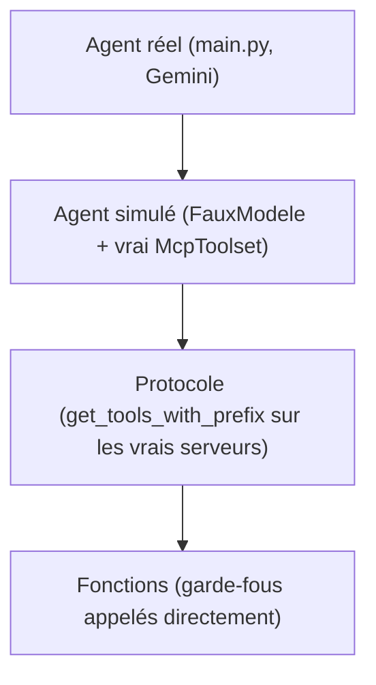

# Tester l'agent MCP et le passer en production

> [!NOTE]
> Dans cette leçon, vous allez tester l'agent à trois niveaux (fonctions, serveurs réels, modèle réel), lire une vraie trace d'appels MCP, puis passer les serveurs du transport stdio au transport HTTP pour un déploiement.

## La pyramide de tests

| Niveau | Test | Clé d'API | Ce qu'il prouve |
| --- | --- | --- | --- |
| Fonctions | `test_select_autorise`, `test_ecritures_refusees`, `test_fichiers_hors_dossier_refuses`… | non | les garde-fous des serveurs |
| Protocole | `test_filtrage_des_outils_mcp` | non | les vrais sous-processus démarrent, le filtre et le préfixe s'appliquent |
| Agent simulé | `test_appel_outil_mcp_de_bout_en_bout` | non | ADK transmet l'appel au serveur et renvoie le résultat au modèle |
| Agent réel | `python main.py` | oui | Gemini choisit les bons outils et répond juste |



Le test « agent simulé » est le plus instructif : le faux modèle demande `executer_select`, ADK l'envoie au serveur MCP lancé en sous-processus, et l'on vérifie que la requête suivante au modèle contient bien la réponse de l'outil.

```python title="files/test_mcp.py"
def test_appel_outil_mcp_de_bout_en_bout():
    sql = "SELECT nom FROM clients WHERE segment='pro' ORDER BY id"
    modele = FauxModele(model="faux", script=[
        types.Part(function_call=types.FunctionCall(name="executer_select", args={"sql": sql})),
        types.Part(text="fini")])
    ...
    # 2e requête au modèle : elle contient la réponse de l'outil MCP (exécuté dans le sous-processus).
    reponse = [p.function_response.response for c in modele.vus[1].contents for p in c.parts if p.function_response]
    assert "Cyclo Rapide SARL" in str(reponse) and "Atelier du Rhône" in str(reponse)
```

> [!TIP]
> Les tests créent la base dans un dossier temporaire et le transmettent au serveur par la variable `COMMANDES_DB`, **avant** d'importer `agent.py` : le `McpToolset` lit cette variable à l'import. Sinon, les tests écriraient un `commandes.db` dans votre dossier de travail.

```quiz
question: "test_filtrage_des_outils_mcp passe, mais l'agent réel répond « je n'ai pas accès à la base ». Quelle piste examiner en premier ?"
options:
  - "Le filtre : annuler_commande est peut-être exposé"
  - "L'instruction ou la description des outils : le modèle ne comprend pas qu'il doit appeler lister_tables puis executer_select"
  - "Le transport stdio, qui ne fonctionne pas avec Gemini"
answer: 1
explanation: "Le test de protocole prouve que les outils sont bien déclarés. Si le modèle ne les utilise pas, c'est un problème de consigne ou de description (docstrings des outils), à corriger puis à valider avec un test réel."
```

## Résultat obtenu

Tests du 2026-10-15, sans clé :

```text
test_mcp.py::test_filtrage_des_outils_mcp PASSED                         [ 90%]
test_mcp.py::test_appel_outil_mcp_de_bout_en_bout PASSED                 [100%]
============================== 11 passed in 4.05s ==============================
```

Test réel du même jour (`python main.py`, `gemini-3.5-flash`), première question :

```text
QUESTION > Quel client professionnel a le plus dépensé en septembre 2026 (montant TTC) ?
   [MCP] lister_tables {}
   [MCP] executer_select {'sql': 'SELECT DISTINCT segment FROM clients;'}
   [MCP] executer_select {'sql': 'SELECT DISTINCT statut FROM commandes;'}
   [MCP] executer_select {'sql': 'SELECT date_commande FROM commandes LIMIT 5;'}
   [MCP] executer_select {'sql': "SELECT c.id, c.nom, c.segment, SUM(cmd.quantite * p.prix_ttc) AS total_ttc
          FROM clients c JOIN commandes cmd ... WHERE c.segment = 'pro' AND cmd.date_commande >= '2026-09-01' ..."}
AGENT > En septembre 2026, le client professionnel qui a le plus dépensé est **Cyclo Rapide SARL**
avec un montant total de **589,00 € TTC**. [...] *Atelier du Rhône* avec un total de 516,00 € TTC.
Sources : tables `clients`, `commandes`, `produits`.
```

Vérification à la main : 40 × 8,50 + 10 × 24,90 = 589,00 € et 4 × 129,00 = 516,00 €. Le modèle a d'abord **exploré** les valeurs (segments, statuts, format des dates) avant d'écrire la requête finale : c'est l'effet de la consigne « n'invente jamais un chiffre ».

## Du stdio au HTTP

En stdio, chaque agent lance ses propres serveurs : parfait sur un poste, inadapté à un service partagé. Le SDK `mcp` sait servir le même serveur en **streamable HTTP** (le transport HTTP de MCP), et ADK sait s'y connecter :

```python title="serveur en HTTP (variante)"
from commandes_server import mcp
mcp.run(transport="streamable-http", host="0.0.0.0", port=8080)  # point d'accès : /mcp
```

```python title="agent : connexion HTTP (variante)"
from google.adk.tools.mcp_tool import McpToolset, StreamableHTTPConnectionParams

commandes = McpToolset(
    connection_params=StreamableHTTPConnectionParams(url="http://localhost:8080/mcp"),
    tool_filter=["lister_tables", "executer_select"],
)
```

Nous avons vérifié cette variante le 2026-10-15 avec `fichiers_server` : `get_tools()` a renvoyé `['lire_document']` à travers HTTP, filtre appliqué.

> [!WARNING]
> Un serveur MCP en HTTP est une **API exposée** : sans authentification, n'importe qui sur le réseau peut appeler ses outils. Sur Cloud Run, déployez-le sans accès public (`--no-allow-unauthenticated`), donnez au compte de service de l'agent le rôle d'invocateur, et transmettez un jeton d'identité (paramètre `headers` de `StreamableHTTPConnectionParams`, ou `header_provider` de `McpToolset`). Ce déploiement n'a pas été exécuté dans ce lab sans GCP.

| | stdio | streamable HTTP |
| --- | --- | --- |
| Qui lance le serveur | l'agent (sous-processus) | vous (service, conteneur) |
| Partage entre agents | non | oui |
| Authentification | inutile (même machine, même utilisateur) | indispensable |
| Cas d'usage | poste de travail, tests, CI | production, plusieurs équipes |

```quiz
question: "Vous déployez commandes_server en streamable HTTP sur Cloud Run. Quelles mesures sont indispensables ? (plusieurs réponses)"
options:
  - "Refuser les appels non authentifiés et transmettre un jeton depuis l'agent"
  - "Garder tool_filter côté agent, même si le serveur est à vous"
  - "Exposer annuler_commande, puisque le réseau est privé"
  - "Utiliser un compte de base de données en lecture seule"
answer: [0, 1, 3]
explanation: "En HTTP, le serveur est une API : authentification obligatoire. Le filtrage côté agent et les droits minimaux côté base restent des couches indépendantes de la défense en profondeur. Un réseau privé ne justifie pas d'exposer une action destructrice au modèle."
```

## Exercice : journaliser les appels

Vous voulez garder une trace de **chaque** requête SQL exécutée par l'agent (date, requête, nombre de lignes) dans un fichier `audit.log`, côté serveur. Où l'ajoutez-vous, et pourquoi pas dans l'agent ?

<details>
<summary>Voir la solution</summary>

Dans `executer_select`, côté serveur, juste avant le `return` :

```python
import json, time
with open(os.environ.get("AUDIT_LOG", "audit.log"), "a", encoding="utf-8") as fh:
    fh.write(json.dumps({"t": time.time(), "sql": requete, "lignes": len(lignes[:MAX_LIGNES])}) + "\n")
```

Côté serveur, la trace couvre **tous** les clients MCP (l'agent, mais aussi un IDE ou un autre agent qui utiliserait le même serveur). Un journal dans l'agent ne verrait que ses propres appels. Attention : n'écrivez **jamais** sur la sortie standard d'un serveur stdio, elle transporte le protocole ; écrivez dans un fichier ou sur la sortie d'erreur.

</details>

## Je sais faire

- [ ] Tester un serveur MCP à trois niveaux : fonctions, protocole, agent simulé
- [ ] Lire une trace d'appels MCP et vérifier les chiffres à la main
- [ ] Servir un serveur MCP en streamable HTTP et s'y connecter avec ADK
- [ ] Expliquer pourquoi un serveur MCP HTTP doit être authentifié
