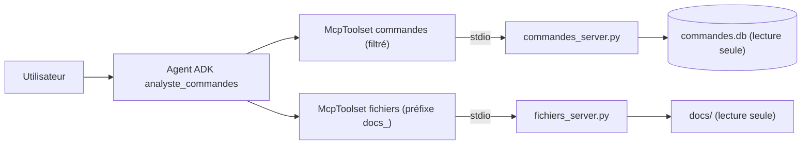

Votre agent doit répondre à « quel client pro a le plus dépensé en septembre ? » et à « ce client peut-il retourner sa commande ? ». La première question demande la **base de commandes**, la seconde la **politique de retours** rangée dans un dossier de documents. Plutôt que de coder ces accès dans l'agent, vous les exposez via **MCP** (Model Context Protocol, un protocole ouvert qui standardise la façon dont une application d'IA découvre et appelle des outils fournis par un autre programme, appelé serveur MCP).

## Pour qui ?

- Vous avez déjà construit un agent ADK avec des outils fonctions.
- Vous lisez du SQL simple (`SELECT`, `JOIN`, `GROUP BY`).
- Niveau avancé : on parle sous-processus, asynchrone et défense en profondeur.

## Ce que vous allez construire

1. **`commandes_server.py`** : un serveur MCP qui expose `lister_tables`, `executer_select` (SELECT uniquement, connexion SQLite en lecture seule) et `annuler_commande` (écriture).
2. **`fichiers_server.py`** : un serveur MCP qui liste et lit les documents d'un seul dossier, sans possibilité d'en sortir.
3. **`agent.py`** : un agent ADK qui lance les deux serveurs, **ne donne pas** `annuler_commande` au modèle et préfixe les outils documentaires.

## Prérequis techniques

- Python 3.10 ou plus récent, une clé d'API Gemini.
- [requirements.txt](./files/requirements.txt) : `google-adk==2.10.0`, `mcp>=2.3`, `python-dotenv`, `pytest`.

> [!WARNING]
> Le SDK `mcp` 2.x a renommé `FastMCP` en `MCPServer` (`from mcp.server.mcpserver import MCPServer`). Les nombreux tutoriels qui écrivent `from mcp.server.fastmcp import FastMCP` échouent avec la version 2 : le module lève une erreur qui renvoie au guide de migration.

## Programme

| Module | Leçon | Durée indicative |
| --- | --- | --- |
| 1. Le cas d'usage | Pourquoi MCP, architecture, modèle de menace | 30 min |
| 2. Construire | Écrire les deux serveurs MCP ; les brancher avec `McpToolset` et filtrer les outils | 1h45 |
| 3. Tester et exploiter | Tests sans clé, test réel, passer en HTTP et en production | 45 min |

## En local ou sur Google Cloud ?

| | En local (ce lab) | Sur Google Cloud (pour aller plus loin) |
| --- | --- | --- |
| Transport MCP | stdio : l'agent lance les serveurs comme sous-processus | HTTP (streamable HTTP) : un serveur MCP par service Cloud Run |
| Base | fichier SQLite | Cloud SQL ou BigQuery, avec un compte de service en lecture seule |
| Documents | dossier local | bucket Cloud Storage |
| Modèle | API Gemini (clé) | Vertex AI |

Code complet : [files/](./files/). Testé le 2026-10-15 avec `google-adk` 2.10.0, `mcp` 2.3.0 et `gemini-3.5-flash`.
