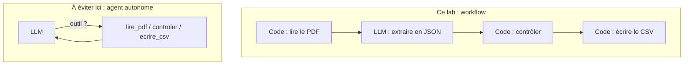

# Un workflow d'extraction : le modèle lit, le code vérifie

> [!NOTE]
> Dans cette leçon, vous allez découvrir les factures du lab, comprendre pourquoi on construit ici un **workflow** plutôt qu'un agent autonome, et répartir les rôles entre le modèle et le code.

## Les factures du lab

`generer_factures.py` crée quatre factures **fictives** (fournisseurs, adresse et SIRET inventés). Trois contiennent un défaut volontaire :

| Facture | Fournisseur (fictif) | Défaut volontaire | Ce qu'on attend |
| --- | --- | --- | --- |
| F-2026-0412 | Papeterie des Canuts | aucun | comptabilisée |
| F-2026-0413 | Imprimerie Bellecour | total HT imprimé 237,00 au lieu de 217,00 | à vérifier |
| F-2026-0414 | Traiteur de la Croix-Rousse | TVA à 20 % sur une ligne à 10 % | à vérifier |
| F-2026-0415 | Nettoyage Confluence | échéance dépassée au 2026-10-15 | comptabilisée, avec alerte |

Voici la facture F-2026-0413 telle que le programme la lit :


## Workflow ou agent ?

Un **agent** choisit lui-même ses étapes ; un **workflow** suit des étapes fixées par le code. Ici, le traitement est toujours le même : lire, extraire, contrôler, écrire. Il n'y a rien à décider.



| Critère | Workflow (ce lab) | Agent avec outils |
| --- | --- | --- |
| Étapes | toujours les mêmes, dans l'ordre | choisies par le modèle |
| Risque de sauter le contrôle | nul : le code l'appelle toujours | réel : le modèle peut l'oublier |
| Appels au modèle par facture | 1 | 3 ou plus |
| Débogage | une étape fautive identifiable | trace à relire |

> [!TIP]
> On utilise quand même ADK pour l'étape d'extraction : l'`Agent` apporte la sortie structurée validée (`output_schema`), le rangement du résultat dans l'état (`output_key`), et la même interface que vos autres agents (traces, tests avec un faux modèle).

```quiz
question: "Pourquoi ne pas donner au modèle un outil controler_facture et le laisser décider de l'appeler ?"
options:
  - "Parce qu'ADK ne permet pas d'outils sur un agent qui a un output_schema"
  - "Parce que le contrôle doit avoir lieu à chaque fois : le confier au modèle ajoute un risque d'oubli sans aucun bénéfice"
  - "Parce que les outils coûtent plus cher que le code"
answer: 1
explanation: "Une étape obligatoire ne doit pas dépendre d'une décision du modèle. Le code appelle controler() pour chaque facture, sans exception. (ADK 2.10 sait d'ailleurs combiner output_schema et outils : ce n'est pas la raison.)"
```

## Qui fait quoi ?

| Étape | Qui | Pourquoi |
| --- | --- | --- |
| Extraire le texte du PDF | `pypdf` | déterministe, gratuit, rapide |
| Retrouver numéro, dates, lignes et montants dans un texte libre | **le modèle** | chaque fournisseur a sa mise en page |
| Vérifier le format du résultat | **pydantic** | types, champs obligatoires, dates valides |
| Vérifier que les montants sont cohérents | **code Python** | arithmétique exacte, règles fiscales |
| Produire les écritures | **code Python** | format imposé par la comptabilité |

Le point clé : on demande au modèle de **recopier** les montants imprimés, même faux, et **jamais** de les corriger. Sinon, il « réparerait » silencieusement le total de la facture F-2026-0413, et l'anomalie disparaîtrait.

```quiz
question: "Le modèle recalcule et corrige le total HT de F-2026-0413 (217,00 au lieu des 237,00 imprimés). Quel est le problème ?"
options:
  - "Aucun, le total corrigé est juste"
  - "L'anomalie est masquée : la comptabilité paierait une facture dont le document dit autre chose, sans que personne ne le sache"
  - "Le JSON devient invalide"
answer: 1
explanation: "Le rôle de l'extraction est de refléter fidèlement le document. C'est au contrôle de signaler l'écart, et à un humain de demander un avoir ou une facture corrigée au fournisseur."
```

## Exercice : un cinquième contrôle

Proposez deux contrôles supplémentaires qu'un comptable aimerait voir, et dites pour chacun s'il revient au modèle ou au code.

<details>
<summary>Voir la solution</summary>

Exemples :

- **Facture en double** (même fournisseur et même numéro déjà traité) : **code**, avec une recherche dans l'historique des écritures.
- **Fournisseur inconnu** du référentiel : **code**, par comparaison avec la liste des fournisseurs ; le modèle peut aider à normaliser le nom (« Papeterie des Canuts SAS » contre « Papeterie des Canuts »).
- **Désignation suspecte** pour la nature d'achat (des plateaux repas facturés par une imprimerie) : plutôt **le modèle**, en classification, avec revue humaine.

</details>

## Résultat obtenu

Sortie réelle de la chaîne complète, le 2026-10-15 :

```text
F-2026-0412  comptabilisee  OK
F-2026-0413  a_verifier     total HT imprimé 237.00 != somme des lignes 217.00; TVA imprimée 43.40 != 20 % du HT (47.40)
F-2026-0414  a_verifier     TVA imprimée 33.60 != 10 % du HT (16.80)
F-2026-0415  comptabilisee  échéance dépassée depuis le 2026-09-19
```

Les quatre cas attendus sont retrouvés. Pour F-2026-0413, la TVA imprimée (43,40) correspond à 20 % du vrai HT (217,00), pas du HT imprimé : les deux anomalies sont liées, et c'est au comptable de trancher.

## Je sais faire

- [ ] Distinguer un workflow d'un agent et choisir le workflow quand les étapes sont fixes
- [ ] Expliquer pourquoi le modèle doit recopier les montants sans les corriger
- [ ] Répartir les étapes entre `pypdf`, le modèle, pydantic et le code
