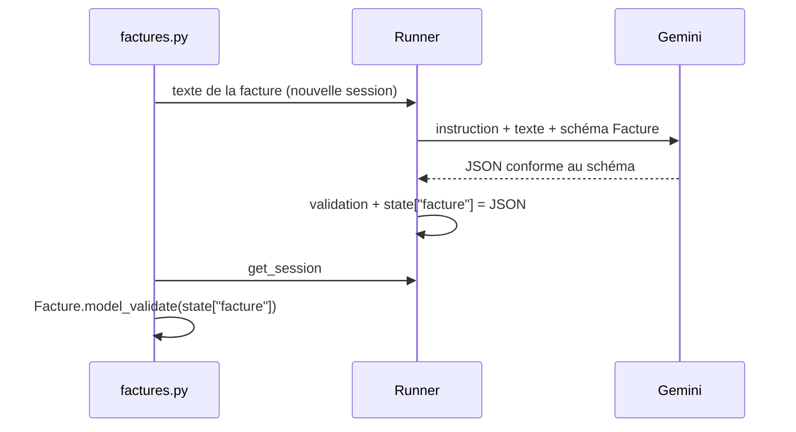

# Le schéma et l'agent extracteur

> [!NOTE]
> Dans cette leçon, vous allez générer les factures de test, extraire leur texte avec `pypdf`, décrire le résultat attendu avec un schéma pydantic et obtenir de Gemini un JSON conforme grâce à `output_schema`.

## 1. Générer les factures

```bash
pip install -r requirements.txt
cp .env.example .env          # puis mettez votre clé dans GOOGLE_API_KEY
python generer_factures.py    # écrit factures/F-2026-0412.pdf ... F-2026-0415.pdf
```

Le générateur ([generer_factures.py](../files/generer_factures.py)) dessine chaque facture avec ReportLab ; pour F-2026-0413, un dictionnaire `triche` (`{"total_ht": 237.00}`) fausse volontairement le total imprimé.

## 2. Du PDF au texte

```python title="files/factures.py"
def texte_pdf(chemin: Path) -> str:
    return "\n".join(page.extract_text() or "" for page in PdfReader(chemin).pages)
```

`pypdf` lit le texte **déjà présent** dans le PDF. Pour un PDF scanné (une image), `extract_text()` renvoie une chaîne vide : il faudrait un OCR (reconnaissance de caractères) ou envoyer directement le PDF au modèle, qui sait lire les images.

| Type de PDF | `pypdf` | Alternative |
| --- | --- | --- |
| Généré par un logiciel (ce lab) | texte complet | inutile |
| Scanné | texte vide | Gemini avec le PDF en pièce jointe, ou Document AI |
| Tableaux complexes | texte parfois désordonné | Gemini avec le PDF : il voit la mise en page |

```quiz
question: "Une facture scannée donne un texte vide avec pypdf. Que fait la chaîne actuelle ?"
options:
  - "Elle lève une erreur dans pypdf"
  - "Elle envoie un texte vide au modèle, qui ne peut rien extraire : il faut détecter ce cas avant l'appel"
  - "Elle passe automatiquement à l'OCR"
answer: 1
explanation: "pypdf ne fait pas d'OCR. Il faut tester len(texte.strip()) et, si c'est vide, envoyer le PDF lui-même au modèle (ou à un OCR) plutôt qu'un message vide."
```

## 3. Le contrat de sortie

Un **schéma** pydantic décrit les champs, leurs types et des consignes par champ (`description`). C'est à la fois la documentation pour le modèle et le validateur du résultat.

```python title="files/factures.py"
class Ligne(BaseModel):
    designation: str
    quantite: float
    prix_unitaire_ht: float
    montant_ht: float


class Facture(BaseModel):
    numero: str = Field(description="numéro de facture tel qu'imprimé")
    fournisseur: str
    date_facture: date = Field(description="format AAAA-MM-JJ")
    date_echeance: date | None = Field(description="null si absente du document")
    lignes: list[Ligne]
    total_ht: float = Field(description="total HT IMPRIMÉ sur la facture, sans le recalculer")
    taux_tva: float = Field(description="en pourcentage, ex. 20 pour 20 %")
    montant_tva: float = Field(description="montant de TVA IMPRIMÉ")
    total_ttc: float = Field(description="total TTC IMPRIMÉ")
    devise: str = "EUR"
```

> [!WARNING]
> Des montants en `float` suffisent pour **comparer** avec une tolérance d'un centime, comme ici. Pour **calculer** des soldes en production, utilisez `Decimal` (module `decimal`) : `0.1 + 0.2` ne vaut pas exactement `0.3` en virgule flottante.

## 4. L'agent extracteur

```python title="files/factures.py"
extracteur = Agent(
    name="extracteur_factures",
    model=os.environ.get("MODEL", "gemini-3.5-flash"),
    instruction="Tu extrais les données d'une facture à partir de son texte. Recopie les montants "
                "EXACTEMENT comme ils sont imprimés, même s'ils te semblent faux : un contrôle "
                "automatique vérifiera la cohérence ensuite. N'invente aucune valeur.",
    output_schema=Facture,   # réponse JSON contrainte + validée
    output_key="facture",    # le JSON validé est rangé dans session.state["facture"]
)
```

- `output_schema` : ADK transmet le schéma à Gemini, qui produit une réponse JSON conforme (**sortie structurée**), puis ADK la valide.
- `output_key` : la réponse finale est copiée dans l'état de la session, sous la clé `facture`. On la relit après l'exécution :

```python title="files/factures.py"
s = await runner.session_service.create_session(app_name="factures", user_id="compta")
msg = types.Content(role="user", parts=[types.Part(text=texte)])
async for _ in runner.run_async(user_id="compta", session_id=s.id, new_message=msg):
    pass
s = await runner.session_service.get_session(app_name="factures", user_id="compta", session_id=s.id)
return Facture.model_validate(s.state["facture"])
```



Une **session par facture** évite que le modèle mélange deux factures : il ne voit jamais l'historique d'un autre document.

```quiz
question: "Que contient session.state[\"facture\"] après l'exécution de l'extracteur ?"
options:
  - "Le texte brut du PDF"
  - "La réponse JSON du modèle, validée par rapport au schéma Facture"
  - "Le fichier CSV"
answer: 1
explanation: "output_key range la réponse finale de l'agent dans l'état. Avec output_schema, cette réponse est un objet conforme au schéma ; le code la revalide avec Facture.model_validate pour obtenir un objet Python typé."
```

## Exercice : ajouter le SIRET

Ajoutez au schéma un champ `siret` : 14 chiffres, ou `null` s'il est absent ou invalide. Comment faire valider le format sans faire confiance au modèle ?

<details>
<summary>Voir la solution</summary>

```python
from pydantic import field_validator

class Facture(BaseModel):
    ...
    siret: str | None = Field(default=None, description="14 chiffres sans espaces, null si absent")

    @field_validator("siret")
    @classmethod
    def siret_valide(cls, v):
        if v is None:
            return v
        v = v.replace(" ", "")
        if not (len(v) == 14 and v.isdigit()):
            raise ValueError("SIRET invalide")
        return v
```

La description guide le modèle, le validateur **garantit** le format : une réponse non conforme lève une erreur au lieu de passer en comptabilité. Sur nos factures fictives, le SIRET `000 000 000 00000` a bien 14 chiffres une fois les espaces retirés.

</details>

## Résultat obtenu

JSON réellement extrait par `gemini-3.5-flash` le 2026-10-15 pour la facture F-2026-0414 (dont la TVA est fausse) :

```json
{
  "numero": "F-2026-0414",
  "fournisseur": "Traiteur de la Croix-Rousse",
  "date_facture": "2026-10-03",
  "date_echeance": "2026-11-02",
  "lignes": [{"designation": "Plateaux repas", "quantite": 12.0, "prix_unitaire_ht": 14.0, "montant_ht": 168.0}],
  "total_ht": 168.0,
  "taux_tva": 10.0,
  "montant_tva": 33.6,
  "total_ttc": 201.6,
  "devise": "EUR"
}
```

Le modèle a bien recopié la TVA imprimée (33,60) sans la « corriger » en 16,80 : le contrôle pourra signaler l'écart.

## Je sais faire

- [ ] Extraire le texte d'un PDF avec `pypdf` et reconnaître un PDF scanné
- [ ] Écrire un schéma pydantic avec des descriptions par champ
- [ ] Utiliser `output_schema` et `output_key` sur un `Agent` ADK
- [ ] Relire le résultat dans l'état de la session
