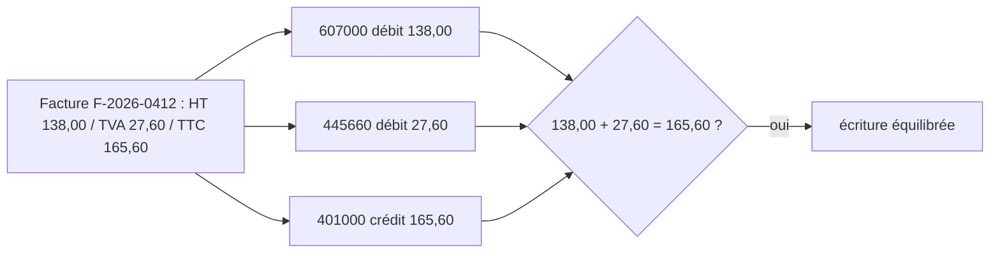

# Les contrôles de cohérence et les écritures CSV

> [!NOTE]
> Dans cette leçon, vous allez écrire les contrôles qui séparent anomalies bloquantes et simples alertes, puis transformer chaque facture saine en trois écritures comptables équilibrées dans un fichier CSV.

## Les cinq contrôles

```python title="files/factures.py"
TAUX_TVA_FR = {0.0, 2.1, 5.5, 10.0, 20.0}
TOLERANCE = 0.01  # euro : écarts d'arrondi acceptés

def controler(f: Facture, aujourdhui: date) -> tuple[list[str], list[str]]:
    """Renvoie (anomalies bloquantes, alertes)."""
    bloquantes, alertes = [], []
    for l in f.lignes:
        if abs(l.quantite * l.prix_unitaire_ht - l.montant_ht) > TOLERANCE:
            bloquantes.append(f"ligne « {l.designation} » : {l.quantite} x {l.prix_unitaire_ht} != {l.montant_ht}")
    somme = round(sum(l.montant_ht for l in f.lignes), 2)
    if abs(somme - f.total_ht) > TOLERANCE:
        bloquantes.append(f"total HT imprimé {f.total_ht:.2f} != somme des lignes {somme:.2f}")
    if f.taux_tva not in TAUX_TVA_FR:
        bloquantes.append(f"taux de TVA inattendu : {f.taux_tva} %")
    tva_attendue = round(f.total_ht * f.taux_tva / 100, 2)
    if abs(tva_attendue - f.montant_tva) > TOLERANCE:
        bloquantes.append(f"TVA imprimée {f.montant_tva:.2f} != {f.taux_tva:g} % du HT ({tva_attendue:.2f})")
    if abs(f.total_ht + f.montant_tva - f.total_ttc) > TOLERANCE:
        bloquantes.append(f"TTC {f.total_ttc:.2f} != HT + TVA ({f.total_ht + f.montant_tva:.2f})")
    if f.date_echeance is None:
        alertes.append("date d'échéance absente")
    elif f.date_echeance < f.date_facture:
        bloquantes.append("échéance antérieure à la date de facture")
    elif f.date_echeance < aujourdhui:
        alertes.append(f"échéance dépassée depuis le {f.date_echeance.isoformat()}")
    return bloquantes, alertes
```

| Contrôle | Type | Exemple dans le lab |
| --- | --- | --- |
| quantité × prix unitaire = montant de la ligne | bloquant | aucune facture fautive |
| somme des lignes = total HT | bloquant | F-2026-0413 |
| taux de TVA dans la liste des taux français | bloquant | aucune |
| HT × taux = TVA | bloquant | F-2026-0413, F-2026-0414 |
| HT + TVA = TTC | bloquant | aucune (les TTC imprimés sont cohérents avec leurs HT et TVA) |
| échéance absente ou dépassée | alerte | F-2026-0415 |

> [!TIP]
> Distinguer **bloquant** et **alerte** évite deux écueils : bloquer une facture juste parce qu'elle est en retard de paiement (c'est une information pour la trésorerie, pas une erreur), ou laisser passer une facture dont les montants ne tiennent pas.

`aujourdhui` est un **paramètre** plutôt qu'un appel à `date.today()` dans la fonction : le test peut fixer la date (`date(2026, 10, 15)`) et rester reproductible le mois prochain.

```quiz
question: "Une facture a un taux de TVA de 19,6 % (ancien taux français) avec des montants cohérents entre eux. Que renvoie controler ?"
options:
  - "Aucune anomalie, car HT × taux = TVA"
  - "Une anomalie bloquante « taux de TVA inattendu »"
  - "Une simple alerte"
answer: 1
explanation: "19,6 n'est pas dans TAUX_TVA_FR : c'est bloquant, même si l'arithmétique est juste. Une facture de 2026 à ce taux mérite un regard humain (vieille facture ? erreur du fournisseur ?)."
```

## Les écritures comptables

Une facture d'achat se traduit en comptabilité française par trois **écritures** (lignes du journal des achats, code `HA`), selon le plan comptable général :

| Compte | Intitulé | Débit | Crédit |
| --- | --- | --- | --- |
| 607000 | Achats de marchandises | HT | |
| 445660 | TVA déductible sur autres biens et services | TVA | |
| 401000 | Fournisseurs | | TTC |

Le total des débits égale le total des crédits : l'écriture est **équilibrée**. Le choix du compte de charge (607 ici) dépend de la nature de l'achat ; un vrai service comptable affinerait par fournisseur ou par catégorie.

```python title="files/factures.py"
def ecritures(f: Facture) -> list[dict]:
    base = {"journal": "HA", "date": f.date_facture.isoformat(), "piece": f.numero,
            "libelle": f"{f.fournisseur} {f.numero}"}
    return [{**base, "compte": "607000", "debit": f"{f.total_ht:.2f}", "credit": ""},      # achats HT
            {**base, "compte": "445660", "debit": f"{f.montant_tva:.2f}", "credit": ""},   # TVA déductible
            {**base, "compte": "401000", "debit": "", "credit": f"{f.total_ttc:.2f}"}]     # fournisseur TTC
```



## Écrire les fichiers

```python title="files/factures.py"
if not bloquantes:
    journal += ecritures(f)  # seules les factures cohérentes partent en comptabilité
...
with open(sortie / "ecritures.csv", "w", newline="", encoding="utf-8") as fh:
    w = csv.DictWriter(fh, fieldnames=["journal", "date", "piece", "compte", "libelle", "debit", "credit"],
                       delimiter=";")
    w.writeheader()
    w.writerows(journal)
```

Le séparateur `;` est l'usage le plus courant des imports comptables en France, car la virgule y sert de séparateur décimal. Vérifiez le format attendu par **votre** logiciel (ordre des colonnes, décimales, encodage) : il varie d'un éditeur à l'autre.

```quiz
question: "Pourquoi la facture F-2026-0415 (échéance dépassée) figure-t-elle dans ecritures.csv ?"
options:
  - "C'est une erreur du programme"
  - "Parce qu'une échéance dépassée est une alerte, pas une anomalie bloquante : la facture est juste, elle est seulement en retard de paiement"
  - "Parce que le modèle l'a décidé"
answer: 1
explanation: "Seules les anomalies bloquantes empêchent la comptabilisation. Le retard est signalé dans anomalies.json pour que la trésorerie paie vite."
```

## Exercice : un contrôle de doublon

Ajoutez à `traiter` un contrôle qui rend bloquante une facture dont le couple (fournisseur, numéro) a déjà été vu dans le même lot.

<details>
<summary>Voir la solution</summary>

```python
vus = set()
for pdf in sorted(dossier.glob("*.pdf")):
    f = await extraire(runner, texte_pdf(pdf))
    bloquantes, alertes = controler(f, aujourdhui)
    cle = (f.fournisseur.strip().lower(), f.numero.strip())
    if cle in vus:
        bloquantes.append("facture en double dans le lot")
    vus.add(cle)
    ...
```

En production, `vus` serait chargé depuis l'historique (les pièces déjà présentes dans les écritures des mois précédents), pas seulement le lot courant.

</details>

## Résultat obtenu

`sortie/ecritures.csv` réellement produit le 2026-10-15 :

```text
journal;date;piece;compte;libelle;debit;credit
HA;2026-09-30;F-2026-0412;607000;Papeterie des Canuts F-2026-0412;138.00;
HA;2026-09-30;F-2026-0412;445660;Papeterie des Canuts F-2026-0412;27.60;
HA;2026-09-30;F-2026-0412;401000;Papeterie des Canuts F-2026-0412;;165.60
HA;2026-08-20;F-2026-0415;607000;Nettoyage Confluence F-2026-0415;480.00;
HA;2026-08-20;F-2026-0415;445660;Nettoyage Confluence F-2026-0415;96.00;
HA;2026-08-20;F-2026-0415;401000;Nettoyage Confluence F-2026-0415;;576.00
```

Deux factures sur quatre partent en comptabilité ; les deux autres attendent un humain, avec la raison écrite dans `anomalies.json`.

## Je sais faire

- [ ] Écrire des contrôles de cohérence avec une tolérance d'arrondi
- [ ] Séparer anomalies bloquantes et alertes
- [ ] Traduire une facture d'achat en trois écritures équilibrées
- [ ] Écrire un CSV au format attendu par la comptabilité
