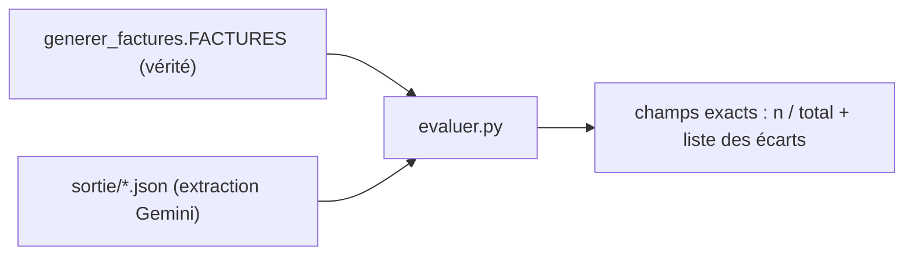
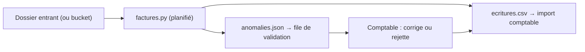

# Tester, mesurer la qualité, mettre en service

> [!NOTE]
> Dans cette leçon, vous allez tester toute la chaîne sans clé d'API, lancer le vrai traitement, **mesurer** l'exactitude de l'extraction champ par champ, puis organiser son exploitation avec une validation humaine.

## Tester sans clé

Trois familles de tests dans [test_factures.py](../files/test_factures.py) :

| Test | Ce qu'il vérifie |
| --- | --- |
| `test_facture_coherente`, `test_anomalies_detectees` | chaque contrôle se déclenche (et seulement lui) |
| `test_ecritures_equilibrees` | débits = crédits = TTC |
| `test_pipeline_complet` | PDF réels générés, lecture `pypdf`, extraction par un **faux modèle**, CSV de 6 lignes |

Le faux modèle lit le numéro dans le texte reçu et renvoie un JSON valide : la chaîne complète tourne, sans réseau.

```python title="files/test_factures.py"
class FauxModele(BaseLlm):
    """Renvoie un JSON tiré du texte reçu : simule l'extraction sans appeler Gemini."""
    async def generate_content_async(self, llm_request, stream=False):
        texte = llm_request.contents[-1].parts[0].text
        num = texte.split("FACTURE N° ")[1].split()[0]
        json = facture(numero=num).model_dump_json()
        yield LlmResponse(content=types.Content(role="model", parts=[types.Part(text=json)]))

agent = extracteur.model_copy(update={"model": FauxModele(model="faux")})
```

`model_copy` (pydantic) crée une copie de l'agent avec un autre modèle : l'instruction, le schéma et `output_key` restent ceux de production.

```quiz
question: "Que NE vérifie PAS test_pipeline_complet ?"
options:
  - "Que pypdf lit bien le texte des PDF générés"
  - "Que Gemini extrait correctement les montants"
  - "Que le CSV contient trois écritures par facture saine"
answer: 1
explanation: "Le faux modèle renvoie un JSON fabriqué par le test : la qualité de l'extraction réelle se mesure avec le vrai modèle et evaluer.py."
```

## Mesurer la qualité de l'extraction

Ici, on connaît la **vérité terrain** : les valeurs qui ont servi à générer les PDF. [evaluer.py](../files/evaluer.py) compare chaque champ extrait à la valeur attendue (montants **imprimés**, y compris faux) :

```python title="files/evaluer.py"
for numero, fournisseur, d, e, lignes, taux, triche in FACTURES:
    ht = round(sum(q * pu for _, q, pu in lignes), 2)
    attendu = {"numero": numero, "fournisseur": fournisseur, "date_facture": d, "date_echeance": e,
               "total_ht": triche.get("total_ht", ht), "taux_tva": taux,
               "montant_tva": triche.get("tva", round(ht * taux / 100, 2)), "nb_lignes": len(lignes)}
    lu = json.loads((sortie / f"{numero}.json").read_text())
    ...
print(f"champs exacts : {ok}/{total}")
```



> [!WARNING]
> Quatre factures générées par le même programme ne représentent **pas** vos vraies factures. Avant la mise en service, constituez un jeu de 30 à 50 factures réelles anonymisées, de fournisseurs différents, saisissez la vérité à la main une fois, et relancez `evaluer.py` (adapté) à chaque changement de modèle ou d'instruction.

## Résultat obtenu

Tests du 2026-10-15, sans clé :

```text
test_factures.py::test_facture_coherente PASSED                          [ 25%]
test_factures.py::test_anomalies_detectees PASSED                        [ 50%]
test_factures.py::test_ecritures_equilibrees PASSED                      [ 75%]
test_factures.py::test_pipeline_complet PASSED                           [100%]
============================== 4 passed in 1.43s ===============================
```

Traitement réel des 4 factures avec `gemini-3.5-flash`, puis évaluation, le même jour :

```text
F-2026-0412  comptabilisee  OK
F-2026-0413  a_verifier     total HT imprimé 237.00 != somme des lignes 217.00; TVA imprimée 43.40 != 20 % du HT (47.40)
F-2026-0414  a_verifier     TVA imprimée 33.60 != 10 % du HT (16.80)
F-2026-0415  comptabilisee  échéance dépassée depuis le 2026-09-19
$ python evaluer.py
champs exacts : 32/32
```

## Mettre en service



| Point d'exploitation | Recommandation |
| --- | --- |
| Déclenchement | une tâche planifiée (cron) sur un dossier entrant ; sur Google Cloud, un dépôt dans Cloud Storage qui déclenche un service Cloud Run (non testé ici) |
| Idempotence | déplacer chaque PDF traité dans `traitees/` pour ne jamais le comptabiliser deux fois |
| Validation humaine | toute facture `a_verifier` passe par un comptable ; il ne corrige jamais le JSON à la place du fournisseur |
| Données | les factures contiennent des données d'entreprise : vérifiez les conditions d'utilisation de l'API (offre gratuite ou payante) avant d'envoyer de vrais documents |
| Coût | un appel au modèle par facture ; `gemini-3.5-flash-lite` peut suffire pour des factures simples, à valider avec `evaluer.py` |

```quiz
question: "evaluer.py donne 32/32 sur nos 4 factures. Que peut-on en conclure ?"
options:
  - "L'extraction est fiable à 100 % sur toutes les factures"
  - "La chaîne fonctionne sur ces factures générées ; la fiabilité réelle se mesure sur un jeu de factures réelles et variées"
  - "On peut supprimer les contrôles de cohérence"
answer: 1
explanation: "Quatre documents au même gabarit ne disent rien des mises en page des vrais fournisseurs. Et même avec une extraction parfaite, les contrôles restent nécessaires : ce sont eux qui détectent les erreurs des fournisseurs."
```

## Exercice : comparer deux modèles

Vous voulez savoir si `gemini-3.5-flash-lite` (moins cher) suffit. Décrivez la procédure en trois commandes et le critère de décision.

<details>
<summary>Voir la solution</summary>

```bash
MODEL=gemini-3.5-flash-lite python factures.py && python evaluer.py > lite.txt
MODEL=gemini-3.5-flash      python factures.py && python evaluer.py > flash.txt
diff lite.txt flash.txt
```

Critère : sur votre jeu de factures réelles, le modèle le moins cher est acceptable s'il obtient le même score **et** si ses écarts éventuels sont tous rattrapés par les contrôles (une erreur d'extraction qui produit une anomalie bloquante coûte une vérification humaine ; une erreur qui passe les contrôles coûte une écriture fausse). La variable `MODEL` est lue par `factures.py` au démarrage.

</details>

## Je sais faire

- [ ] Tester une chaîne d'extraction de bout en bout avec un faux modèle
- [ ] Mesurer l'exactitude champ par champ contre une vérité terrain
- [ ] Organiser la validation humaine des anomalies
- [ ] Choisir un modèle sur la base d'une mesure, pas d'une impression
