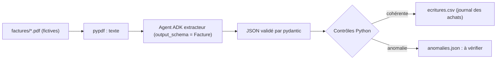

Chaque mois, le service comptable ressaisit des dizaines de factures fournisseurs : numéro, dates, lignes, HT, TVA, TTC. C'est lent, et une facture fausse (un total qui ne correspond pas aux lignes, une TVA mal calculée) passe parfois inaperçue. Dans ce lab, un agent ADK **lit** les factures, et du code Python **vérifie** tout ce qui peut l'être avant de produire les écritures comptables.

## Pour qui ?

- Vous connaissez Python et les bases d'ADK (un `Agent`, un `Runner`).
- Pas besoin d'être comptable : les trois comptes utilisés sont expliqués.
- Aucun projet Google Cloud n'est nécessaire.

## Ce que vous allez construire

1. **`generer_factures.py`** crée quatre factures PDF fictives avec ReportLab, dont trois avec un défaut volontaire.
2. **`factures.py`** extrait chaque facture en JSON **contraint** par un schéma pydantic, applique cinq contrôles de cohérence, écrit `ecritures.csv` pour les factures saines et `anomalies.json` pour toutes.
3. **`test_factures.py`** teste les contrôles et la chaîne complète sans clé d'API.

## Prérequis techniques

- Python 3.10 ou plus récent, une clé d'API Gemini.
- [requirements.txt](./files/requirements.txt) : `google-adk==2.10.0`, `pypdf`, `reportlab`, `pydantic>=2`, `python-dotenv`, `pytest`.

## Programme

| Module | Leçon | Durée indicative |
| --- | --- | --- |
| 1. Le cas d'usage | Un workflow d'extraction : ce que fait le modèle, ce que fait le code | 30 min |
| 2. Construire | Le schéma et l'agent extracteur ; les contrôles et les écritures CSV | 1h20 |
| 3. Tester et exploiter | Tests sans clé, test réel, mesure de la qualité, mise en service | 40 min |

## En local ou sur Google Cloud ?

| | En local (ce lab) | Sur Google Cloud (pour aller plus loin) |
| --- | --- | --- |
| Lecture du PDF | `pypdf` (PDF avec texte) | Document AI pour des scans, ou envoi direct du PDF à Gemini |
| Modèle | API Gemini (clé) | Vertex AI |
| Déclenchement | `python factures.py` sur un dossier | dépôt dans un bucket Cloud Storage, traitement par Cloud Run |
| Sortie | `sortie/ecritures.csv` | fichier dans un bucket, ou table BigQuery |

Code complet : [files/](./files/). Testé le 2026-10-15 avec `google-adk` 2.10.0 et `gemini-3.5-flash`.
