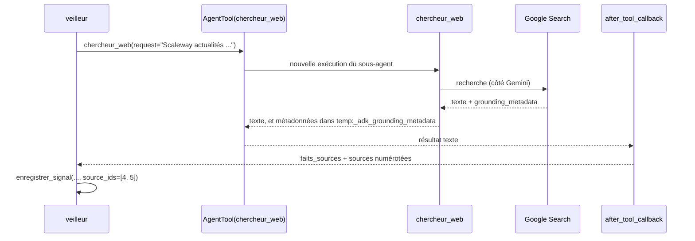

# La veille avec un agent : signaux, sources, architecture

> [!NOTE]
> Dans cette leçon, vous allez définir ce qu'est un « signal » de veille, comprendre pourquoi une synthèse sans source ne vaut rien, et découvrir l'architecture à deux agents imposée par l'outil de recherche Google.

## Du bruit aux signaux

Une recherche « OVHcloud actualités » renvoie des dizaines de pages. La veille ne retient que des **signaux** : des faits datés qui peuvent changer une décision.

| Catégorie | Exemple de signal | Pourquoi il compte |
| --- | --- | --- |
| prix | nouvelle grille tarifaire, hausse d'une option | votre offre devient plus ou moins compétitive |
| lancement | nouveau produit, nouvelle région | un concurrent entre sur votre marché |
| recrutement | campagne d'embauches sur un métier précis | indice d'un investissement à venir |
| partenariat | accord avec un fournisseur ou un client majeur | changement de rapport de force |
| autre | incident, résultat financier, événement | contexte utile, à trier |

Chaque signal enregistré par l'agent a la même structure : `concurrent`, `categorie`, `resume` (une phrase), `date`, `sources` (identifiants de pages web).

## Une synthèse sans source ne vaut rien

Un modèle de langage peut écrire une phrase plausible et fausse : une **hallucination**. En veille, c'est grave : une fausse baisse de prix d'un concurrent peut déclencher une mauvaise décision. D'où trois règles de conception :

1. La recherche passe par **Google Search** et le modèle répond **ancré** (grounded) : l'API renvoie, en plus du texte, la liste des pages utilisées (`grounding_chunks`) et quels passages du texte s'appuient sur quelles pages (`grounding_supports`).
2. Les URL du rapport viennent de ces **métadonnées**, jamais du texte écrit par le modèle.
3. Un signal **sans source valide est refusé** par l'outil `enregistrer_signal`.

```quiz
question: "Le modèle écrit dans sa réponse « source : https://exemple.com/annonce ». Pourquoi le rapport n'utilise-t-il pas cette URL ?"
options:
  - "Parce que les URL sont trop longues pour un tableau Markdown"
  - "Parce qu'une URL écrite par le modèle peut être inventée ; seules celles des métadonnées d'ancrage proviennent réellement de la recherche"
  - "Parce que Google interdit de citer des URL"
answer: 1
explanation: "Le texte du modèle n'est pas une preuve. Les grounding_chunks sont produits par le service de recherche lui-même : ce sont les pages réellement consultées."
```

## L'architecture à deux agents

L'outil `google_search` d'ADK est un outil **intégré au modèle** (la recherche est exécutée côté Google, pas par votre code). Le code source d'ADK 2.10 le rappelle : les outils intégrés ne peuvent pas être utilisés en même temps que d'autres outils dans le même agent. Or le veilleur a besoin de la recherche **et** de `enregistrer_signal`. La solution : un sous-agent dédié, appelé comme un outil grâce à `AgentTool`.



| Composant | Rôle | Outils |
| --- | --- | --- |
| `chercheur_web` | une recherche, des faits datés | `google_search` uniquement |
| `veilleur` | orchestrer les recherches, choisir les signaux | `AgentTool(chercheur_web)`, `enregistrer_signal` |
| `ajouter_sources` (callback) | transformer les métadonnées en sources numérotées | aucun, c'est du code |
| `rediger_rapport` | mettre en forme le Markdown | aucun, c'est du code |

> [!TIP]
> ADK propose aussi `GoogleSearchTool(bypass_multi_tools_limit=True)`, qui fait cet emballage automatiquement. Nous écrivons le sous-agent nous-mêmes pour maîtriser son instruction (« des faits datés, aucune opinion ») et voir le mécanisme.

```quiz
question: "Pourquoi ne pas mettre google_search et enregistrer_signal dans le même agent ?"
options:
  - "Parce que google_search est trop lent"
  - "Parce qu'un outil intégré au modèle comme google_search ne peut pas être combiné avec d'autres outils dans le même agent ; on l'isole dans un sous-agent appelé via AgentTool"
  - "Parce qu'enregistrer_signal a besoin d'une clé différente"
answer: 1
explanation: "C'est la limitation documentée dans le code d'ADK (« the built-in tools cannot be used together with other tools »). AgentTool fait du sous-agent un outil comme un autre pour le veilleur."
```

## Exercice : adapter la veille à votre secteur

Rédigez le `concurrents.json` d'une veille sur trois éditeurs de logiciels de paie, et proposez une sixième catégorie de signal pertinente pour ce secteur.

<details>
<summary>Voir la solution</summary>

```json
{
  "secteur": "logiciels de paie pour PME",
  "concurrents": ["Éditeur A", "Éditeur B", "Éditeur C"],
  "jours": 7
}
```

Remplacez les noms par les vrais concurrents que vous suivez. Catégorie supplémentaire pertinente : **réglementaire** (mise à jour liée à une nouvelle loi, certification obtenue). Il faut l'ajouter à la fois dans le `Literal` du paramètre `categorie` de `enregistrer_signal` et dans `CATEGORIES` (ordre des sections du rapport).

</details>

## Résultat obtenu

Début de la trace réelle du 2026-10-15 : le veilleur lance une recherche par concurrent, puis enregistre les signaux en citant des sources précises.

```text
   [outil] chercheur_web {"request": "OVHcloud actualités octobre 2026 08-15 octobre 2026"}
   [outil] chercheur_web {"request": "Scaleway actualités octobre 2026 08-15 octobre 2026"}
   [outil] chercheur_web {"request": "Hetzner actualités octobre 2026 08-15 octobre 2026"}
   [outil] chercheur_web {"request": "OVHcloud annonce 8 octobre 2026 15 octobre 2026"}
   [outil] enregistrer_signal {"source_ids": [1, 2, 3], "concurrent": "Scaleway", "categorie": "partenariat", ...
   [outil] enregistrer_signal {"date_signal": "2026-10-13", "source_ids": [4, 5], "concurrent": "Scaleway", ...
```

> [!WARNING]
> Le contenu du rapport dépend du web au moment de l'exécution et de l'interprétation du modèle. Il est marqué « à relire avant diffusion » : un humain vérifie chaque signal important en ouvrant sa source.

## Je sais faire

- [ ] Définir les catégories de signaux d'une veille
- [ ] Expliquer pourquoi les sources doivent venir des métadonnées d'ancrage
- [ ] Justifier l'architecture veilleur + sous-agent de recherche
