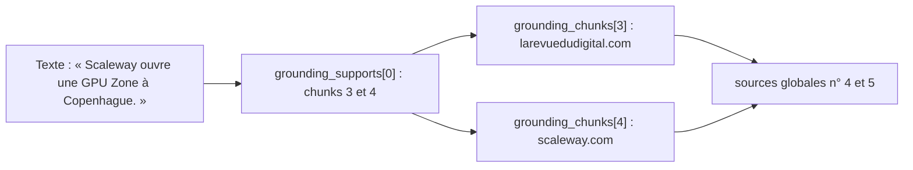

# La recherche web et les sources vérifiables

> [!NOTE]
> Dans cette leçon, vous allez écrire le sous-agent de recherche, l'emballer dans un `AgentTool` qui transmet les métadonnées d'ancrage, puis écrire le callback qui transforme ces métadonnées en sources numérotées et en faits reliés à leurs sources.

## 1. Le sous-agent de recherche

```python title="files/veille.py"
chercheur = Agent(
    name="chercheur_web",
    model=MODEL,
    description="Recherche sur le web les actualités récentes d'une entreprise et renvoie des faits datés.",
    instruction="Tu fais une recherche Google sur la demande reçue. Réponds par 3 à 6 puces factuelles, "
                "chacune avec sa date (AAAA-MM-JJ si connue). Uniquement des faits trouvés, aucune opinion.",
    tools=[google_search],
)
```

La `description` compte : c'est elle que le veilleur lit pour savoir à quoi sert l'outil `chercheur_web`.

## 2. L'emballer dans un `AgentTool`

```python title="files/veille.py"
tools=[AgentTool(chercheur_agent, propagate_grounding_metadata=True), enregistrer_signal],
after_tool_callback=ajouter_sources,
```

Quand le veilleur appelle `chercheur_web(request=...)`, `AgentTool` lance une exécution séparée du sous-agent et renvoie **seulement le texte** de sa dernière réponse. Avec `propagate_grounding_metadata=True`, il range en plus les métadonnées d'ancrage de cette réponse dans l'état, sous la clé `temp:_adk_grounding_metadata` (nom relevé dans le code d'ADK 2.10 ; le préfixe `temp:` signifie « pour cette invocation seulement »).

| Paramètre d'`AgentTool` | Effet |
| --- | --- |
| `skip_summarization` | `False` par défaut : le veilleur relit le résultat et continue ; `True` : le résultat de l'outil clôt le tour, sans nouvel appel au modèle du veilleur |
| `propagate_grounding_metadata` | copie les métadonnées d'ancrage du sous-agent dans l'état temporaire |
| `include_plugins` | applique au sous-agent les plugins du Runner parent |

## 3. Les métadonnées d'ancrage

Une réponse ancrée contient notamment :

- `grounding_chunks` : la liste des pages consultées, chacune avec `web.uri` et `web.title` ;
- `grounding_supports` : des passages du texte (`segment.text`) et les indices des pages qui les justifient (`grounding_chunk_indices`).



## 4. Le callback qui fabrique les sources

Un **callback** ADK est une fonction appelée à un moment précis du cycle de l'agent. `after_tool_callback` est appelé après chaque outil ; s'il renvoie un dictionnaire, celui-ci **remplace** le résultat de l'outil vu par le modèle.

```python title="files/veille.py"
def ajouter_sources(tool, args, tool_context: ToolContext, tool_response):
    """after_tool_callback : après chaque recherche, numérote les sources et relie chaque fait à ses sources."""
    if tool.name != chercheur.name:
        return None
    meta = tool_context.state.get("temp:_adk_grounding_metadata")
    tool_context.state["temp:_adk_grounding_metadata"] = None  # ne pas réattribuer à la recherche suivante
    sources = list(tool_context.state.get("sources", []))
    id_de = {}  # index du chunk dans cette recherche -> identifiant global de la source
    for i, chunk in enumerate(getattr(meta, "grounding_chunks", None) or []):
        if not (chunk.web and chunk.web.uri):
            continue
        url = url_finale(chunk.web.uri)
        existant = next((s for s in sources if s["url"] == url), None)
        if existant is None:
            existant = {"id": len(sources) + 1, "titre": chunk.web.title or chunk.web.domain or url, "url": url}
            sources.append(existant)
        id_de[i] = existant["id"]
    tool_context.state["sources"] = sources
    faits = [{"texte": s.segment.text, "sources": sorted({id_de[j] for j in s.grounding_chunk_indices or [] if j in id_de})}
             for s in (getattr(meta, "grounding_supports", None) or []) if s.segment and s.segment.text]
    return {"faits_sources": faits, "texte_complet": tool_response,
            "sources": [{"id": s["id"], "titre": s["titre"]} for s in sources if s["id"] in id_de.values()]}
```

Points clés :

- les identifiants sont **globaux** à toute la veille (la source n° 7 reste la n° 7 d'une recherche à l'autre) et dédoublonnés par URL ;
- le modèle ne reçoit que `id` et `titre` : il n'a aucune URL à recopier, donc aucune à inventer ;
- on **vide** la clé temporaire après lecture : si la recherche suivante ne renvoyait aucune métadonnée, on ne lui attribuerait pas celles de la précédente.

> [!WARNING]
> Les `web.uri` renvoyés par l'API Gemini sont des liens de **redirection** (`https://vertexaisearch.cloud.google.com/grounding-api-redirect/...`). `url_finale` suit la redirection avec une requête `HEAD` pour garder l'adresse réelle de la page dans le rapport. Pendant nos essais du 2026-10-15, une telle requête a renvoyé `302` vers `https://www.hetzner.com/newsroom/`.

```python title="files/veille.py"
def url_finale(url: str) -> str:
    """Les URL d'ancrage sont des redirections Google : on garde la vraie page (repli : l'URL reçue)."""
    if "grounding-api-redirect" not in url:
        return url
    try:
        return httpx.head(url, follow_redirects=False, timeout=10).headers.get("location", url)
    except httpx.HTTPError:
        return url
```

```quiz
question: "Que voit le veilleur comme résultat de chercheur_web, une fois le callback appliqué ?"
options:
  - "Seulement le texte du sous-agent"
  - "Un dictionnaire avec faits_sources (passages reliés à des identifiants), texte_complet et la liste des sources (id, titre)"
  - "Les URL complètes de toutes les pages"
answer: 1
explanation: "Le dictionnaire renvoyé par after_tool_callback remplace la réponse de l'outil. Le modèle reçoit des identifiants et des titres, jamais les URL."
```

```quiz
question: "Pourquoi relier chaque fait à ses sources (faits_sources) plutôt que donner toutes les sources de la recherche ?"
options:
  - "Pour réduire le nombre de jetons"
  - "Pour que chaque signal cite les pages qui le justifient vraiment, et pas les 7 pages de la recherche"
  - "Parce que grounding_chunks est souvent vide"
answer: 1
explanation: "Dans notre première version, sans faits_sources, le modèle citait toutes les sources d'une recherche pour chaque signal (« [17] [18] ... [23] »). Avec les passages reliés, les signaux citent une à trois sources précises."
```

## Exercice : filtrer les domaines

La direction ne veut pas de sources issues de sites de cours de bourse grand public. Modifiez le callback pour ignorer les pages dont le domaine figure dans une liste `DOMAINES_EXCLUS`.

<details>
<summary>Voir la solution</summary>

```python
from urllib.parse import urlparse

DOMAINES_EXCLUS = {"exemple-bourse.test"}

# dans la boucle, après url = url_finale(chunk.web.uri) :
if urlparse(url).hostname and urlparse(url).hostname.removeprefix("www.") in DOMAINES_EXCLUS:
    continue
```

Le chunk ignoré n'entre pas dans `id_de` : les faits qui ne s'appuyaient que sur lui auront une liste de sources vide, et `enregistrer_signal` refusera de les enregistrer. Le filtre se fait **après** `url_finale`, car avant la redirection tous les domaines sont `vertexaisearch.cloud.google.com`.

</details>

## Résultat obtenu

Section « Sources » du rapport réel du 2026-10-15 (extrait) : les URL sont les pages finales, plus les redirections.

```text
1. [scaleway.com](https://www.scaleway.com/news/scaleway-scales-up-to-power-europes-ai-ambitions/)
4. [larevuedudigital.com](https://www.larevuedudigital.com/scaleway-de-xavier-niel-renforce-ses-capacites-de-calcul-pour-une-ia-hebergee-en-europe/)
5. [scaleway.com](https://www.scaleway.com/en/news/)
13. [hetzner.com](https://status.hetzner.com/incident/0bd2f9f1-d3fd-420d-80e3-0259cbd9a095)
```

Seules les sources citées par au moins un signal figurent dans le rapport : 13 sur les 19 collectées.

## Je sais faire

- [ ] Isoler `google_search` dans un sous-agent appelé via `AgentTool`
- [ ] Récupérer les métadonnées d'ancrage avec `propagate_grounding_metadata`
- [ ] Écrire un `after_tool_callback` qui remplace le résultat d'un outil
- [ ] Résoudre les URL de redirection d'ancrage
