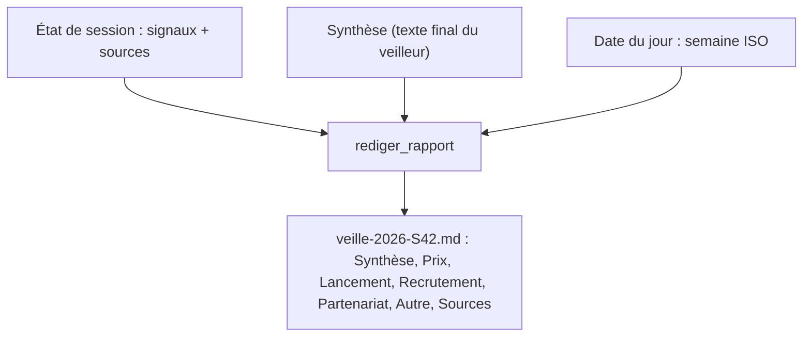

# Les signaux structurés et le rapport hebdomadaire

> [!NOTE]
> Dans cette leçon, vous allez écrire l'outil qui enregistre un signal seulement s'il cite des sources existantes, l'instruction du veilleur, et la fonction qui produit le rapport Markdown de la semaine.

## 1. Un outil qui refuse les signaux sans preuve

```python title="files/veille.py"
def enregistrer_signal(concurrent: str, categorie: Literal["prix", "lancement", "recrutement", "partenariat", "autre"],
                       resume: str, date_signal: str, source_ids: list[int], tool_context: ToolContext) -> dict:
    """Enregistre un signal concurrentiel vérifiable.

    Args:
        concurrent: nom de l'entreprise concernée.
        categorie: prix, lancement, recrutement, partenariat ou autre.
        resume: le fait en une phrase.
        date_signal: date du fait, AAAA-MM-JJ (ou AAAA-MM si le jour est inconnu).
        source_ids: identifiants des sources (champ "sources" renvoyé par chercheur_web).
    """
    connues = {s["id"] for s in tool_context.state.get("sources", [])}
    if not source_ids or not set(source_ids) <= connues:
        return {"erreur": f"source_ids doit citer des sources existantes parmi {sorted(connues)}"}
    signaux = list(tool_context.state.get("signaux", []))
    signaux.append({"concurrent": concurrent, "categorie": categorie, "resume": resume,
                    "date": date_signal, "sources": sorted(set(source_ids))})
    tool_context.state["signaux"] = signaux
    return {"ok": True, "nb_signaux": len(signaux)}
```

- Le type `Literal[...]` devient une **énumération** dans la déclaration de l'outil : le modèle ne peut proposer qu'une des cinq catégories.
- La vérification `set(source_ids) <= connues` (inclusion d'ensembles) refuse tout identifiant inventé. L'erreur renvoyée liste les identifiants valides : le modèle peut se corriger au tour suivant.
- Les signaux et les sources vivent dans l'**état de session** (`signaux`, `sources`), pas dans le texte de la conversation : le rapport les relira tels quels.

```quiz
question: "Le modèle appelle enregistrer_signal avec source_ids=[2, 42] alors que seules les sources 1 à 19 existent. Que se passe-t-il ?"
options:
  - "Le signal est enregistré avec la source 2 seulement"
  - "Le signal est refusé, l'outil renvoie la liste des identifiants valides et le modèle peut réessayer"
  - "ADK lève une exception et la veille s'arrête"
answer: 1
explanation: "L'ensemble {2, 42} n'est pas inclus dans les sources connues : rien n'est enregistré. Renvoyer l'erreur comme résultat (au lieu de lever une exception) laisse le modèle corriger son appel."
```

## 2. L'instruction du veilleur

```python title="files/veille.py"
instruction="""Tu es analyste de veille concurrentielle. Pour CHAQUE concurrent de la demande :
1. Appelle chercheur_web avec une requête précise (nom + actualités + période demandée).
2. Pour chaque fait sur les prix, un lancement, des recrutements ou un partenariat, appelle
   enregistrer_signal en citant les sources de CE fait (champ faits_sources). Ignore les faits sans source.
Quand tout est enregistré, réponds par une synthèse de 3 à 5 phrases : tendances communes
et ce qu'il faudrait surveiller. Pas de liste de liens : le rapport les ajoute.""",
```

La demande elle-même est construite par le code à partir de `concurrents.json` et de la date du jour :

```python title="files/veille.py"
demande = (f"Secteur : {config['secteur']}. Concurrents : {', '.join(config['concurrents'])}. "
           f"Période : les {config.get('jours', 7)} jours précédant le {jour.isoformat()}.")
```

> [!TIP]
> Donner la date du jour **dans la demande** est indispensable : sans elle, le modèle ne sait pas ce que « la semaine dernière » veut dire et peut chercher des actualités d'une autre année.

## 3. Le rapport, écrit par du code

```python title="files/veille.py"
def rediger_rapport(synthese: str, signaux: list[dict], sources: list[dict], jour: date) -> str:
    annee, semaine, _ = jour.isocalendar()
    lignes = [f"# Veille concurrentielle - semaine {semaine} ({annee})", "",
              f"_Généré le {jour.isoformat()} par un agent : à relire avant diffusion._", "",
              "## Synthèse", "", synthese.strip(), ""]
    for cat in CATEGORIES:
        du_type = sorted((s for s in signaux if s["categorie"] == cat), key=lambda s: s["date"], reverse=True)
        if du_type:
            lignes += [f"## {cat.capitalize()}", "", "| Date | Concurrent | Signal | Sources |", "|---|---|---|---|"]
            lignes += [f"| {s['date']} | {s['concurrent']} | {s['resume']} | "
                       f"{' '.join(f'[{i}]' for i in s['sources'])} |" for s in du_type]
            lignes.append("")
    cites = sorted({i for s in signaux for i in s["sources"]})
    lignes += ["## Sources", ""] + [f"{s['id']}. [{s['titre']}]({s['url']})" for s in sources if s["id"] in cites]
    return "\n".join(lignes) + "\n"
```



| Partie du rapport | Produite par | Garantie |
| --- | --- | --- |
| Synthèse | le modèle | à relire : c'est une interprétation |
| Tableaux de signaux | le code, depuis l'état | chaque ligne a au moins une source vérifiée |
| Liste des sources | le code, depuis les métadonnées | URL réellement consultées |
| Nom du fichier | le code (semaine ISO) | un fichier par semaine, `S42` pour la semaine 42 |

La **semaine ISO** (norme ISO 8601) commence le lundi ; la semaine 1 est celle qui contient le premier jeudi de l'année. `date(2026, 10, 15).isocalendar()` donne la semaine 42.

```quiz
question: "Un signal mentionne une source que le modèle a citée mais qui n'apparaît dans aucun autre signal. Figure-t-elle dans la section Sources ?"
options:
  - "Non, seules les sources des faits non enregistrés y figurent"
  - "Oui : la section liste exactement les sources citées par au moins un signal enregistré"
  - "Oui, avec toutes les sources collectées pendant la veille"
answer: 1
explanation: "cites rassemble les identifiants de tous les signaux enregistrés ; les sources collectées mais jamais citées sont écartées du rapport."
```

## Exercice : signaler les nouveautés

Modifiez la chaîne pour ne garder que les signaux **absents** du rapport de la semaine précédente (même concurrent, même résumé). Où placer ce filtre ?

<details>
<summary>Voir la solution</summary>

Dans le code, pas dans l'agent : ajoutez à `lancer_veille` un paramètre `deja_vus: str = ""` (le texte du rapport précédent) et filtrez juste avant `rediger_rapport` :

```python
signaux = [s for s in etat.get("signaux", []) if s["resume"] not in deja_vus]
return rediger_rapport(synthese, signaux, etat.get("sources", []), jour), etat
```

Dans le bloc `__main__`, lisez le rapport de la semaine précédente :

```python
annee, semaine, _ = jour.isocalendar()
precedent = ICI / "rapports" / f"veille-{annee}-S{semaine - 1:02d}.md"
deja_vus = precedent.read_text(encoding="utf-8") if precedent.exists() else ""
rapport, _ = asyncio.run(lancer_veille(config, jour, deja_vus=deja_vus))
```

Comparer des résumés en texte libre reste fragile (le modèle reformule d'une semaine à l'autre). Plus robuste : sauvegarder les signaux en JSON chaque semaine et comparer `(concurrent, categorie, date)`, ou demander au modèle de juger la similarité. Attention au passage d'année (semaine 1 : la précédente est la 52 ou 53 de l'année d'avant).

</details>

## Résultat obtenu

Extrait du rapport réel `veille-2026-S42.md` produit le 2026-10-15 (sortie brute de l'agent, non vérifiée signal par signal) :

```text
# Veille concurrentielle - semaine 42 (2026)

_Généré le 2026-10-15 par un agent : à relire avant diffusion._

## Lancement

| Date | Concurrent | Signal | Sources |
|---|---|---|---|
| 2026-10-13 | Scaleway | Scaleway ouvre une nouvelle GPU Zone à Copenhague équipée de processeurs Nvidia B300 [...] | [4] [5] |

## Partenariat

| Date | Concurrent | Signal | Sources |
|---|---|---|---|
| 2026-10-13 | Scaleway | Scaleway s'associe à AMD pour déployer en Suède son premier supercalculateur d'IA [...] | [1] [2] [3] |
```

10 signaux enregistrés, 19 sources collectées, 13 citées.

## Je sais faire

- [ ] Écrire un outil qui valide les références avant d'enregistrer
- [ ] Contraindre un paramètre d'outil avec `Literal`
- [ ] Générer un rapport Markdown déterministe depuis l'état de session
- [ ] Nommer les rapports par semaine ISO
