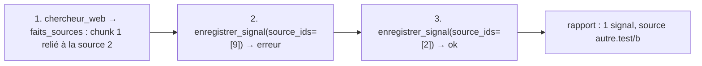
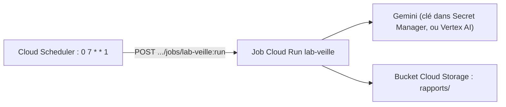

# Tester la veille et la planifier chaque semaine

> [!NOTE]
> Dans cette leçon, vous allez tester la chaîne complète sans clé (recherche simulée avec de fausses métadonnées d'ancrage), lancer et relire une vraie veille, puis la planifier chaque lundi avec `cron` en local ou avec Cloud Scheduler sur Google Cloud.

## Simuler une recherche ancrée

Le faux modèle de [test_veille.py](../files/test_veille.py) renvoie, comme Gemini avec `google_search`, un texte **et** des métadonnées d'ancrage :

```python title="files/test_veille.py"
META = types.GroundingMetadata(
    grounding_chunks=[types.GroundingChunk(web=types.GroundingChunkWeb(uri="https://exemple.test/a", title="exemple.test")),
                      types.GroundingChunk(web=types.GroundingChunkWeb(uri="https://autre.test/b", title="autre.test"))],
    grounding_supports=[types.GroundingSupport(segment=types.Segment(text="ACME baisse ses prix de 10 %."),
                                               grounding_chunk_indices=[1])])

class FauxModele(BaseLlm):
    script: list = []
    vus: list = []

    async def generate_content_async(self, llm_request, stream=False):
        self.vus.append(llm_request)
        part, meta = self.script.pop(0)
        yield LlmResponse(content=types.Content(role="model", parts=[part]), grounding_metadata=meta)
```

Le test `test_flux_complet_simule` utilise **deux** faux modèles (veilleur et chercheur) et vérifie trois comportements :



```python title="files/test_veille.py"
# 1. la recherche renvoie chaque fait relié à SA source (chunk 1 -> source 2)
assert reponses[0]["faits_sources"] == [{"texte": "ACME baisse ses prix de 10 %.", "sources": [2]}]
# 2. une source inventée (9) est refusée, le modèle doit corriger
assert "erreur" in reponses[1]
assert len(etat["signaux"]) == 1 and etat["signaux"][0]["sources"] == [2]
```

```quiz
question: "Que garantit le test simulé que le test réel ne peut pas garantir ?"
options:
  - "Que Google Search trouve des actualités pertinentes"
  - "Que le callback, la validation des sources et le rapport se comportent exactement comme prévu, à chaque exécution"
  - "Que la synthèse est bien rédigée"
answer: 1
explanation: "Le web et le modèle changent d'une exécution à l'autre ; le test simulé est déterministe et porte sur notre code. La pertinence et la rédaction se jugent sur une vraie exécution, relue par un humain."
```

## Résultat obtenu

Tests du 2026-10-15, sans clé :

```text
test_veille.py::test_rapport_markdown PASSED                             [ 50%]
test_veille.py::test_flux_complet_simule PASSED                          [100%]
============================== 2 passed in 1.58s ===============================
```

Veille réelle du même jour (`gemini-3.5-flash`, trois concurrents) : 4 recherches, 10 signaux enregistrés, 19 sources collectées dont 13 citées. Synthèse produite par le modèle (extrait) :

```text
Scaleway adopte une posture très offensive avec l'événement *ai-PULSE*, concrétisée par des partenariats
stratégiques majeurs (AMD, Nvidia), l'ouverture de nouvelles zones GPU hors de France (Suède, Danemark) [...]
Hetzner concentre ses efforts sur la transparence technique et la maintenance lourde de ses infrastructures réseau.
```

## Relire et évaluer une veille

Une veille ne se teste pas par une égalité exacte. Avant diffusion, un relecteur applique une grille simple, par exemple sur 5 signaux tirés au hasard :

| Critère | Question | Constat sur la veille du 2026-10-15 |
| --- | --- | --- |
| Exactitude | la source dit-elle bien ce que résume le signal ? | à vérifier en ouvrant les liens |
| Période | le fait date-t-il de la période demandée ? | **non** pour deux signaux de notre première exécution (datés du 2026-08-26 et du 2026-09-01) : il faut filtrer les dates |
| Pertinence | un incident d'exploitation est-il un signal ? | classé « autre », utile mais secondaire |
| Sources | chaque signal cite-t-il une page précise ? | oui après l'ajout de `faits_sources` |

> [!TIP]
> Les défauts trouvés en relecture deviennent des **règles de code** quand c'est possible. Exemple : refuser dans `enregistrer_signal` une `date_signal` antérieure au début de la période (passez la date de début dans l'état au lancement). C'est l'exercice ci-dessous.

## Planifier en local avec cron

`cron` est le planificateur standard de Linux et macOS. Ligne à ajouter avec `crontab -e` (chemin à adapter) : chaque lundi à 7 h.

```bash
0 7 * * 1 cd /chemin/vers/files && .venv/bin/python veille.py >> veille.log 2>&1
```

Les cinq champs sont minute, heure, jour du mois, mois, jour de la semaine (1 = lundi). Le poste doit être allumé à cette heure ; sinon, la veille est simplement sautée.

## Planifier sur Google Cloud

Sur Google Cloud, le schéma courant est un **job Cloud Run** (un conteneur qui s'exécute puis s'arrête) déclenché par **Cloud Scheduler** :



```bash
# Commandes à adapter : NON exécutées dans ce lab sans GCP.
gcloud run jobs deploy lab-veille --source . --region europe-west1 \
  --command python --args veille.py \
  --set-secrets GOOGLE_API_KEY=gemini-api-key:latest \
  --labels formation-lab=veille-concurrentielle

gcloud scheduler jobs create http lab-veille-hebdo --location europe-west1 \
  --schedule "0 7 * * 1" --time-zone "Europe/Paris" \
  --uri "https://run.googleapis.com/v2/projects/PROJECT_ID/locations/europe-west1/jobs/lab-veille:run" \
  --http-method POST \
  --oauth-service-account-email PROJECT_NUMBER-compute@developer.gserviceaccount.com
```

> [!WARNING]
> Le disque d'un job Cloud Run est **éphémère** : un rapport écrit dans `rapports/` disparaît à la fin de l'exécution. En production, écrivez-le dans un bucket Cloud Storage (bibliothèque `google-cloud-storage`) ou envoyez-le par e-mail. Pensez aussi au nettoyage : `gcloud scheduler jobs delete lab-veille-hebdo` puis `gcloud run jobs delete lab-veille`.

| | cron local | Cloud Scheduler + job Cloud Run |
| --- | --- | --- |
| Machine | doit être allumée | rien à maintenir |
| Secrets | fichier `.env` local | Secret Manager |
| Historique des exécutions | `veille.log` | journaux Cloud Logging, relances automatiques possibles |
| Coût | aucun en plus du modèle | quelques exécutions par mois, généralement faible |

```quiz
question: "Que signifie la ligne cron « 0 7 * * 1 » ?"
options:
  - "Le 7 de chaque mois à minuit"
  - "Chaque lundi à 7 h 00"
  - "Toutes les 7 minutes le lundi"
answer: 1
explanation: "Les champs sont minute (0), heure (7), jour du mois (*), mois (*), jour de la semaine (1 = lundi)."
```

## Exercice : refuser les signaux hors période

Faites en sorte que `enregistrer_signal` refuse un signal dont la date est antérieure au début de la période. Indice : `lancer_veille` peut créer la session avec un état initial.

<details>
<summary>Voir la solution</summary>

Dans `lancer_veille`, créez la session avec la date de début :

```python
from datetime import timedelta
debut = (jour - timedelta(days=config.get("jours", 7))).isoformat()
s = await runner.session_service.create_session(app_name="veille", user_id="veille", state={"debut": debut})
```

Dans `enregistrer_signal`, avant d'enregistrer :

```python
debut = tool_context.state.get("debut", "")
if date_signal[:len(debut)] < debut[:len(date_signal)]:
    return {"erreur": f"signal hors période : il doit dater du {debut} ou après"}
```

Comparer les préfixes gère les dates partielles (`2026-10` contre `2026-10-08`) : un signal « octobre 2026 » est accepté, un signal d'août est refusé. Ajoutez un test : un appel avec `date_signal="2026-08-26"` doit renvoyer une erreur.

</details>

## Je sais faire

- [ ] Simuler une réponse ancrée avec `types.GroundingMetadata` pour tester sans clé
- [ ] Relire une veille avec une grille et transformer les défauts en règles de code
- [ ] Planifier un script chaque semaine avec `cron`
- [ ] Décrire le couple Cloud Scheduler + job Cloud Run et ses pièges (disque éphémère, secrets)
