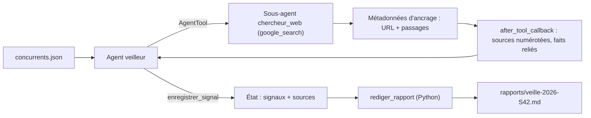

Une équipe produit veut savoir chaque lundi matin ce que ses concurrents ont annoncé la semaine passée : baisses de prix, nouvelles offres, recrutements massifs, partenariats. Aujourd'hui, quelqu'un y passe une demi-journée. Dans ce lab, un agent ADK fait la recherche, structure les faits **avec leurs sources**, et un script met en forme une synthèse hebdomadaire prête à relire.

L'exemple porte sur trois hébergeurs cloud européens (OVHcloud, Scaleway, Hetzner), choisis parce que leur actualité est publique et abondante. Remplacez-les par vos propres concurrents dans [concurrents.json](./files/concurrents.json).

## Pour qui ?

- Vous avez déjà construit un agent ADK avec des outils fonctions.
- Vous voulez comprendre l'**ancrage** (grounding : la réponse du modèle est rattachée aux pages web qu'il a consultées) et la composition d'agents.
- Niveau avancé : callbacks, état temporaire, métadonnées d'ancrage.

## Ce que vous allez construire

## Prérequis techniques

- Python 3.10 ou plus récent, une clé d'API Gemini.
- La recherche ancrée a sa propre ligne de tarif : d'après la page de tarifs consultée le 2026-10-15, elle n'est pas disponible dans le niveau gratuit pour la plupart des modèles et, en niveau payant, 5 000 requêtes de recherche par mois sont offertes (partagées entre les modèles Gemini 3 et suivants) avant facturation. Vérifiez la page avant de planifier la veille.
- [requirements.txt](./files/requirements.txt) : `google-adk==2.10.0`, `httpx`, `python-dotenv`, `pytest`.

## Programme

| Module | Leçon | Durée indicative |
| --- | --- | --- |
| 1. Le cas d'usage | La veille avec un agent : signaux, sources, architecture | 30 min |
| 2. Construire | La recherche et les sources ; les signaux et le rapport | 1h45 |
| 3. Tester et exploiter | Tests sans clé, test réel, planification (cron, Cloud Scheduler) | 45 min |

## En local ou sur Google Cloud ?

| | En local (ce lab) | Sur Google Cloud (pour aller plus loin) |
| --- | --- | --- |
| Exécution | `python veille.py` | job Cloud Run |
| Planification | `cron` sur un poste ou un serveur | Cloud Scheduler qui déclenche le job |
| Rapport | fichier `rapports/*.md` | bucket Cloud Storage, e-mail ou message d'équipe |
| Modèle | API Gemini (clé) | Vertex AI |

Code complet : [files/](./files/). Testé le 2026-10-15 avec `google-adk` 2.10.0 et `gemini-3.5-flash`.
