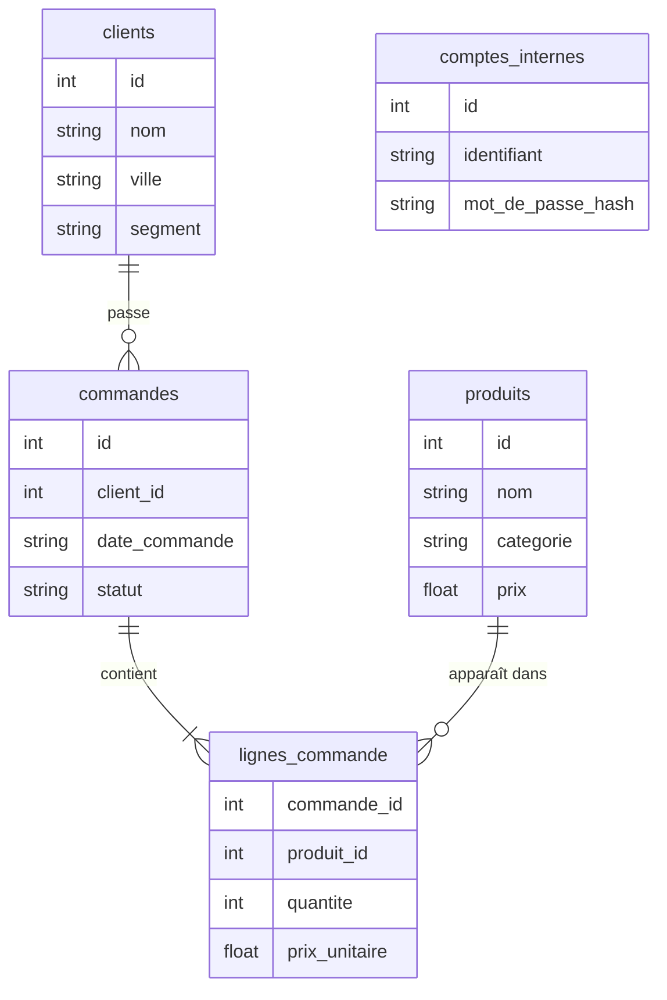

# La base et les garde-fous

> [!NOTE]
> Dans cette leçon, vous allez générer la base de ventes fictive, puis écrire `garde_fous.py` : l'autorisateur SQLite, la connexion en lecture seule, la validation avant exécution et le LIMIT forcé. Aucun LLM ici : tout se teste à la main.

## 1. Une base fictive et reproductible

[creer_base.py](../files/creer_base.py) crée `ventes.db` avec une graine aléatoire fixe : 60 clients, 12 produits, 400 commandes de janvier à septembre 2026, 823 lignes de commande. Il ajoute volontairement une table sensible, `comptes_internes`, pour vérifier que l'agent ne peut pas la lire.



```bash title="terminal"
cd files
pip install -r requirements.txt
python creer_base.py        # Base créée : .../ventes.db
```

## 2. L'autorisateur : la liste blanche appliquée par SQLite

Un **autorisateur** est une fonction que SQLite appelle pendant la **compilation** de chaque requête, pour chaque action : lire une colonne d'une table (`SQLITE_READ`), appeler une fonction (`SQLITE_FUNCTION`), supprimer (`SQLITE_DELETE`), attacher une base (`SQLITE_ATTACH`)… Elle répond `SQLITE_OK` (permis) ou `SQLITE_DENY` (la compilation échoue).

```python title="files/garde_fous.py"
TABLES_AUTORISEES = {"clients", "produits", "commandes", "lignes_commande"}
FONCTIONS_INTERDITES = {"load_extension", "readfile", "writefile", "edit"}
_ACTIONS_LECTURE = {sqlite3.SQLITE_SELECT, sqlite3.SQLITE_READ, sqlite3.SQLITE_FUNCTION}

def _autorisateur(action, arg1, arg2, _db, _trigger):
    if action not in _ACTIONS_LECTURE:
        return sqlite3.SQLITE_DENY
    if action == sqlite3.SQLITE_READ and arg1 not in TABLES_AUTORISEES:
        return sqlite3.SQLITE_DENY
    if action == sqlite3.SQLITE_FUNCTION and (arg2 or "").lower() in FONCTIONS_INTERDITES:
        return sqlite3.SQLITE_DENY
    return sqlite3.SQLITE_OK

def connecter(chemin: Path) -> sqlite3.Connection:
    con = sqlite3.connect(f"file:{chemin}?mode=ro", uri=True, check_same_thread=False)
    con.set_authorizer(_autorisateur)
    return con
```

Deux protections indépendantes :

- `mode=ro` dans l'**URI** (l'adresse de la base sous forme `file:...?options`) ouvre le fichier en lecture seule : SQLite refuse toute écriture, quel que soit le SQL ;
- l'autorisateur refuse tout ce qui n'est pas une lecture, et toute lecture hors liste blanche, y compris la table système `sqlite_master` qui décrit le schéma.

```quiz
question: "La requête SELECT c.nom FROM clients c WHERE c.id IN (SELECT id FROM comptes_internes) commence par SELECT. Pourquoi est-elle refusée ?"
options:
  - "Parce qu'une regex trouve le mot comptes_internes"
  - "Parce que SQLite appelle l'autorisateur avec SQLITE_READ sur comptes_internes pendant la compilation de la sous-requête"
  - "Parce que les sous-requêtes sont interdites"
answer: 1
explanation: "Le code ne cherche pas les noms de tables dans le texte : c'est SQLite qui, en compilant la requête, déclare chaque lecture. La sous-requête lit comptes_internes, l'autorisateur répond SQLITE_DENY."
```

## 3. Valider avant d'exécuter

`valider_sql()` ne lit **aucune donnée** : elle nettoie le texte, vérifie la forme, puis demande à SQLite de compiler la requête avec `EXPLAIN` (qui renvoie le plan d'exécution sans exécuter la requête). L'autorisateur intervient à ce moment-là.

```python title="files/garde_fous.py"
def valider_sql(con, sql: str) -> str:
    propre = _COMMENTAIRES.sub(" ", sql).strip().rstrip(";").strip()
    if not propre:
        raise RequeteRefusee("Requête vide.")
    if ";" in propre:
        raise RequeteRefusee("Une seule requête à la fois (pas de point-virgule).")
    if not re.match(r"(?is)^(select|with)\b", propre):
        raise RequeteRefusee("Seules les requêtes SELECT (ou WITH ... SELECT) sont permises.")
    try:
        con.execute("EXPLAIN " + propre).fetchall()
    except sqlite3.DatabaseError as e:
        if "not authorized" in str(e) or "prohibited" in str(e):
            raise RequeteRefusee("Accès refusé : seules les tables ... sont lisibles") from None
        raise RequeteRefusee(f"SQL invalide : {e}") from None
    return propre
```

Les messages de `RequeteRefusee` sont écrits **pour le modèle** : ils lui disent quoi corriger, sans révéler ce qui existe en dehors de la liste blanche.

## 4. LIMIT forcé et délai maximal

```python title="files/garde_fous.py"
def executer(con, sql: str, limite: int = LIMITE_LIGNES) -> dict:
    propre = valider_sql(con, sql)
    finale = f"SELECT * FROM ({propre}) LIMIT {limite + 1}"   # +1 : savoir si on a coupé
    fin = time.monotonic() + DELAI_MAX_S
    con.set_progress_handler(lambda: int(time.monotonic() > fin), 10_000)
    ...
    return {"sql_execute": propre, "colonnes": colonnes,
            "lignes": [list(l) for l in lignes[:limite]],
            "nb_lignes": min(len(lignes), limite), "tronque": len(lignes) > limite}
```

- la requête du modèle est **enveloppée** dans un `SELECT * FROM (...) LIMIT 51` : même un `SELECT *` sur une grosse table renvoie au plus 50 lignes ;
- le **progress handler** est appelé par SQLite toutes les 10 000 instructions de sa machine virtuelle ; s'il renvoie une valeur non nulle, la requête est interrompue ;
- `tronque` permet à l'agent de dire honnêtement que le résultat est partiel.

| Requête | Couche qui réagit | Résultat |
| --- | --- | --- |
| `DELETE FROM clients` | 1. texte | refus |
| `SELECT * FROM comptes_internes` | 2. autorisateur | refus |
| `SELECT * FROM clients` | 4. LIMIT | 50 lignes, `tronque: true` |
| produit cartésien de 3 tables | 4. délai | « Requête trop longue » |

```quiz
question: "Pourquoi envelopper la requête dans SELECT * FROM (...) LIMIT 51 plutôt que de lire 50 lignes avec fetchmany(50) ?"
options:
  - "fetchmany est plus lent"
  - "Les deux limitent ce que reçoit le modèle, mais le LIMIT dans le SQL permet aussi à SQLite d'arrêter le travail plus tôt, et la 51e ligne indique qu'il y a une suite"
  - "fetchmany n'existe pas en Python 3.10"
answer: 1
explanation: "Le LIMIT est poussé dans la requête : SQLite s'arrête dès la 51e ligne. Cette ligne en trop ne sert qu'à savoir si le résultat est tronqué ; elle n'est jamais renvoyée."
```

## Exercice : autoriser une 5e table en lecture partielle

Le service marketing veut que l'agent lise une nouvelle table `campagnes(id, nom, budget, responsable_email)`, **sans** la colonne `responsable_email`. Modifiez l'autorisateur.

<details>
<summary>Voir la solution</summary>

L'autorisateur reçoit aussi le nom de la colonne (`arg2`) pour `SQLITE_READ`. SQLite propose `SQLITE_IGNORE`, qui remplace la valeur par `NULL` au lieu de faire échouer la requête :

```python title="files/garde_fous.py (variante)"
TABLES_AUTORISEES = {"clients", "produits", "commandes", "lignes_commande", "campagnes"}
COLONNES_MASQUEES = {("campagnes", "responsable_email")}

def _autorisateur(action, arg1, arg2, _db, _trigger):
    if action not in _ACTIONS_LECTURE:
        return sqlite3.SQLITE_DENY
    if action == sqlite3.SQLITE_READ:
        if arg1 not in TABLES_AUTORISEES:
            return sqlite3.SQLITE_DENY
        if (arg1, arg2) in COLONNES_MASQUEES:
            return sqlite3.SQLITE_IGNORE     # la colonne est lue comme NULL
    ...
```

Pensez aussi à retirer la colonne du schéma montré au modèle (fonction `schema()`), sinon il la demandera et ne comprendra pas les `NULL`.

</details>

## Résultat obtenu

Exécution réelle le 2026-10-15, sans LLM, des garde-fous sur `ventes.db` :

```text
OK    SELECT ville, COUNT(*) AS n FROM clients GROU -> 6 lignes, tronque = False [['Rennes', 15], ['Nantes', 14]]
OK    SELECT * FROM clients                         -> 50 lignes, tronque = True [[1, 'Client 001', 'Lyon', ...
REFUS DELETE FROM clients                           -> Seules les requêtes SELECT (ou WITH ... SELECT) sont permises.
REFUS SELECT * FROM comptes_internes                -> Accès refusé : seules les tables clients, commandes, lignes_commande, produits sont lisibles, en lecture seule.
REFUS SELECT name FROM sqlite_master                -> Accès refusé : seules les tables clients, commandes, lignes_commande, produits sont lisibles, en lecture seule.
REFUS PRAGMA table_info(clients)                    -> Seules les requêtes SELECT (ou WITH ... SELECT) sont permises.
```

> [!WARNING]
> Sous Python 3.10, `set_authorizer(None)` ne désactive pas l'autorisateur (c'est possible à partir de 3.11). C'est pourquoi `schema()` ouvre sa **propre** connexion pour lire `PRAGMA table_info` : la connexion de l'agent garde son autorisateur en permanence.

## Je sais faire

- [ ] Générer une base fictive reproductible avec une graine fixe
- [ ] Écrire un autorisateur SQLite qui applique une liste blanche de tables et d'actions
- [ ] Ouvrir une base SQLite en lecture seule avec une URI `mode=ro`
- [ ] Valider une requête avec `EXPLAIN` avant de l'exécuter
- [ ] Forcer un LIMIT et un délai maximal, et signaler un résultat tronqué
