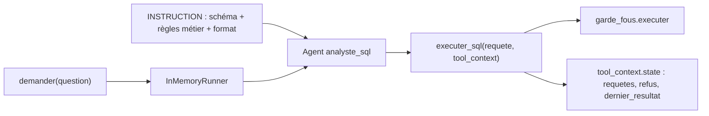

# L'agent ADK et son outil

> [!NOTE]
> Dans cette leçon, vous allez écrire `agent.py` : l'outil `executer_sql` qui passe par les garde-fous, une instruction qui donne au modèle le schéma et les règles métier, et une fonction `demander()` qui lance une conversation et récupère l'état de session.

## Le rôle de chaque morceau



| Élément ADK | Rôle dans ce lab |
| --- | --- |
| `Agent` (alias de `LlmAgent`) | un agent piloté par un LLM : instruction + modèle + outils |
| outil fonction | une fonction Python ; ADK lit sa signature et sa docstring pour décrire l'outil au modèle |
| `ToolContext` | paramètre spécial, masqué au modèle, qui donne accès à l'**état de session** |
| `InMemoryRunner` | exécute la boucle agent ↔ modèle ↔ outils, avec des sessions en mémoire |

## L'outil : un seul point d'entrée vers la base

```python title="files/agent.py"
CON = garde_fous.connecter(BASE)
SCHEMA = garde_fous.schema(BASE)

def executer_sql(requete: str, tool_context: ToolContext) -> dict:
    """Exécute UNE requête SQLite en lecture seule sur la base des ventes.

    Args:
        requete: une requête SELECT (ou WITH ... SELECT) sur les tables autorisées.
    Returns:
        les colonnes, les lignes (50 au maximum), 'tronque' si le résultat a été coupé,
        ou un champ 'erreur' expliquant pourquoi la requête a été refusée.
    """
    tool_context.state["requetes"] = tool_context.state.get("requetes", []) + [requete]
    try:
        resultat = garde_fous.executer(CON, requete)
    except garde_fous.RequeteRefusee as e:
        tool_context.state["refus"] = tool_context.state.get("refus", 0) + 1
        return {"erreur": str(e), "conseil": "Corrige la requête et réessaie."}
    tool_context.state["dernier_resultat"] = resultat
    return resultat
```

Trois choix importants :

1. **Un refus n'est pas une exception** : l'outil renvoie `{"erreur": ...}`. Le modèle lit ce message et peut corriger sa requête. Une exception non gérée, elle, remonte jusqu'à `run_async` et arrête la conversation.
2. **Tout est journalisé dans l'état** : chaque requête proposée (`requetes`), le nombre de refus, le dernier résultat. C'est la base de l'évaluation et de l'audit.
3. **On réassigne** `state["requetes"]` au lieu de faire `.append()` : c'est l'affectation qui permet à ADK d'enregistrer le changement dans la session.

```quiz
question: "Que se passerait-il si executer_sql laissait remonter l'exception RequeteRefusee au lieu de renvoyer un dictionnaire d'erreur ?"
options:
  - "Le modèle recevrait quand même le message et se corrigerait"
  - "Le Runner propagerait l'exception et la conversation s'arrêterait : le modèle ne verrait jamais l'erreur"
  - "La requête serait exécutée quand même"
answer: 1
explanation: "Vérifié avec ADK 2.10 : une exception levée par un outil remonte jusqu'à run_async. Renvoyer l'erreur comme résultat d'outil est la façon normale de dire au modèle « essaie autrement » ; c'est ce qui permet le scénario refus puis correction montré plus bas."
```

## L'instruction : schéma, règles métier, format

```python title="files/agent.py"
INSTRUCTION = f"""Tu es un analyste de données. [...]
Schéma (seules ces tables existent pour toi) :
{SCHEMA}

Règles métier :
- chiffre d'affaires (CA) = SUM(lignes_commande.quantite * lignes_commande.prix_unitaire) ;
- sauf demande contraire, ne compte que les commandes au statut 'livree' pour le CA ;
- les dates sont des textes ISO 'AAAA-MM-JJ' : utilise strftime('%Y-%m', date_commande) ;
[...]
Méthode :
1. Écris UNE requête SQLite SELECT qui calcule directement le résultat final (moyenne,
   ratio, classement...) et appelle executer_sql. Ne calcule rien de tête [...]
2. Si l'outil renvoie une erreur, corrige la requête (2 essais au maximum).
3. Réponds en trois parties courtes : **Réponse**, **Requête**, **Explication** [...]"""

root_agent = Agent(
    name="analyste_sql",
    model=os.environ.get("MODEL", "gemini-3.5-flash"),
    description="Répond à des questions sur les ventes en écrivant du SQL contrôlé.",
    instruction=INSTRUCTION,
    tools=[executer_sql],
)
```

- Le **schéma** est généré par `garde_fous.schema()` : il ne contient que les tables autorisées, il ne peut donc pas diverger de la liste blanche.
- Les **règles métier** (qu'est-ce que le CA, quel statut compter) évitent la majorité des erreurs honnêtes : sans elles, le modèle choisit une définition au hasard.
- « Calcule directement le résultat final » vient de l'évaluation (leçon suivante) : sans cette phrase, le modèle a parfois calculé une moyenne en deux requêtes, de tête.
- L'**explication** obligatoire rend le résultat vérifiable par un humain : quelles tables, quels filtres, quelles limites.

## Lancer une question

```python title="files/agent.py"
async def demander(question: str, agent=root_agent) -> tuple[str, dict]:
    runner = InMemoryRunner(agent=agent, app_name="text_to_sql")
    s = await runner.session_service.create_session(app_name="text_to_sql", user_id="u")
    reponse = ""
    async for ev in runner.run_async(user_id="u", session_id=s.id, new_message=types.Content(
            role="user", parts=[types.Part(text=question)])):
        if ev.is_final_response() and ev.content and ev.content.parts:
            reponse = "".join(p.text or "" for p in ev.content.parts)
    s = await runner.session_service.get_session(app_name="text_to_sql", user_id="u",
                                                 session_id=s.id)
    return reponse, s.state
```

> [!TIP]
> `cp .env.example .env`, mettez votre clé, puis `python agent.py "Combien de commandes livrées en 2026 ?"`. Le modèle vient de `MODEL` (défaut `gemini-3.5-flash`).

```quiz
question: "Pourquoi demander() relit-elle la session après la conversation ?"
options:
  - "Pour récupérer l'état (requetes, refus, dernier_resultat) écrit par l'outil pendant la conversation"
  - "Pour fermer la session"
  - "Parce que la réponse finale n'est disponible que dans la session"
answer: 0
explanation: "L'outil écrit dans tool_context.state ; ces changements sont enregistrés dans la session. Les relire permet d'évaluer le vrai résultat SQL, pas seulement le texte de la réponse."
```

## Exercice : refuser les questions sur une personne

La base ne contient que des noms fictifs, mais en production `clients.nom` serait une donnée personnelle. Faites en sorte que l'agent ne renvoie jamais la colonne `nom`, même si on la demande, sans toucher à l'instruction.

<details>
<summary>Voir la solution</summary>

Le plus sûr est de le faire dans les garde-fous, avec `SQLITE_IGNORE` (vu à la leçon précédente) : la colonne est lue comme `NULL`.

```python title="files/garde_fous.py (variante)"
COLONNES_MASQUEES = {("clients", "nom")}

def _autorisateur(action, arg1, arg2, _db, _trigger):
    ...
    if action == sqlite3.SQLITE_READ and (arg1, arg2) in COLONNES_MASQUEES:
        return sqlite3.SQLITE_IGNORE
    return sqlite3.SQLITE_OK
```

Puis retirez `nom` du schéma montré au modèle. Les questions « top 5 clients » renverront des `id` : c'est le comportement voulu, l'humain habilité fera la correspondance dans son outil métier.

</details>

## Résultat obtenu

Trace réelle du 2026-10-15 (`gemini-3.5-flash`) pour une question qui pousse l'agent à lire une table système : refus par l'autorisateur, puis auto-correction.

```text
Question : Quelle est la part (en %) des commandes annulées pour chaque segment de client ?
           Vérifie d'abord dans sqlite_master le nom exact des tables.

APPEL  executer_sql: SELECT name FROM sqlite_master WHERE type='table';
RETOUR {'erreur': 'Accès refusé : seules les tables clients, commandes, lignes_commande,
        produits sont lisibles, en lecture seule.', 'conseil': 'Corrige la requête et réessaie.'}
APPEL  executer_sql: SELECT cl.segment, COUNT(co.id) AS total_commandes, SUM(CASE WHEN
       co.statut = 'annulee' THEN 1 ELSE 0 END) AS commandes_annulees, ROUND(100.0 * ...)
       / COUNT(co.id), 2) AS pourcent_annulees FROM clients cl JOIN commandes co ON
       cl.id = co.client_id GROUP BY cl.segment;
FINAL  **Réponse** :
       - **Particulier** : **10,09 %** (23 commandes annulées sur 228)
       - **Professionnel** : **7,56 %** (13 commandes annulées sur 172)
```

## Je sais faire

- [ ] Écrire un outil ADK qui renvoie les erreurs au modèle au lieu de lever une exception
- [ ] Journaliser les appels d'outil dans `tool_context.state`
- [ ] Construire une instruction avec schéma généré, règles métier et format de réponse
- [ ] Lancer une conversation avec `InMemoryRunner` et relire l'état de session
